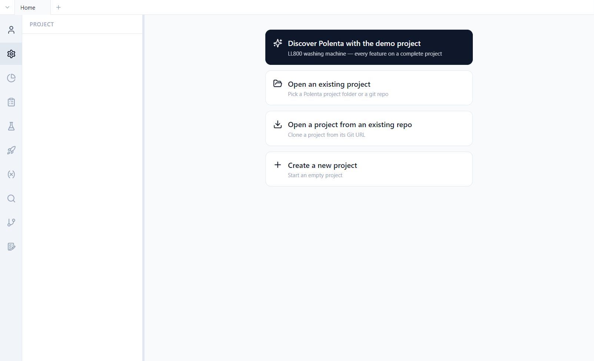
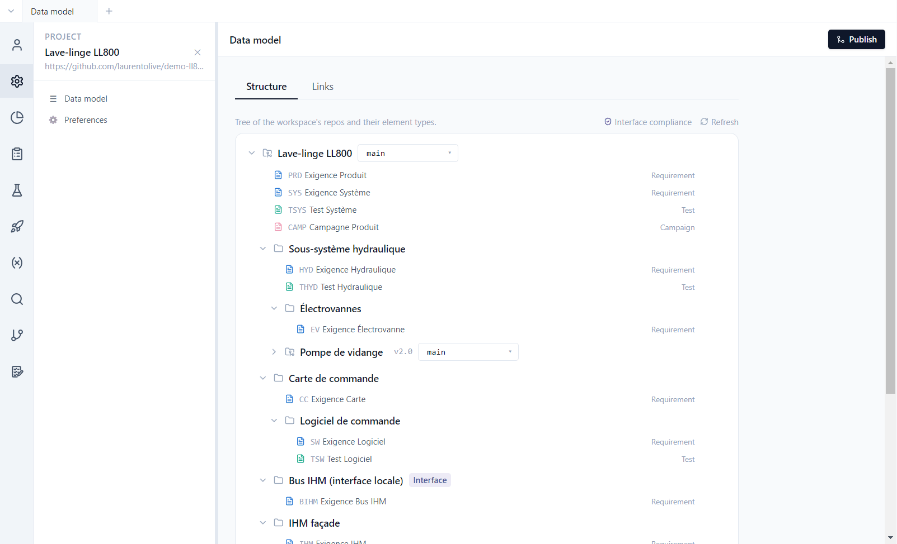

# 1. Getting started

**English** | [Français](../tutoriels/01-prise-en-main.md)

This tutorial opens the demo project, introduces the interface and the data model, then shows what
Polenta writes to disk.

## Open the demo

With no project open, Polenta shows its home screen.



1. Click **Discover Polenta with the demo project**.
2. Pick an **empty** folder: Polenta clones the product repository and its components into it.
3. The project opens on its **data model**.

The other home choices are for real projects: open a folder already on the machine, clone a
project from its git URL, or create an empty project.

## The interface

- The **activity bar**, on the left, switches views: Account, Project, Tracking, Requirements,
  Tests, Campaigns, Parameters, Search, Version, Impact analysis. Right-click hides a button,
  drag and drop reorders them.
- The **side panel** shows the view's content: requirement tree, campaign list, dashboards…
- The **main area** shows the open item. Each view opens in a **tab** (at the top); **Ctrl+T** opens
  a new tab.
- The **Publish** button, top right, shares your changes (see [tutorial 7](07-versions.md)).

## The data model

*Project > Data model*, **Structure** tab: the tree of the project's repositories and of the item
types in each.



- Each **item type** has a prefix (`PRD`, `SYS`, `TSYS`…), a category (requirement, test or
  campaign), its fields and its statuses. A type's pencil opens its definition.
- **Local components** (folders) break the product down within the same repository: *Sous-système
  hydraulique*, *Carte de commande › Logiciel de commande*…
- **Reusable components** (repository icon) are other git repositories, mounted at a precise
  version: *Pompe de vidange* is pinned to tag `v2.0`. They can be shared between several
  products; within the product they are read-only.
- An **interface** (*Interface* badge) describes an exchange between components, with roles
  (master / slave, controller / device). See [tutorial 5](05-traceability.md).

The **Links** tab defines the link types allowed between items (refinement, implementation,
verification…).

Everything is configurable: type, field and status names are the team's, not the tool's.

## On disk

A Polenta project is a folder of text files versioned with git. A requirement is a YAML file that
can be read and compared line by line:

```yaml
# ll800-produit/requirements/PRD-0002.yaml
id: PRD-0002
objectTypeRef: root::exigence-produit
title: Vitesse d'essorage maximale
status: approved
version: 1
fields:
  statement: THE lave-linge SHALL essorer à une vitesse maximale de {vitesse_essorage} en programme Coton.
  priority: high
  source: Marketing
  kpi_cible: 1400 tr/min
  acceptanceCriteria: '- [ ] Vitesse mesurée au tachymètre ≥ {vitesse_essorage} − 2 %'
```

| Folder | Contents |
|---|---|
| `requirements/`, `tests/`, `campaigns/` | one file per item |
| `links/links.yaml` | all the repository's traceability links |
| `parameters/parameters.yaml` | the parameter base |
| `test-runs/` | execution results |
| `queries/`, `dashboards/` | shared queries and dashboards |
| `.polenta/schema.yaml` | the data model |
| `polenta-repo.yaml` | the reused components and their version |

History, authors and dates come from git: there is no separate database.
