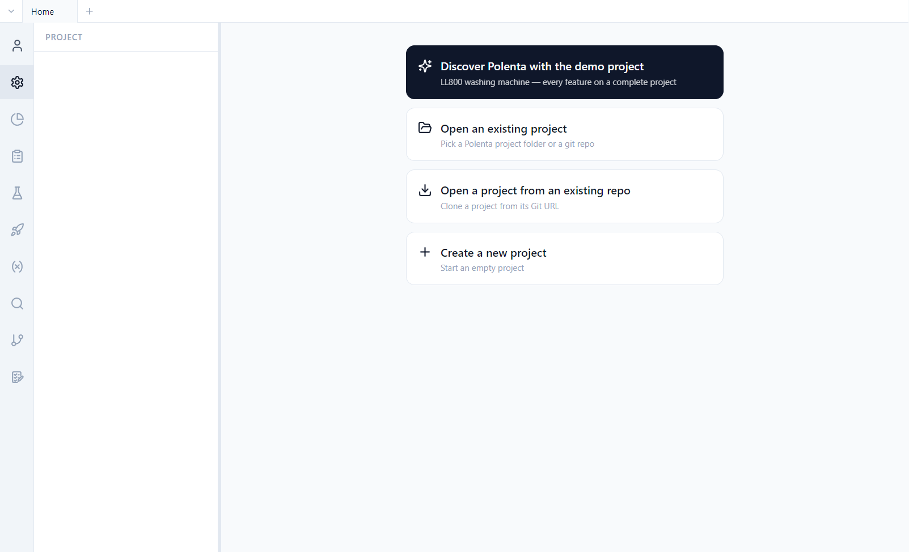
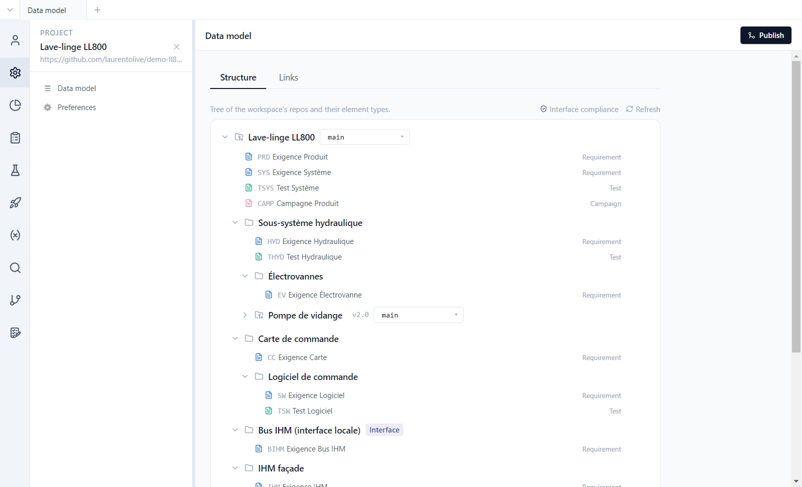

# 2. Getting started

**English** | [Français](../tutoriels/02-prise-en-main.md)

This tutorial opens the demo project, introduces the interface and the data model, then shows what
Polenta writes to disk. It assumes a connected account ([tutorial 1](01-account-login.md)).

## Open the demo

With no project open, Polenta shows its home screen.



1. Click **Discover Polenta with the demo project**.
2. Pick an **empty** folder: Polenta clones the product repository and its components into it.
3. The project opens on its **data model**.

The other home choices are for real projects:

| Choice | Use |
|---|---|
| **Open an existing project** | a folder already on the machine |
| **Open a project from an existing repo** | clone a project: picked from the list of projects accessible with your account, or by its git URL |
| **Create a new project** | an empty project, **On this computer only** or **On a server (GitHub, Forgejo)** ([tutorial 11](11-team-projects.md)) |
| **Your team’s projects** | on a company Forgejo server, the projects published for your teams, to open with one click |

## The interface

- The **activity bar**, on the left, switches views: Account, Project, Tracking, Requirements,
  Tests, Campaigns, Issues, Validation, Parameters, Search, Version. Right-click hides a button (or
  **Reset layout**), drag and drop reorders them.
- The **side panel** shows the view's content: requirement tree, campaign list, dashboards… Clicking
  the icon of the active view again **collapses** or expands it; shortcut **Ctrl+B**.
- The **main area** shows the open item. Each view opens in a **tab** (at the top); **Ctrl+T** opens
  a new tab.
- The **Publish** button, top right, shares your changes
  ([tutorial 8](08-publishing-history.md)).

### Navigating

- **Back** and **Forward** (`<` `>`, left of the tabs), or **Alt+←** / **Alt+→**, as in a browser;
  right-click shows the history. Leaving a page with unsaved changes asks for confirmation.
- Any displayed **ID** that designates another item (in a table, a document, a card, a campaign, a
  search or dashboard result…) is a **link**: a click opens the item, **Ctrl+click** opens it in a
  new tab, hovering for a moment shows a **preview**.
- **Zoom** of the whole interface: **Ctrl+mouse wheel**, **Ctrl+=** / **Ctrl+-**, **Ctrl+0** to go
  back to 100%.

## The data model

*Project > Data model*, **Structure** tab: the tree of the project's repositories and of the item
types in each.



- Each **item type** has a prefix (`PRD`, `SYS`, `TSYS`…), a category (requirement, test, campaign,
  version, issue, validation), its fields and its statuses. A type's pencil opens its definition;
  the **+** on a component's row adds a type to it.
- **Local components** (folders) break the product down within the same repository: *Sous-système
  hydraulique*, *Carte de commande › Logiciel de commande*…
- **Reusable components** (repository icon) are other git repositories, mounted at a precise
  version: *Pompe de vidange* is pinned to tag `v2.0`. They can be shared between several
  products; within the product they are read-only.
- An **interface** (*Interface* badge) describes an exchange between components, with roles
  (master / slave, controller / device). See [tutorial 6](06-traceability.md).
- Each repository shows its **integration branch**, where the team shares its work
  ([tutorial 8](08-publishing-history.md)) and, on a GitHub or Forgejo server, its **Repository
  settings** (gear on hover, [tutorial 11](11-team-projects.md)).

The **Links** tab defines the link types allowed between items (refinement, implementation,
verification…).

Everything is configurable: type, field and status names are the team's, not the tool's. The
optional rules (conditionally required fields, status transition constraints) are presented in
[tutorial 3](03-requirements.md).

## On disk

A Polenta project is a folder of text files versioned with git. A requirement is a YAML file that
can be read and compared line by line:

```yaml
# demo-ll800-produit/requirements/PRD-0002.yaml
id: PRD-0002
objectTypeRef: root::exigence-produit
title: Vitesse d'essorage maximale
status: approved
version: 1
fields:
  statement: THE lave-linge SHALL essorer à une vitesse maximale de {vitesse_essorage} en programme Coton.
  priority: high
  source: Marketing
  kpi_cible: 1400 tr/min
  acceptanceCriteria: '- [ ] Vitesse mesurée au tachymètre ≥ {vitesse_essorage} − 2 %'
```

| Folder | Contents |
|---|---|
| `requirements/`, `tests/`, `campaigns/` | one file per item |
| `issues/`, `versions/`, `validations/` | one file per issue, version, validation ([tutorials 9](09-versions.md) and [10](10-issues-validation.md)) |
| `links/links.yaml` | all the repository's traceability links |
| `parameters/parameters.yaml` | the parameter base |
| `test-runs/` | execution results |
| `queries/`, `dashboards/` | shared queries and dashboards |
| `.polenta/schema.yaml` | the data model |
| `.polenta/views/` | the team's saved views |
| `.polenta/trees/` | the arrangement of items into sections |
| `.polenta/tombstones/` | one empty file per deleted ID, so that it is never reassigned |
| `polenta-repo.yaml` | the reused components and their version |

History, authors and dates come from git: there is no separate database.

The product repository is cloned into the `demo-ll800-produit` folder. A requirement's `history`
field keeps the history of its tracked fields (status, priority): the application writes it, you do
not edit it by hand ([tutorial 3](03-requirements.md)).

## Starting again from a clean demo

The exercises modify the demo, and some cannot be undone: releasing a version, signing a
validation. To start again from the published state:

1. *Project > Close project*;
2. delete the folder chosen when opening the demo, with all its contents
   (`demo-ll800-produit` and the components);
3. on the home screen, **Discover Polenta with the demo project**, in an empty folder.

Each exercise in the following tutorials starts from this state, unless a prerequisite is stated.

## Exercises

**Read the components' mounted versions.**
1. *Project > Data model > Structure*, spot the reusable components.
2. Find the mounted version of *Pompe de vidange*, *Module Wi-Fi* and the internal bus. The
   product repository's `polenta-repo.yaml` file also gives them (`pin`).

Result: the pump is pinned to tag `v2.0`, the Wi-Fi module to a precise commit (SHA `0d20234…`), the
internal bus to tag `v1.1`. The bus is mounted under the motor, which follows the `main` branch.

**Arrange a requirement.**
1. **Requirements** view, *Lave-linge LL800 / Exigence Produit*.
2. Drag PRD-0012 into another section.
3. **Version** view, **Modifications**: open the changed file.

Result: only `.polenta/trees/root/exigence-produit.yaml` changes. PRD-0012's file is not rewritten:
the arrangement is separate from the content.

**Add a field to a type.**
1. *Project > Data model*, pencil of *Exigence Hydraulique*: add a text field *Fournisseur*, save.
2. Open HYD-0001.
3. **Version** view, **Modifications**.

Result: the field appears, empty, in HYD-0001's editor. Only `.polenta/schema.yaml` is modified: no
requirement is rewritten. Remove the field to go back to the initial state.

**Navigate.**
1. Open PRD-0002, then click SYS-0002 in its links.
2. **Alt+←**.
3. In the **Account** panel, change the theme, then the language.

Result: **Alt+←** brings you back to PRD-0002. The theme and language change without closing the
project.
