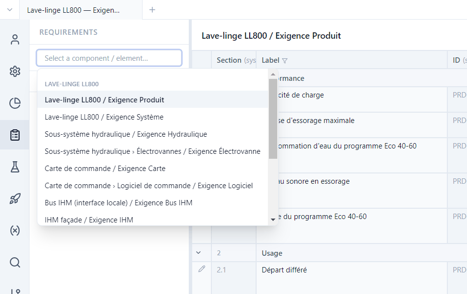
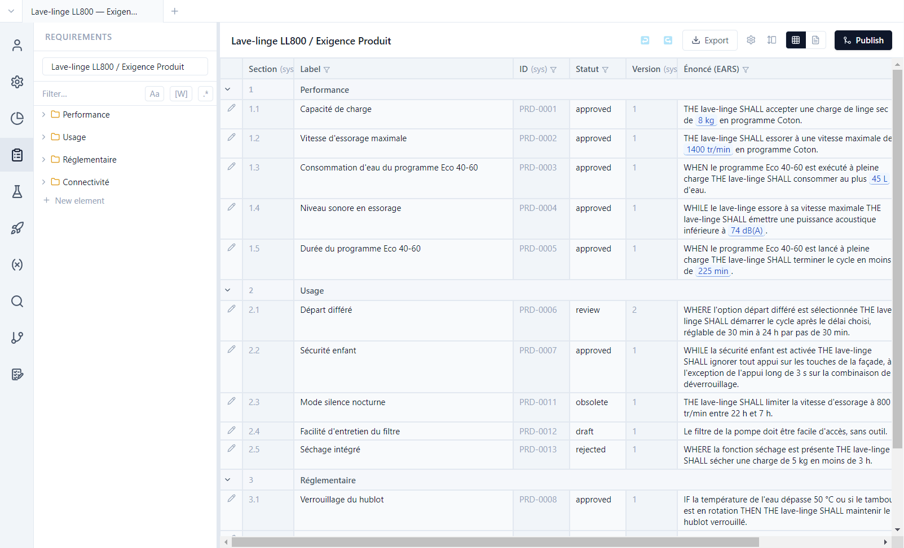
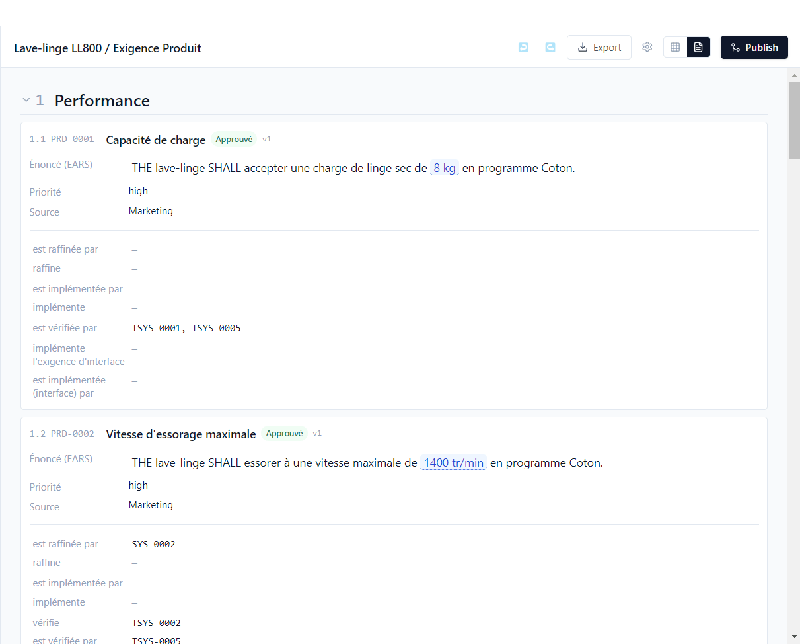
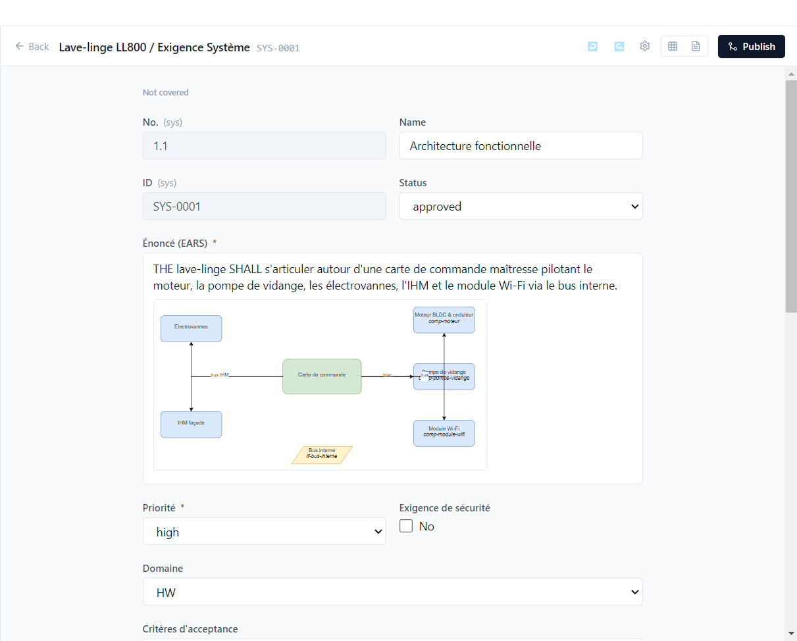
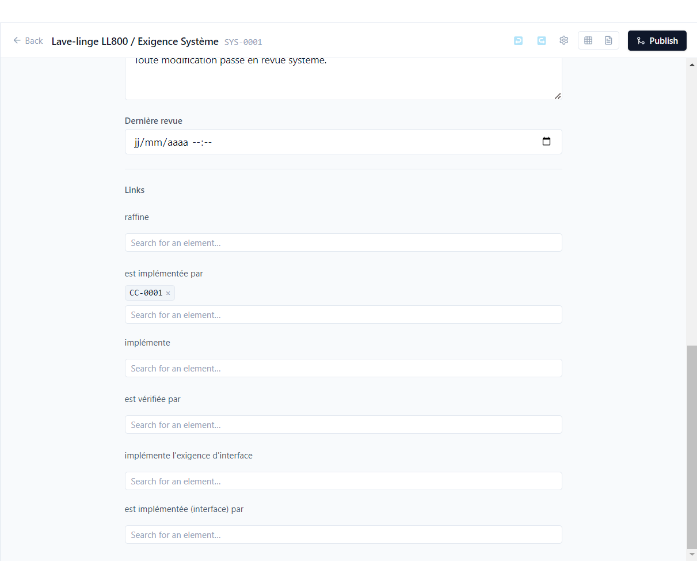

# 2. Requirements

**English** | [Français](../tutoriels/02-exigences.md)

This tutorial goes through the demo's requirements: lists, editor, EARS syntax, diagrams and
links.

## Choose a requirement type

**Requirements** view (activity bar). The selector at the top of the side panel lists every
requirement type of every component: *Lave-linge LL800 / Exigence Produit*, *Sous-système
hydraulique / Exigence Hydraulique*, *Moteur BLDC & onduleur / Exigence Moteur*… Type to filter
it.

Below the selector, the tree groups requirements into **sections** (*Performance*, *Usage*,
*Réglementaire*…). **New element** adds a requirement; Polenta assigns its ID (`PRD-0014`…), and an
ID is never reused, even after deletion.

## Table view and document view

The **table view** shows one row per requirement and one column per field.

- A column's funnel filters it; **Configure columns** chooses which columns are shown.
- Underlined blue values (`8 kg`, `1400 tr/min`) are **parameters**: the value comes from the
  parameter base ([tutorial 4](04-parameters.md)).
- Statuses follow the life cycle defined by the type: `draft`, `review`, `approved`, and two
  terminal statuses, `obsolete` (PRD-0011) and `rejected` (PRD-0013).
- **Export** produces an Excel, Word or PDF file, with a customer template if needed.

The **document view** (page icon) shows the same requirements as a specification document, with
their links.

## The editor

A row's pencil opens the editor. Open **SYS-0001** (*Exigence Système*, *Architecture* section):

- At the top, the requirement's **coverage** (here *Not covered*: no test verifies it, see
  [tutorial 5](05-traceability.md)).
- Fields come from the type: text, rich text, list, checkboxes, date, user, number, diagram… An
  asterisk marks a required field.
- Rich text accepts **draw.io diagrams**, images and tables. SYS-0001's architecture diagram is a
  `.drawio` file in the repository, shown inside the statement.
- **Back** returns to the list; **↩ / ↪** undo and redo.

Every save is dated and attributed by git. Reopening an approved requirement (moving it back to
`review` or `draft`) increments its **version**: PRD-0006 is at version 2. Items linked to it are
then marked **needs revalidation** ([tutorial 5](05-traceability.md)).

## Writing in EARS

Statements follow the **EARS** syntax (*Easy Approach to Requirements Syntax*), five short,
verifiable forms:

| Form | Pattern | Demo example |
|---|---|---|
| Ubiquitous | `THE <system> SHALL <action>` | PRD-0001 |
| Event-driven | `WHEN <trigger> THE <system> SHALL <action>` | PRD-0003 |
| State-driven | `WHILE <state> THE <system> SHALL <action>` | PRD-0004 |
| Optional feature | `WHERE <feature> THE <system> SHALL <action>` | PRD-0006 |
| Unwanted behaviour | `IF <condition> THEN THE <system> SHALL <action>` | PRD-0008 |

A type's *Statement* field carries the `EARS` validator. The statement of **PRD-0012** ("Le filtre
de la pompe doit être facile d'accès…") does not follow it: Polenta reports it in the **maturity**
criteria of queries ([tutorial 6](06-tracking.md)) and rejects a non-compliant bulk import
([tutorial 8](08-ai-agent.md)).

## Links

At the bottom of the editor, one section per link type, in both directions: *refines* / *is
refined by*, *implements* / *is implemented by*, *is verified by*…

Type an ID or a title in **Search for an element…** to create a link; the cross removes it. Only
items allowed by the link type are offered, including those of other repositories: SYS-0002 is
implemented by MOT-0001, a requirement of the motor component.

The link labels are defined by the project; in the demo they are in French (*raffine*, *est
implémentée par*…).
