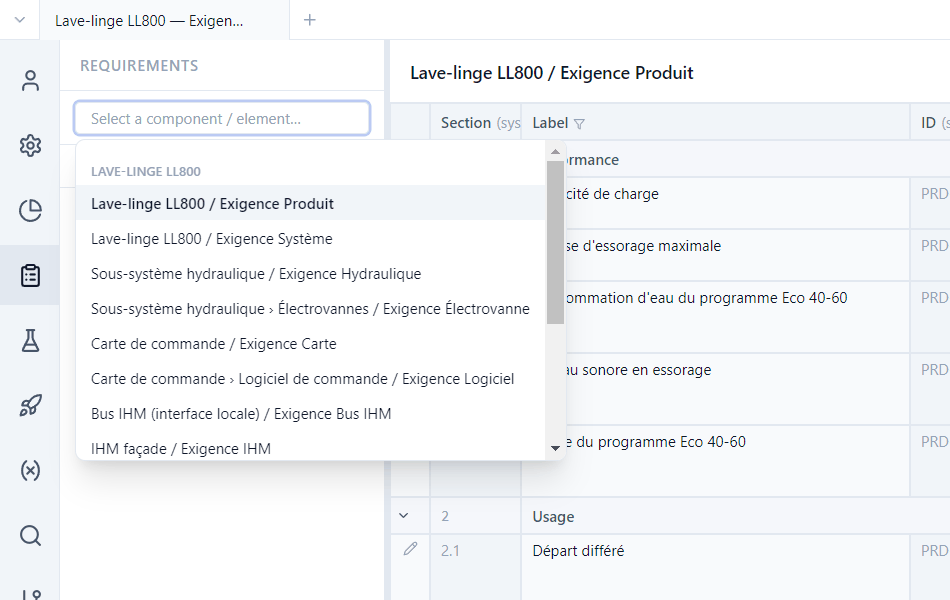
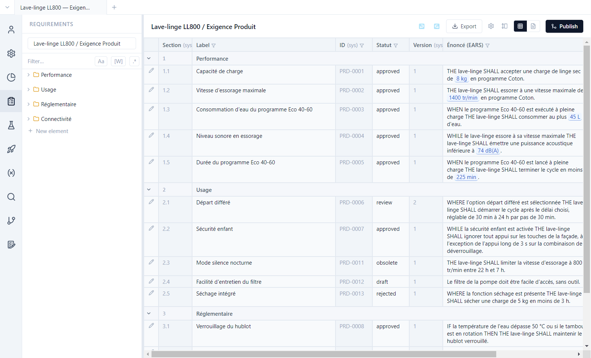
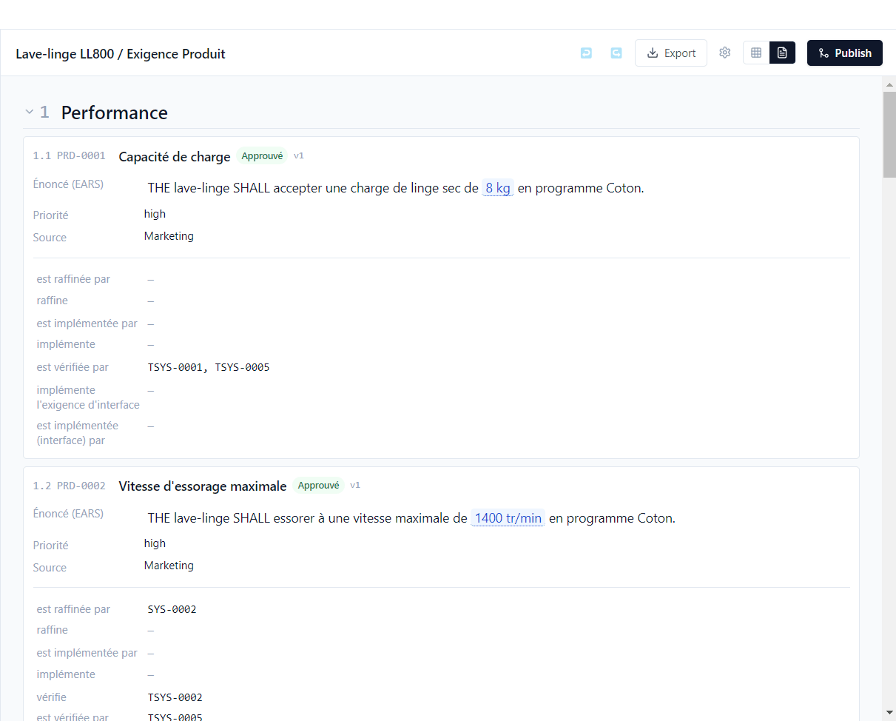
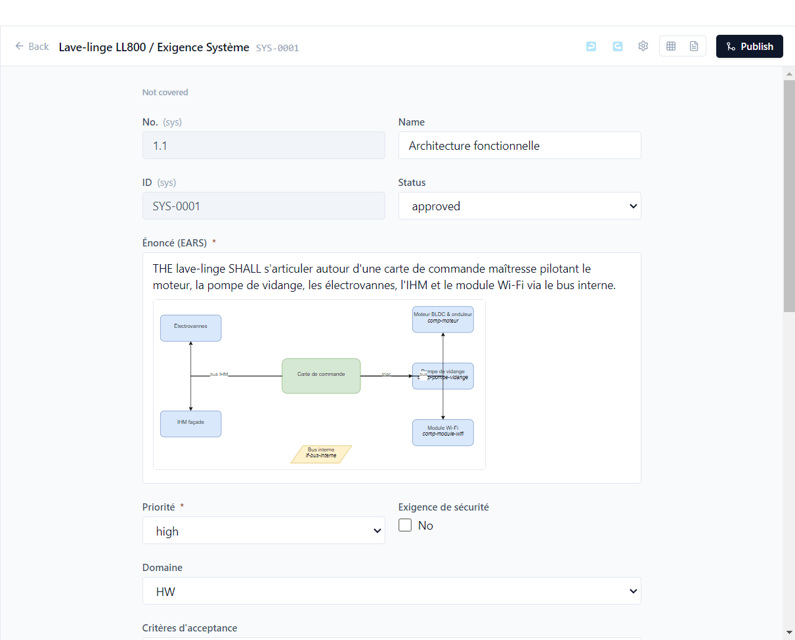
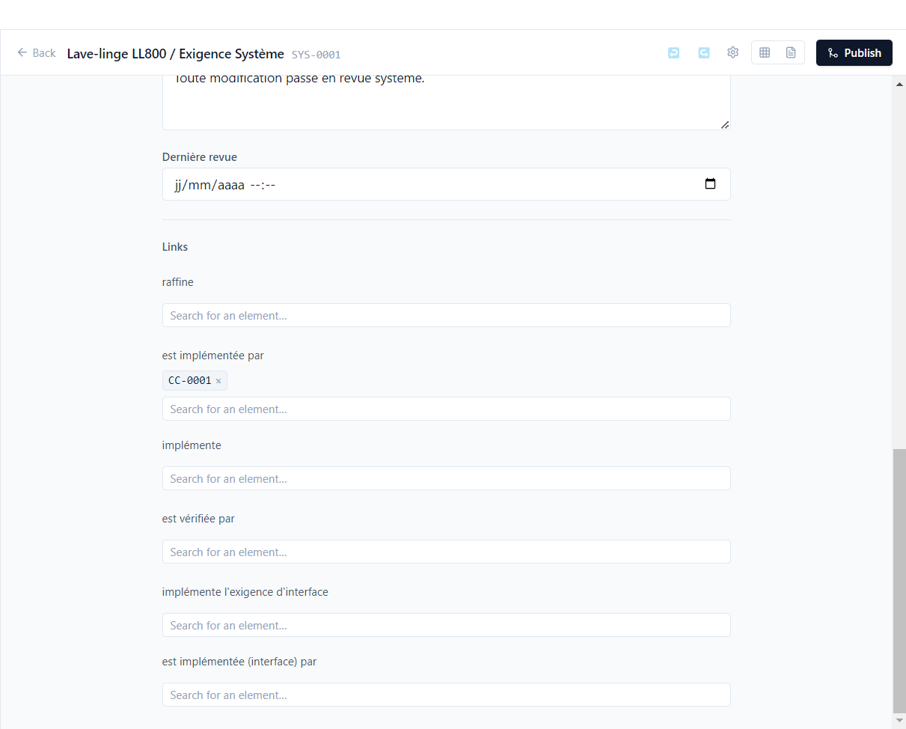

# 3. Requirements

**English** | [Français](../tutoriels/03-exigences.md)

This tutorial goes through the demo's requirements: lists, saved views, the editor, EARS syntax,
diagrams, links and the rules for moving from one status to another.

## Choose a requirement type

**Requirements** view (activity bar). The selector at the top of the side panel lists every
requirement type of every component: *Lave-linge LL800 / Exigence Produit*, *Sous-système
hydraulique / Exigence Hydraulique*, *Moteur BLDC & onduleur / Exigence Moteur*… Type to filter
it.

Below the selector, the tree groups requirements into **sections** (*Performance*, *Usage*,
*Réglementaire*…). **New element** adds a requirement; Polenta assigns its ID (`PRD-0014`…), and an
ID is never reused, even after deletion. A requirement not yet placed appears at the end of the
list, sorted by ID, until you drag it into a section.

## Table view and document view

The **table view** shows one row per requirement and one column per field.

- A column's funnel filters it (text, case, whole word, regular expression), including the
  **Verification** column (*Not covered*, *Failing*…).
- The **⚙️ › Visible fields** gear chooses the columns: the type's fields, links, and **computed
  columns** defined by the project (for example the campaign *Last result*, or one column per
  campaign, see [tutorial 7](07-tracking.md)). When a type is both source and target of the same
  link, each direction has its own column (*refines* / *is refined by*).
- Underlined blue values (`8 kg`, `1400 tr/min`) are **parameters**: the value comes from the
  parameter base ([tutorial 5](05-parameters.md)).
- Statuses follow the life cycle defined by the type: `draft`, `review`, `approved`, and two
  terminal statuses, `obsolete` (PRD-0011) and `rejected` (PRD-0013).
- **Export** produces an Excel, Word or PDF file, with a customer template if needed.

The **document view** (page icon) shows the same requirements as a specification document, with
their links. Switching from one view to the other keeps the selected requirement.

### The four statuses of a requirement

A requirement has four statuses, which the optional columns of **⚙️ › Visible fields** show side by
side:

| Status | What it says | Where it comes from |
|---|---|---|
| **Authoring** | draft, in review, approved… | the status you enter |
| **Design** | the first released version that contains the requirement in its current state (`1.2.4`), "—" otherwise | versions ([tutorial 9](09-versions.md)) |
| **Verification** | *Not covered*, *Covered*, *Verified*, *Failing*, *Needs revalidation* | tests and their results ([tutorial 6](06-traceability.md)) |
| **Validation** | the decision of the latest signed validation, with its version (*Conforme (1.2.4)*) | validations ([tutorial 10](10-issues-validation.md)) |

Only authoring is entered; the other three are computed when displayed.

### Saved views

A setup of columns, filters and sorting is saved as a **view**, from the drop-down next to ⚙️:

- **Save as…**: a name, and a **scope** — *Personal* (for you only) or *Team* (written to the
  repository, under `.polenta/views/`, to be published to share it);
- the list groups **My views** and **Team**; a view changed since it was loaded carries the
  *modified* mention; **Save**, **Rename**, **Delete**, **Default columns**.

The **Popup** tab of ⚙️ chooses the fields shown in the preview that opens when hovering an ID.

## The editor

A row's pencil opens the editor. Open **SYS-0001** (*Exigence Système*, *Architecture* section):

- At the top, the requirement's **verification** state (here *Not covered*: no test verifies it,
  see [tutorial 6](06-traceability.md)).
- Fields come from the type: text, rich text, list, checkboxes, date, user, number, diagram,
  **link** (a label and a URL: web page, file or network share)… An asterisk marks a required
  field.
- Rich text accepts **draw.io diagrams**, images and tables. SYS-0001's architecture diagram is a
  `.drawio` file in the repository, shown inside the statement.
- At the bottom, the **Executions** section lists all the results of the tests that verify the
  requirement ([tutorial 4](04-tests-campaigns.md)).
- **↩ / ↪** undo and redo; **Back** returns to the list.

Every save is dated and attributed by git. Reopening an approved requirement (moving it back to
`review` or `draft`) increments its **version**: PRD-0006 is at version 2. Items linked to it are
then marked **Impact to check** ([tutorial 6](06-traceability.md)).

Changing status offers a **Status change comment (optional)**: it is kept in the requirement's
history, with the date and the author of the change.

## Writing in EARS

Statements follow the **EARS** syntax (*Easy Approach to Requirements Syntax*), five short,
verifiable forms:

| Form | Pattern | Demo example |
|---|---|---|
| Ubiquitous | `THE <system> SHALL <action>` | PRD-0001 |
| Event-driven | `WHEN <trigger> THE <system> SHALL <action>` | PRD-0003 |
| State-driven | `WHILE <state> THE <system> SHALL <action>` | PRD-0004 |
| Optional feature | `WHERE <feature> THE <system> SHALL <action>` | PRD-0006 |
| Unwanted behaviour | `IF <condition> THEN THE <system> SHALL <action>` | PRD-0008 |

A type's *Statement* field carries the `EARS` validator. The statement of **PRD-0012** ("Le filtre
de la pompe doit être facile d'accès…") does not follow it: Polenta reports it in the **maturity**
criteria of queries ([tutorial 7](07-tracking.md)), rejects a non-compliant bulk import
([tutorial 12](12-ai-agent.md)) and, if the type asks for it, when the status changes (below).

## Links

At the bottom of the editor, one section per link type, in both directions: *refines* / *is
refined by*, *implements* / *is implemented by*, *is verified by*…

Type an ID or a title in **Search for an element…** to create a link; the cross removes it. Only
items allowed by the link type are offered, including those of other repositories of the project:
SYS-0002 is implemented by MOT-0001, a requirement of the motor component.

The link labels are defined by the project; in the demo they are in French (*raffine*, *est
implémentée par*…).

## Type rules

In *Project › Data model*, a type's definition carries two optional rules. The demo declares none:
try them on a demo type.

**Required if.** The **Req. if** column of the fields table makes a field required under a
condition: `status = approved` (the rationale is only required at approval), or a value of another
field (`priority = high`). Renaming the status or the value updates the condition.

**Transition constraints.** The **Transition constraints** section of a requirement, test or issue
type controls moving from one status to another:

1. **+ Add a rule**: **From** (optional, **Any status** by default) and **To** a status;
2. for each condition — **Required fields filled**, **Valid formats (EARS…)**, **Covered by a
   test** — a level: **No check**, **Notify** (default) or **Block**.

In the editor's status list, a blocked transition is greyed out with its reason; a notified
transition remains possible, with a warning and an *items to check* notification after the change.
With no rule, changing status is free.
