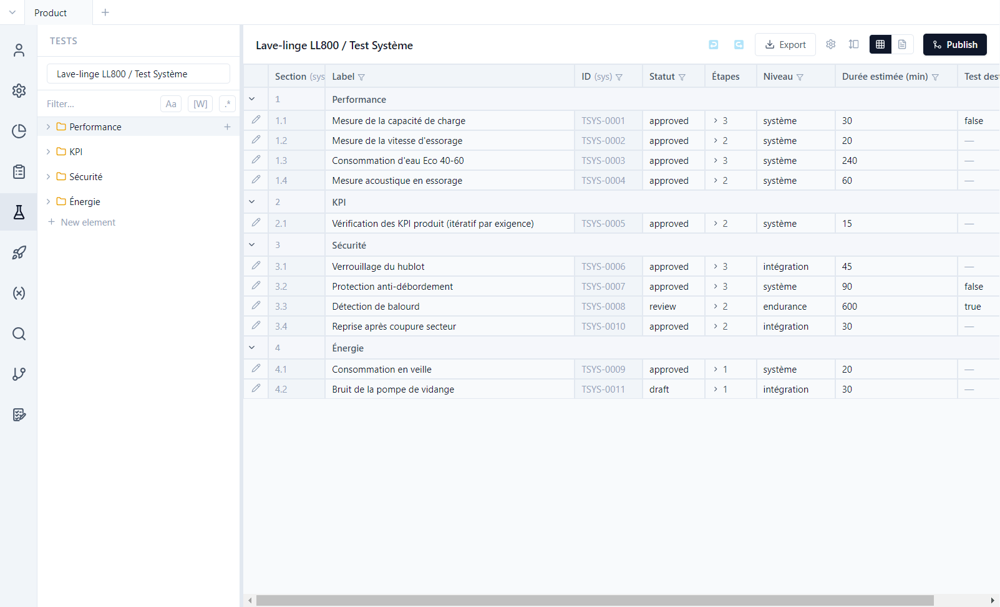
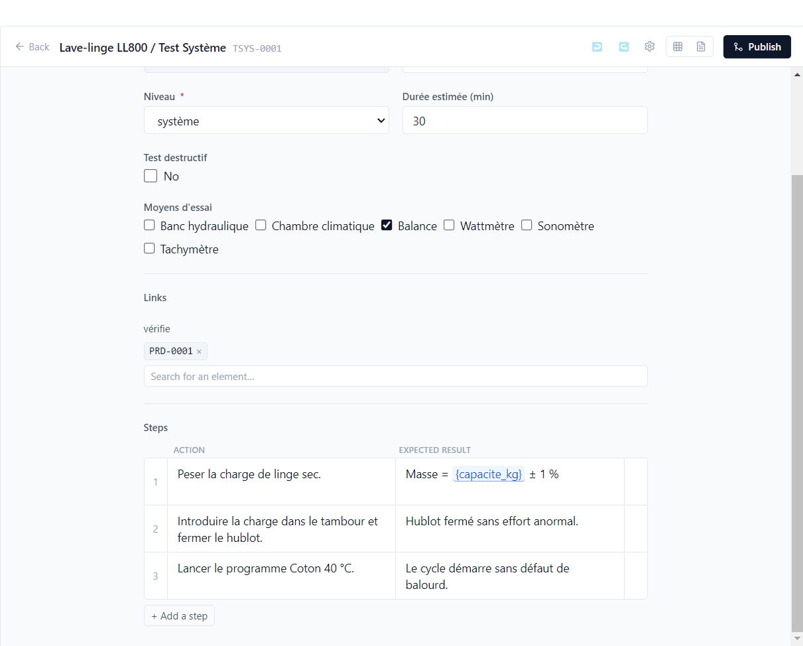
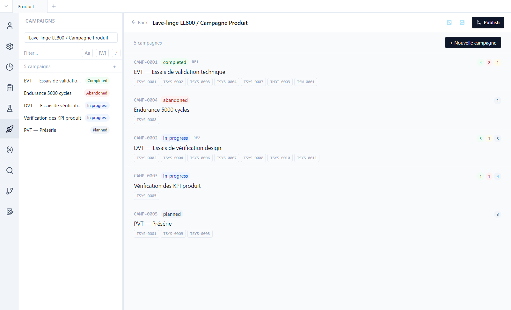
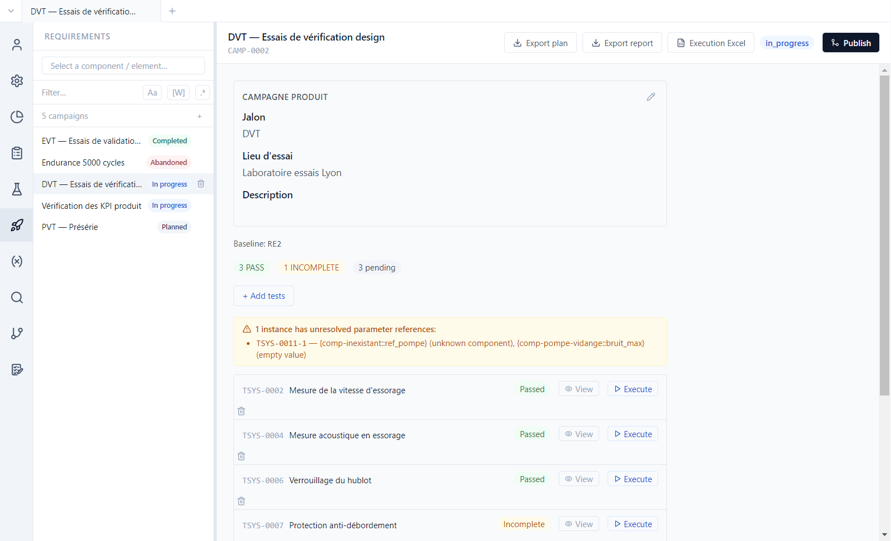
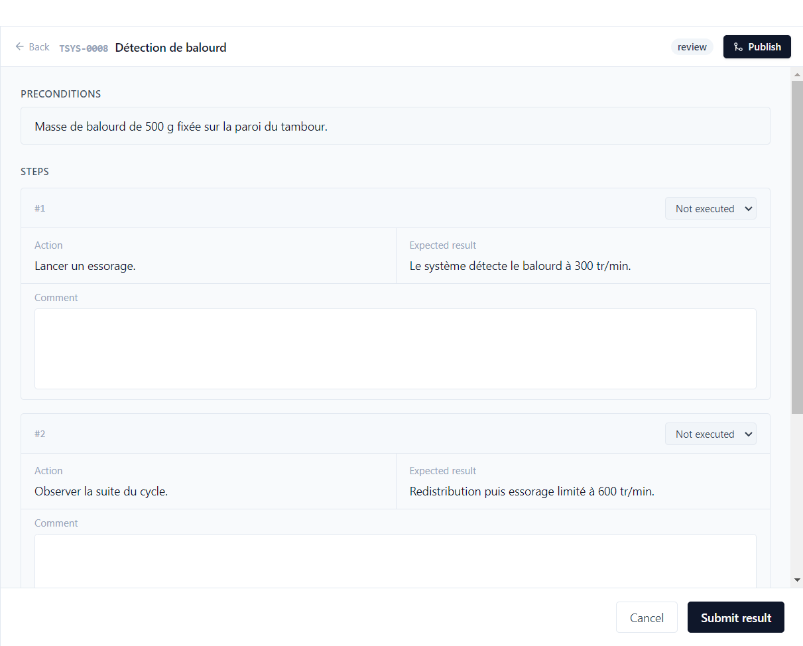

# 3. Tests and campaigns

**English** | [Français](../tutoriels/03-tests-campagnes.md)

A **test case** describes how to verify one or more requirements. A **campaign** groups tests to be
run together, on a given version of the project, and keeps their results.

## Test cases

**Tests** view, type *Lave-linge LL800 / Test Système*. Like requirements, tests are grouped in
sections and listed in a table, with their type's fields: level, estimated duration, destructive
test…

Open **TSYS-0001** (*Mesure de la capacité de charge*) and scroll to the bottom of the editor:

- **Links**: TSYS-0001 *verifies* PRD-0001. This link is what makes the requirement covered.
- **Steps**: one action and one expected result per row; **Add a step** adds one. The expected
  result of step 1 contains the `{capacite_kg}` parameter: the value is frozen when the test enters
  a campaign.

A test can also iterate over requirements: TSYS-0005 (*Vérification des KPI produit*) checks the
`{req.kpi_cible}` of each requirement associated with it, with one instance per requirement in
campaign CAMP-0003.

## Campaigns

**Campaigns** view. The demo has five, one per project milestone:

| Campaign | Status | Baseline |
|---|---|---|
| CAMP-0001 EVT | completed | RE1 |
| CAMP-0002 DVT | in progress | RE2 |
| CAMP-0003 KPI | in progress | — |
| CAMP-0004 Endurance | abandoned | — |
| CAMP-0005 PVT | planned | — |

Each row shows the campaign's tests and the count of results. **New campaign** creates one from the
tests you choose.

## A campaign in progress

Open **DVT — Essais de vérification design**:

- The **baseline** (RE2) sets the version of the requirements and parameters being verified. The
  same measurement expects 1200 rpm in the EVT campaign (baseline RE1) and 1400 rpm in the DVT
  campaign.
- The orange banner reports an **unresolved parameter reference** in TSYS-0011: an unknown
  component and an empty value. The test can still be run, but the tester is warned.
- Each test shows its result (*Passed*, *Incomplete*, *Pending*), **View** to read the last
  execution again, **Execute** to run a new one.
- At the bottom, **Close campaign** or **Abandon**.

## Run a test

**Execute** on *TSYS-0008 Détection de balourd*:

1. Read the **preconditions**.
2. For each step, choose the result (*Passed*, *Failed*, *Blocked*, *Skipped*) and add a comment
   if needed.
3. Choose the **global result** (*Passed*, *Failed*, *Blocked*, *Incomplete*) and **Submit
   result**.

The result is stored in `test-runs/` of the **test's** repository: a motor component test run in a
product campaign keeps its result in `comp-moteur`. When a test is run several times, the last
execution counts: TSYS-0004, failed in EVT, passed in DVT.

## Outside the tool

At the top of the campaign:

| Button | Use |
|---|---|
| **Export plan** | the test plan, to print or have reviewed |
| **Export report** | the campaign's results |
| **Execution Excel** | a workbook for testers to fill in at the test bench, then import back into the campaign |
