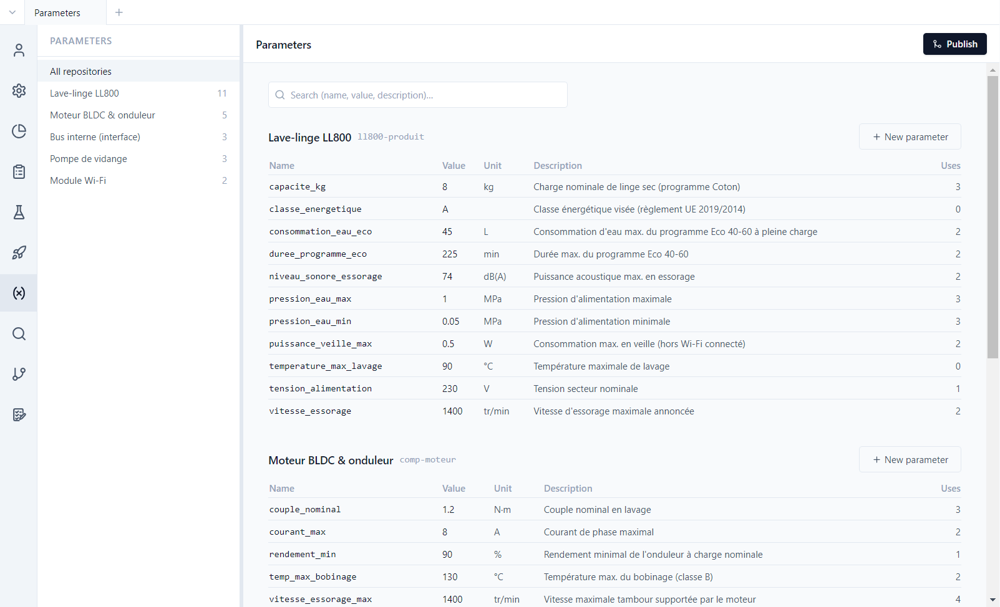
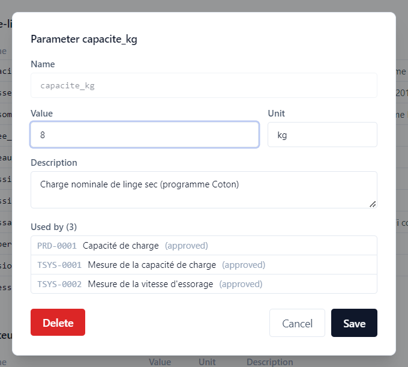

# 4. Parameters

**English** | [Français](../tutoriels/04-parametres.md)

A value that appears in several requirements and tests (a capacity, a speed, a voltage) is declared
once in the repository's **parameter base**. Texts refer to it instead of copying the value.

## The parameter base

**Parameters** view: one table per repository, with the number of parameters of each in the side
panel.

Each parameter has a name, a value, a unit and a description. The **Uses** column counts the items
that refer to it. The base is stored in `parameters/parameters.yaml`, in each repository.

## Refer to a parameter

In a text field, write the parameter name between braces:

| Syntax | Parameter |
|---|---|
| `{capacite_kg}` | parameter of the same repository |
| `{comp-moteur::vitesse_essorage_max}` | parameter of a component mounted in the project |

When displayed, the reference is replaced by the value and unit, in blue (`8 kg`). The demo also
shows the edge cases:

- SYS-0011 refers to `{comp-pompe-vidange::bruit_max}`, whose value is **empty**: the reference is
  reported as unresolved. In a campaign, the test concerned carries a warning banner.
- SYS-0012 refers to `{effort_fermeture_hublot}`, **absent** from the base: the text stays as
  written. In a test, such a local reference is entered by hand at execution time (the
  `charge_essai` parameter of the EVT campaign).

## Who uses this parameter?

Clicking `capacite_kg` opens its card:

**Used by** lists the three items that refer to it. Changing the value is therefore a change to
those three items:

- the **approved** items that use it are marked **needs revalidation**
  ([tutorial 5](05-traceability.md));
- **Delete** is refused as long as the parameter is used.

In the demo, `vitesse_essorage` went from 1200 to 1400 rpm between baselines RE1 and RE2: comparing
the two baselines shows it ([tutorial 7](07-versions.md)).
