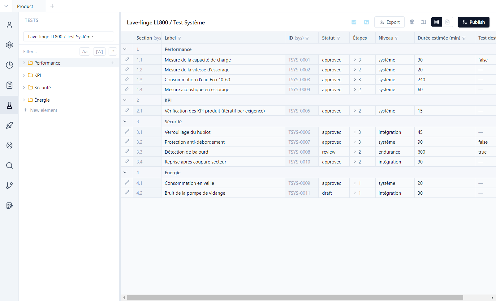
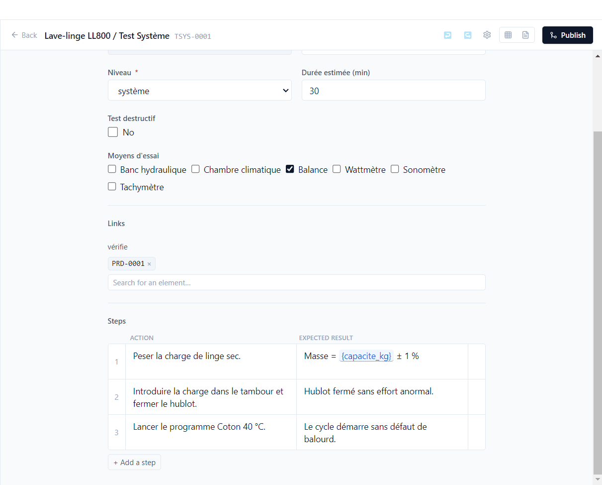
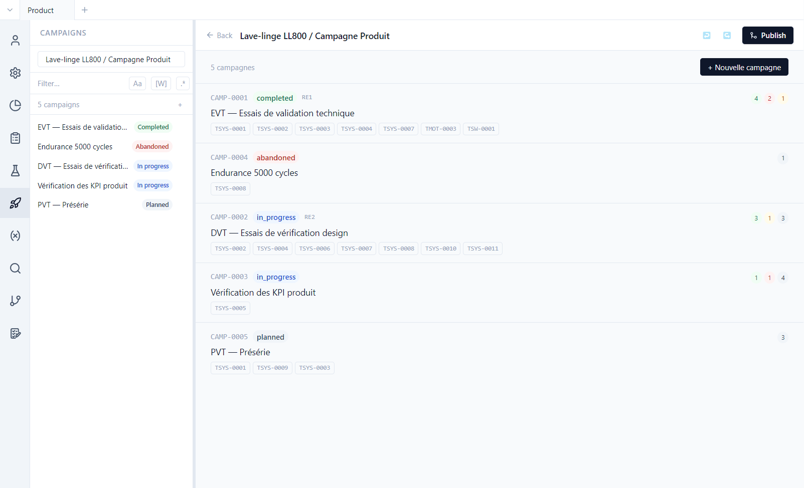
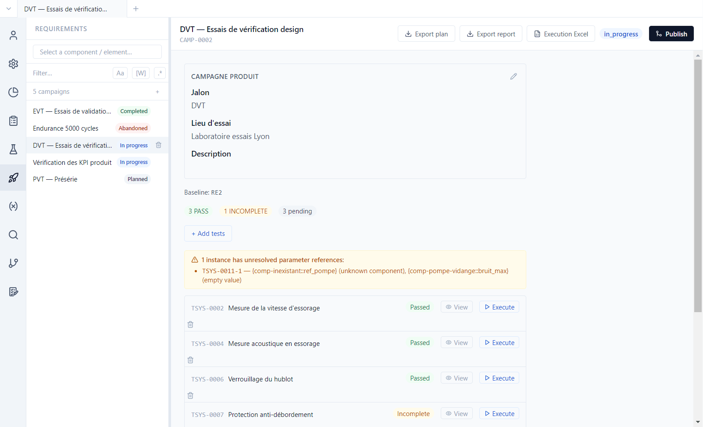
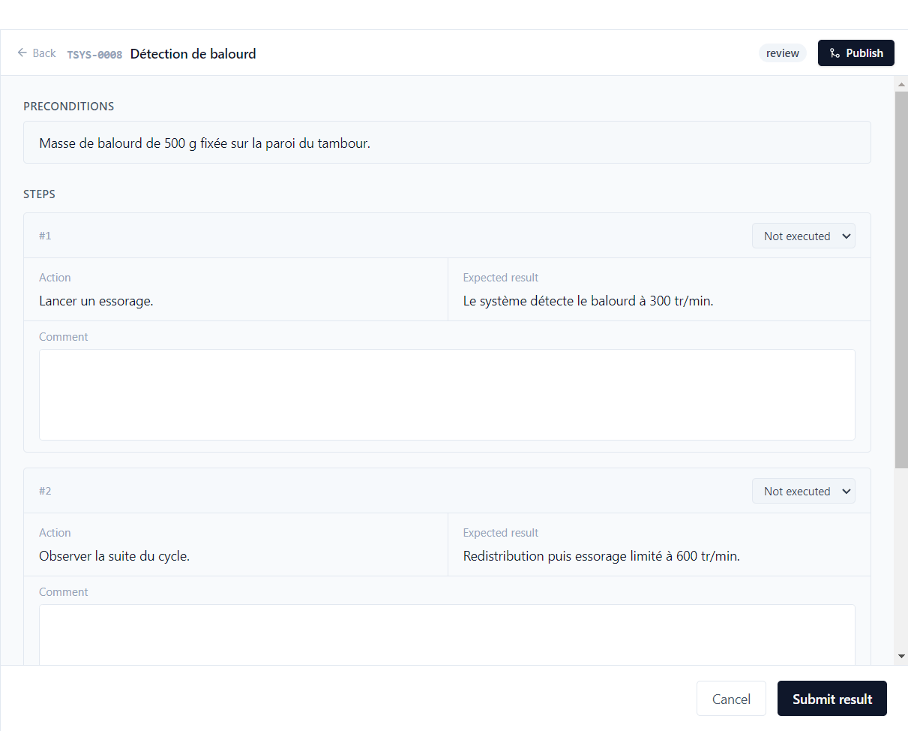

# 4. Tests and campaigns

**English** | [Français](../tutoriels/04-tests-campagnes.md)

A **test case** describes how to verify one or more requirements. A **campaign** groups tests to be
run together and keeps their results; each result says on which **version** of the product the test
was run.

## Test cases

**Tests** view, type *Lave-linge LL800 / Test Système*. Like requirements, tests are grouped in
sections and listed in a table, with their type's fields: level, estimated duration, destructive
test…

Open **TSYS-0001** (*Mesure de la capacité de charge*) and scroll to the bottom of the editor:

- **Links**: TSYS-0001 *verifies* PRD-0001. This link is what makes the requirement covered.
- **Steps**: one action and one expected result per row; **+ Add a step** adds one. The expected
  result of step 1 contains the `{capacite_kg}` parameter: the value is frozen when the test enters
  a campaign.
- **Executions**: the grid of all the test's runs, across all campaigns (see below).

A test can also iterate over requirements: TSYS-0005 (*Vérification des KPI produit*) checks the
`{req.kpi_cible}` of each requirement associated with it, with one instance per requirement in
campaign CAMP-0003.

### Run fields

In the data model, the test type can declare **Run fields** (entered once per run: serial number of
the sample, bench used…) and **Step fields** (entered at each step: measured value…). The **Req. if**
column makes them required depending on the result (`result = FAIL`: describe the deviation). They
appear at execution and in the execution Excel workbook.

The demo's system tests have a *Banc utilisé* run field and a *Mesure relevée* step field. The run
of TSYS-0002 in DVT fills them in: bench B2, 1392 rpm at the first step.

## Campaigns

**Campaigns** view. The product repository has five, for the EVT, DVT and PVT milestones:

| Campaign | Status |
|---|---|
| CAMP-0001 EVT | completed |
| CAMP-0002 DVT | in progress |
| CAMP-0003 KPI | in progress |
| CAMP-0004 Endurance | abandoned |
| CAMP-0005 PVT | planned |

Each row shows the campaign's tests and the count of results. **+ New campaign** creates one from
the tests you choose; in the test picker, ⚙️ chooses the displayed columns without losing the
selection. The **From a campaign** tab takes entries over from another campaign: this is how the
PVT carried over TSYS-0004 from the DVT (*Carried over from CAMP-0002*).

A campaign only contains tests of its own repository. The motor's tests have their campaign in
`comp-moteur`: CMOT-0001, *Essais de protection de l'onduleur*, where TMOT-0003 is failing.

## A campaign in progress

Open **DVT — Essais de vérification design**:

- Parameter values are the ones read when the test entered the campaign: the same measurement
  expects 1200 rpm in the EVT campaign and 1400 rpm in the DVT campaign, created after the value
  changed.
- The orange banner reports an **unresolved parameter reference** in TSYS-0011: an unknown
  component and an empty value. The test can still be run, but the tester is warned.
- Each test shows its result (*Passed*, *Incomplete*, *Pending*), **View** to read the last
  execution again, **Execute** to run a new one. TSYS-0006's result comes from an execution Excel
  workbook (below).
- TSYS-0003 was removed from the campaign after being added: the removed entry stays in the
  campaign's file, with its removal date.
- At the bottom, **Close campaign** or **Abandon**.

## Run a test

**Execute** on *TSYS-0008 Détection de balourd*:

1. Read the **preconditions**.
2. Indicate the **Tested version**: the product repository declares versions
   ([tutorial 9](09-versions.md)), so it is required. A version from the list (in progress or
   released), or **Other (free text)…**; the version of the previous run is suggested. The DVT runs
   carry LLV-0002, the `2.0` version in progress. **Tested structure** details the version of each
   component and lets you note a deviation: TSYS-0007 was run with a motor in *préversion
   1.3-rc2*, instead of the planned `1.2.4` version.
3. For each step, choose the result (*Passed*, *Failed*, *Blocked*, *Skipped*), fill in the step
   fields, add a comment if needed.
4. Fill in the run fields, choose the **global result** (*Passed*, *Failed*, *Blocked*,
   *Incomplete*) and **Submit result**.

The result is stored in `test-runs/` of the test's repository, with a frozen copy of the tested
version and structure. A motor test runs in a motor campaign: TMOT-0003's failed result is in
`comp-moteur`, attached to CMOT-0001. When a test is run several times, the last execution counts:
TSYS-0004, failed in EVT, passed in DVT.

**On failure**, Polenta offers to track the problem: *Failed execution — do you want to track this
problem in an issue?*, with **Create an issue**, **Link to an existing issue** or **Ignore**
([tutorial 10](10-issues-validation.md)). In the demo, TSYS-0004's failure in EVT gave ISS-0001,
and TSYS-0005's failure on PRD-0002 (1352 rpm measured) gave ISS-0003.

## Execution history

At the bottom of a test's card, and of a requirement's, the **Executions** section lists all the
runs: verdict, date, tester, duration, campaign, test version, **tested version**, deviations,
origin (*entered* or *Excel import*)… **Columns** chooses the columns, **Show steps** details each
run. This is the place to answer "on which version was this test run?".

## Outside the tool

At the top of the campaign:

| Button | Use |
|---|---|
| **Export plan** | the test plan, to print or have reviewed |
| **Export report** | the campaign's results |
| **Execution Excel** | **Export execution workbook…** to fill in at the test bench (steps, run fields, tested version), then **Import results…**: a preview separates the rows to import, those in error and those with a warning before the import |

## Exercises

**Add a step to a test.**
1. Open TSYS-0011 (draft), **+ Add a step**: an action, an expected result.

Result: the step appears in the test's page, after the others.

**Create a campaign, then change a test.**
1. **+ New campaign** with TSYS-0009 and TSYS-0010 (CAMP-0006 on a fresh demo).
2. Change a step of TSYS-0009.
3. Reopen the campaign.

Result: the campaign keeps the copy of the test taken when it was created. Polenta reports that the
test has changed since and offers to update the entry.

**Look for a motor test in a product campaign.**
1. **+ New campaign**, **Select tests…**: search for TMOT-0003.
2. **Campaigns** view, `comp-moteur` campaigns: open CMOT-0001.

Result: the picker only offers tests of the product repository; TMOT-0003 is not there. It is in
CMOT-0001, with its failed result.

**Enter the run fields.**
1. Open CAMP-0005, **Execute** on TSYS-0001.
2. Choose LLV-0002 as tested version, fill in *Banc utilisé* and one *Mesure relevée* per step,
   then **Submit result**.
3. **View** the result.

Result: the bench and the measurements are stored in the execution.

**Indicate the tested version.**
1. Open CAMP-0002, **Execute** on TSYS-0008.
2. Submit without a tested version.
3. Choose LLV-0002. In **Tested structure**, enter a value other than `1.2.4` for `comp-moteur`,
   then submit.

Result: at step 2, the execution is refused: *The tested version is required.* (code
`TESTED_VERSION_REQUIRED`). At step 3, the execution is stored with a deviation, shown in the
execution history.

**Read a test's history.**
1. Open TSYS-0004, **Executions** section.

Result: a failure in EVT (CAMP-0001), without a tested version, then a success in DVT (CAMP-0002) on
version `2.0`.

**Carry over results and remove an entry.**
1. **+ New campaign**, **From a campaign** tab: tick CAMP-0002 and take over its passed entries.
2. In the new campaign, run a test, then **Remove this test from the campaign**.

Result: the entries taken over carry *Carried over from CAMP-0002*. The removed entry leaves the
list but stays in the campaign's file, with its execution.

**Run an iterative test.**
1. Open CAMP-0003: one instance of TSYS-0005 per linked requirement.
2. Run the instance of PRD-0001.

Result: each instance expects its requirement's `{req.kpi_cible}`; the instance of PRD-0002 is
failing (1352 rpm).

**Run outside the tool.**
1. Open CAMP-0005, **Execution Excel › Export execution workbook…**.
2. Fill in a row (result, tested version, run fields), save.
3. **Import results…**, review the preview, import.

Result: the imported execution carries the *Excel import* origin, like TSYS-0006's in the DVT.

**Make a test fail.**
1. Open CAMP-0002, **Execute** on TSYS-0008, version LLV-0002, global result *Failed*.

Result: Polenta offers *Create an issue*, *Link to an existing issue* or *Ignore*. The rest is done
in [tutorial 10](10-issues-validation.md#exercises).
