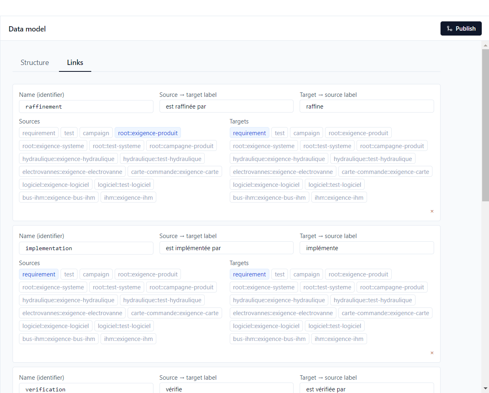
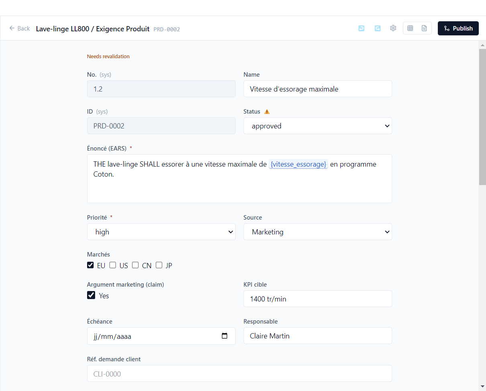
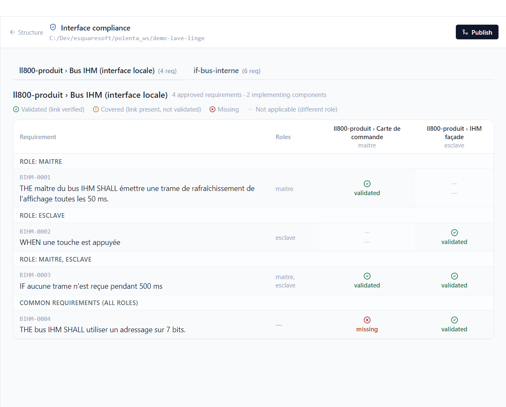

# 5. Traceability

**English** | [Français](../tutoriels/05-tracabilite.md)

Polenta links product needs to system requirements, to the components that implement them and to
the tests that verify them. This tutorial shows how these links are defined, what Polenta derives
from them and how it flags a link that has become doubtful.

## Link types

*Project > Data model*, **Links** tab:

Each link type has a name, a label in each direction (*is refined by* / *refines*) and the items
allowed as source and target: a whole category (`requirement`, `test`) or a specific type
(`root::exigence-produit`). The demo declares five:

| Type | Meaning | Example |
|---|---|---|
| refinement | a requirement details another one | SYS-0002 refines PRD-0002 |
| implementation | a component realises a requirement | CC-0001 implements SYS-0001 |
| verification | a test verifies a requirement | TSYS-0001 verifies PRD-0001 |
| interface implementation | a component requirement realises an interface requirement | MOT-0006 implements an internal bus requirement |
| relation | free link, unconstrained | — |

The direction of a verification link does not matter: created from the test or from the
requirement, it counts the same.

## Coverage

Each requirement has a **coverage** status, computed from its verification links and the latest
result of each linked test. It appears at the top of the editor, in the table view columns and in
queries (`coverageStatus` column).

| Status | Meaning | In the demo |
|---|---|---|
| **Not covered** | no linked test | SYS-0008, Wi-Fi module requirements |
| **Covered** | linked tests, not run yet | SYS-0010 |
| **Validated** | the latest result of the linked tests is *Passed* | PRD-0001, SW-0001 |
| **Failing** | the latest result of a linked test is not *Passed* (failed, blocked…) | PRD-0009 |
| **Needs revalidation** | a linked item changed after approval | PRD-0002, SYS-0002 |

## Items to revalidate

When an approved requirement is reopened, or a parameter it uses changes value, Polenta cannot
know whether the linked items are still right. It marks them **needs revalidation**: a ⚠ next to
their status, and the *Needs revalidation* banner at the top of the editor.

In the demo, SYS-0002 (which refines PRD-0002) was moved back to review; PRD-0002 and test
TSYS-0002 are marked. The [impact analysis](07-versions.md#analyze-the-impact) lets you check each
item and clear the flag.

## Interface compliance

An **interface** groups the requirements of an exchange between components, with roles. Each
component that implements the interface declares its role, and must cover the requirements of that
role.

*Project > Data model > Structure*, **Interface compliance**:

For the UI bus (master and slave roles), one row per interface requirement, one column per
implementing component:

- *validated*: the component has a linked requirement, validated by its tests;
- *covered*: the link exists, validation is missing;
- *missing*: no requirement of the component realises the interface's one. Here, the control
  board (master) does not cover BIHM-0004;
- a dash: the requirement does not apply to this component's role.
