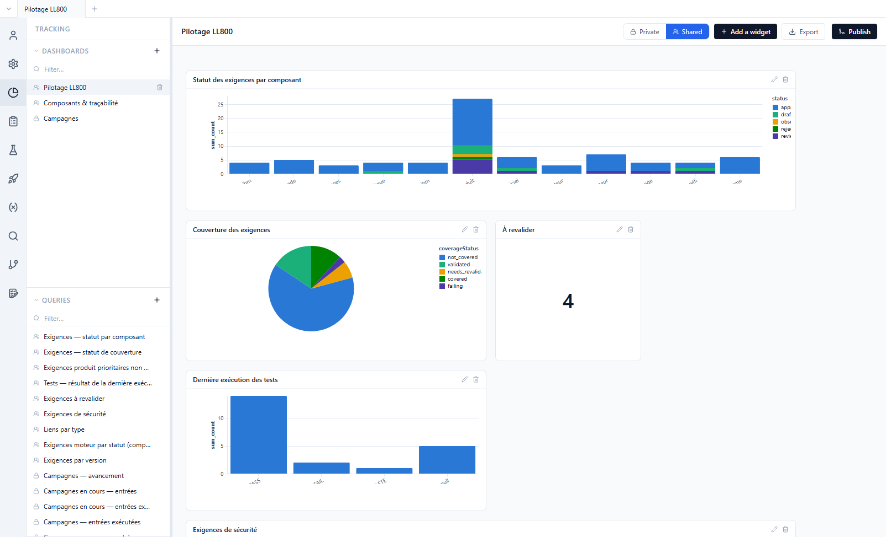
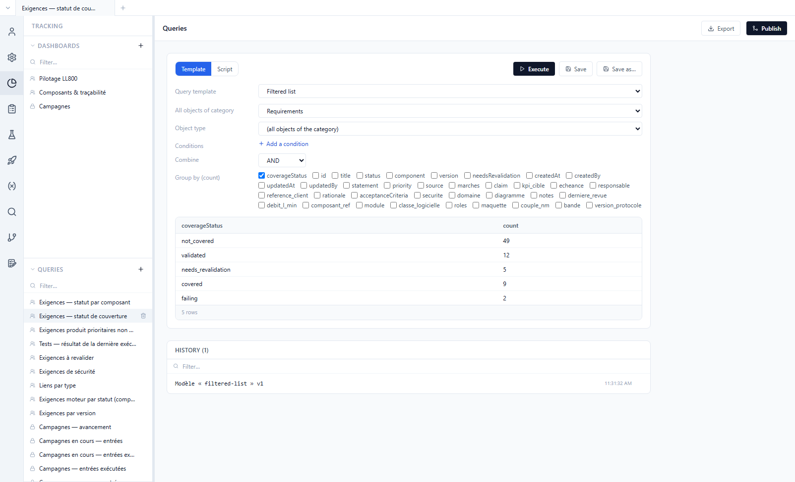
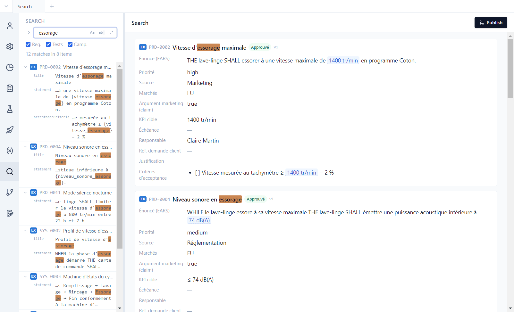

# 6. Tracking and search

**English** | [Français](../tutoriels/06-suivi.md)

The **Tracking** view answers project management questions: where the requirements stand, what is
not tested, how the campaigns are progressing. It relies on **queries** over the whole project
(product and components), shown in **dashboards**.

## Dashboards

**Tracking** view, *Pilotage LL800* dashboard:



- Each **widget** shows a query result: bars (here stacked by status), pie, line, table, key figure
  (*À revalider*: 4), matrix, area over time.
- Clicking a bar, a slice or a key figure opens the **details**: the requirements, tests or campaign
  entries behind it, each one opening in a tab.
- **Add a widget** adds one; a widget's pencil edits it. A widget is set up with a **template**
  (*Template* tab: chart type, columns, measure); the *Code* tab shows the generated code, which an
  advanced user can edit (the widget is then "customized", *Back to template* undoes it).
- **Private** / **Shared**: a shared dashboard is saved in the repository and visible to the whole
  team; a private dashboard stays with its author.
- **Export** produces a Word or PDF version of the dashboard.

The second dashboard, *Composants & traçabilité*, tracks coverage component by component. On first
access, Polenta also creates the shared *Status* dashboard (when there is no dashboard yet) and a
private *Campaigns* dashboard: progress of each campaign (from test preparation to result),
% executed, % PASS, executions per day, failed entries, progress over time.

## Queries

The bottom of the side panel lists the shared queries. Open *Exigences — statut de couverture*:



A query can be built in two ways:

- **Template**: a form, no code — *Filtered list* (object type, component, conditions, grouping),
  *Campaign entries*, *Progress over time*;
- **Script**: a JavaScript script that reads the project data (requirements, tests, links,
  campaigns, executions, histories) and returns rows. It runs in an isolated sandbox, with no access
  to the disk or the network.

**Execute** shows the result, **Save** stores the query, the history keeps the latest queries run;
**Export** produces Excel or PDF. Example script:

```js
// Approved requirements without a test
export default (data) => data.requirements
  .filter((r) => r.status === 'approved' && r.coverageStatus === 'not_covered')
  .map((r) => ({ id: r.id, title: r.title, _ids: [r.id] }))
```

The `_ids` column names the source objects: it is what makes a row or a bar clickable. Scripts can
import the **project library** (`dashboards/lib/`, copied on first access): campaign progress steps,
campaign state day by day, requirement **maturity** (required fields filled in, EARS statement,
measurable acceptance criterion, verification link for an approved requirement, no pending impact):

```js
import { maturity, maturityContext } from 'lib/maturity.js'

// Requirements that are not "mature", with the reason
export default (data) => {
  const ctx = maturityContext(data)
  return data.requirements
    .map((r) => ({ r, m: maturity(data, r, ctx) }))
    .filter(({ m }) => !m.ok)
    .map(({ r, m }) => ({ id: r.id, title: r.title, missing: m.missing.join(', '), _ids: [r.id] }))
}
```

When Polenta ships a new version of a library file or of a pre-configured dashboard widget, an
**Updates available** banner appears at the top of the panel: nothing changes until you click
*Apply*. An AI assistant connected to the project (tutorial 8) can write and test these scripts for
you.

## Search

**Search** view: a text, or a regular expression, searched across all the project's
repositories.



- **Aa** matches case, **ab|** matches whole words, **.\*** enables regular expressions; the
  checkboxes restrict the search to requirements, tests or campaigns.
- On the left, each match with its field; on the right, the matching items in full.
- The arrow left of the field opens **replace**, across the whole project.

Example: `\{[a-z_]+\}` as a regular expression finds every parameter reference.
