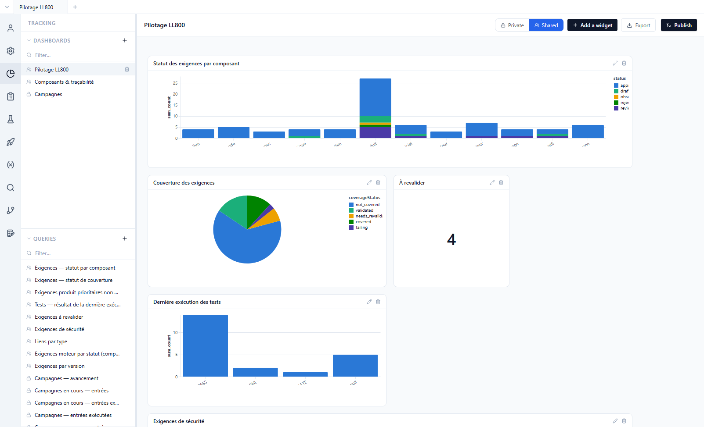
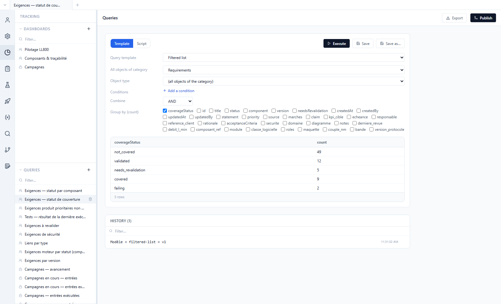
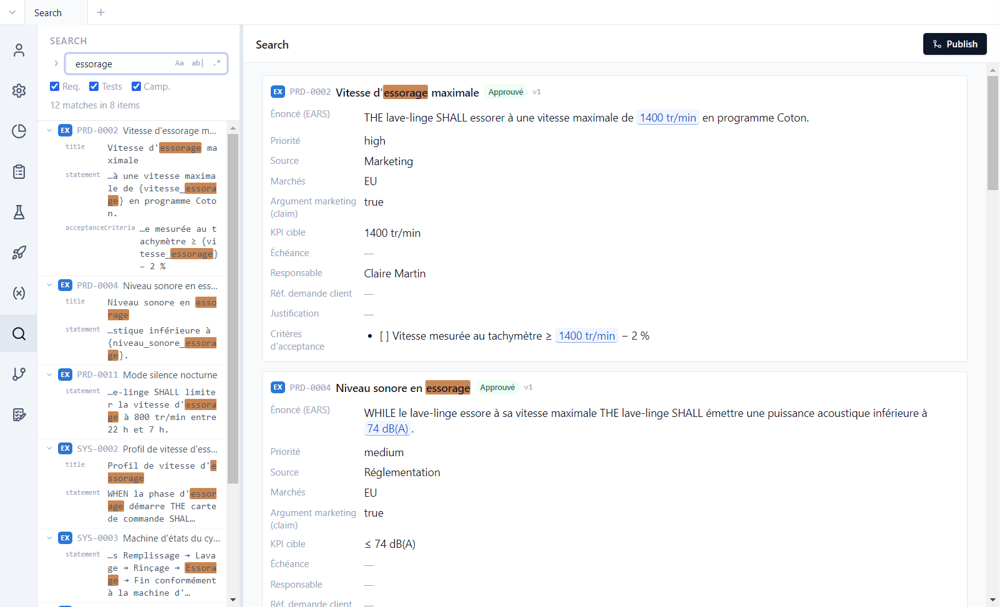

# 7. Tracking and search

**English** | [Français](../tutoriels/07-suivi.md)

The **Tracking** view answers project management questions: where the requirements stand, what is
not tested, how the campaigns are progressing. It relies on **queries** over the whole project
(product and components), shown in **dashboards**.

## Dashboards

**Tracking** view, *Pilotage LL800* dashboard:



- Each **widget** shows a query result. *Pilotage LL800* shows bars (here stacked by status), a pie,
  a key figure (*À revalider*: 4), a table and a line; other forms exist, such as the matrix or the
  area over time.
- Clicking a bar, a slice or a key figure opens the **details**: the requirements, tests or campaign
  entries behind it, each one opening in a tab.
- **Add a widget** adds one; a widget's pencil edits it. A widget is set up with a **template**
  (*Template* tab: chart type, columns, measure); the *Code* tab shows the generated code, which an
  advanced user can edit (the widget is then "customized", *Back to template* undoes it).
- **Private** / **Shared**: a shared dashboard is saved in the repository and visible to the whole
  team; a private dashboard stays with its author. Sharing a private dashboard whose widgets use
  private queries (such as *Campagnes*) opens a confirmation that lists them: they are shared with it,
  in a single action.
- **Export** produces a Word or PDF version of the dashboard.

The second dashboard, *Composants & traçabilité*, shows links by type (pie), the motor's
requirements by status (bars) and the high-priority product requirements not yet approved (table).
The third, *Versions & validation*, counts the issues of each version and breaks down the decisions
of a validation. On first access, Polenta also creates the shared *Status* dashboard (when there is no dashboard yet) and a
private *Campagnes* dashboard: progress of each campaign (from test preparation to result),
% executed, % PASS, executions per day, failed entries, progress over time.

**Parameters chosen when displayed.** The *Campagnes* dashboard shows a **Campaign** selector at the
top: on *All*, it shows the campaigns in progress; a chosen campaign (even a completed one)
refocuses all its widgets on that campaign alone — for example the progress over time of one
specific campaign. The choice is remembered for you only (nothing to publish); *Reset* goes back
to *All*. Any query can declare such parameters (campaign, component, object type, list of values,
text, period): through the "… chosen when displayed" checkboxes of its template, or in the
*Parameters chosen when displayed* section of the Queries view in Script mode, where the script
reads the values in `polenta.params`. Widgets that share a parameter share the same selector.
In the shared *Versions & validation* dashboard, the *Décisions de la validation* widget thus has a
**Validation** selector: *Validation 1.0*, *Validation 2.0* or *Validation 1.2.4* (motor).

## Queries

The bottom of the side panel lists the queries (scope icon: private or shared). The **Private** /
**Shared** selector in a query's header, or the scope button shown when hovering its row in the
panel, changes its scope after confirmation. Open *Exigences — statut de couverture*:



A query can be built in two ways:

- **Template**: a form, no code — *Filtered list* (object type, component, conditions, grouping),
  *Campaign entries*, *Progress over time*;
- **Script**: a JavaScript script that reads the project data (requirements, tests, links,
  campaigns, executions, histories, versions, issues, validations) and returns rows. It runs in an
  isolated sandbox, with no access to the disk or the network.

**Execute** shows the result, **Save** stores the query, the history keeps the latest queries run;
**Export** produces an Excel or PDF file. Example script:

```js
// Approved requirements without a test
export default (data) => data.requirements
  .filter((r) => r.status === 'approved' && r.coverageStatus === 'not_covered')
  .map((r) => ({ id: r.id, title: r.title, _ids: [r.id] }))
```

The `_ids` column names the source objects: it is what makes a row or a bar clickable. Scripts can
import the **project library** (`dashboards/lib/`, copied on first access): campaign progress steps,
campaign state day by day, requirement **maturity** (required fields filled in, EARS statement,
measurable acceptance criterion, verification link for an approved requirement, no pending impact):

```js
import { maturity, maturityContext } from 'lib/maturity.js'

// Requirements that are not "mature", with the reason
export default (data) => {
  const ctx = maturityContext(data)
  return data.requirements
    .map((r) => ({ r, m: maturity(data, r, ctx) }))
    .filter(({ m }) => !m.ok)
    .map(({ r, m }) => ({ id: r.id, title: r.title, manque: m.missing.join(', '), _ids: [r.id] }))
}
```

When Polenta ships a new version of a library file or of a pre-configured dashboard widget, an
**Updates available** banner appears at the top of the panel: nothing changes until you click
*Apply*. An AI assistant connected to the project ([tutorial 12](12-ai-agent.md)) can write and
test these scripts for you.

### Computed columns in views

A shared query can also **add a column** to the table views of requirements or tests: it declares a
column, and returns one value per item. The provided template computes the campaign **Last result**
of each test; a variant splits the column into **one column per campaign**, and a new campaign adds
its own column to it automatically. These columns are chosen in **⚙️ › Visible fields › Computed
columns**, and are filtered and exported like the others. They are defined by the project, not by
Polenta: each team computes what it needs.

## Search

**Search** view: a text, or a regular expression, searched across all the project's
repositories.



- **Aa** matches case, **ab|** matches whole words, **.\*** enables regular expressions; the
  checkboxes restrict the search to requirements, tests or campaigns.
- On the left, each match with its field; on the right, the matching items in full.
- The arrow left of the field opens **replace**, across the whole project.

Example: `\{[a-z_]+\}` as a regular expression finds every parameter reference.

## Exercises

**Add a widget.**
1. *Pilotage LL800*, **Add a widget** on the *Exigences — statut de couverture* query, as a table.
2. Widget's pencil: change the grouping in the *Template* tab.

Result: the new widget appears next to the six others and follows the change.

**Change a dashboard parameter.**
1. *Versions & validation* dashboard, **Validation** selector: *Validation 1.0*.
2. Choose *Validation 1.2.4*, then *Reset*.

Result: the pie is recomputed. The 1.0 shows mostly *conforme* decisions, two *hors scope*
(PRD-0010, SYS-0013) and one *dérogation* (SYS-0004); the 1.2.4 covers the motor's requirements.

**Show a computed column.**
1. **Tests** view, *Test Système*, **⚙️ › Visible fields › Computed columns**: tick *Dernier
   résultat* (QUERY-0010).

Result: a *Dernier résultat* column appears; TSYS-0004 shows `PASS` (DVT), TSYS-0007 `INCOMPLETE`.

**Count issues per version.**
1. **Tracking** view, new query in Script mode:

```js
export default (data) => data.versions.map((v) => ({
  version: v.component + ' ' + v.title,
  issues: v.changes.filter((c) => data.issues.some((i) => i.id === c.id)).length,
}))
```

2. **Execute**, then compare with the shared *Issues par version* query (QUERY-0012).

Result: the product's `1.0` counts one issue (ISS-0001), the `2.0` two (ISS-0002, ISS-0003), the
motor's `1.3` one (MISS-0001); the other versions, none.

**Search and replace.**
1. **Search** view: `essorage`.
2. Open replace, enter a replacement text, read the preview, do not apply.

Result: the matches are listed in the product repository and in `comp-moteur`, each with its field.
