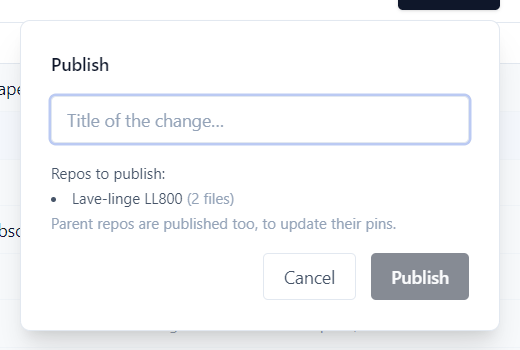
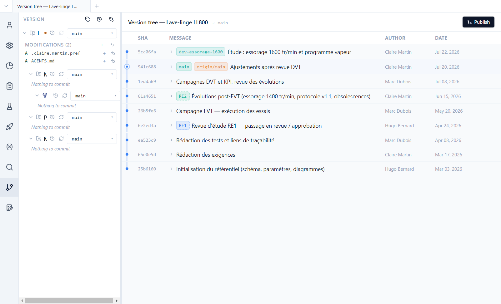
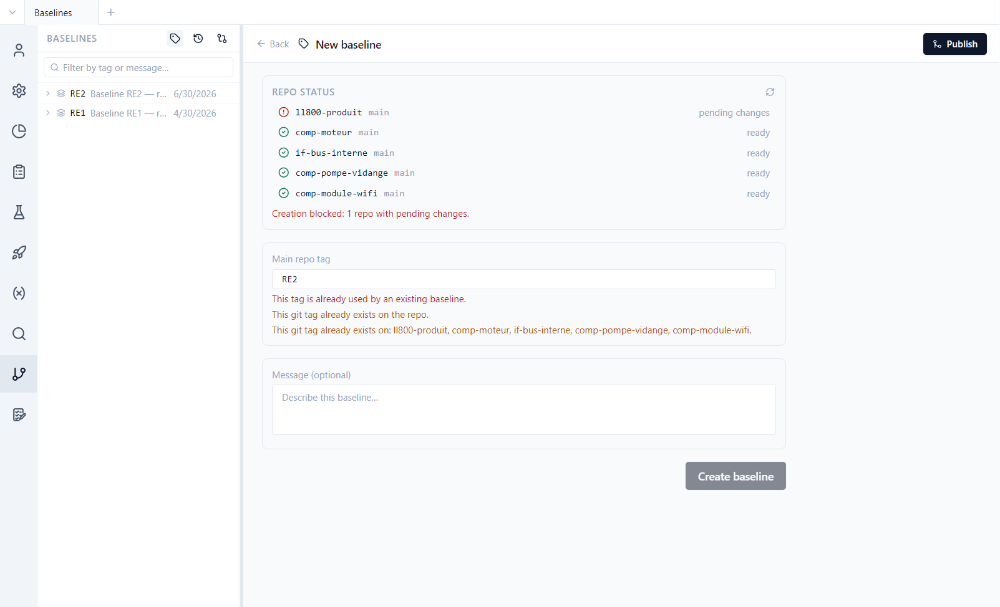
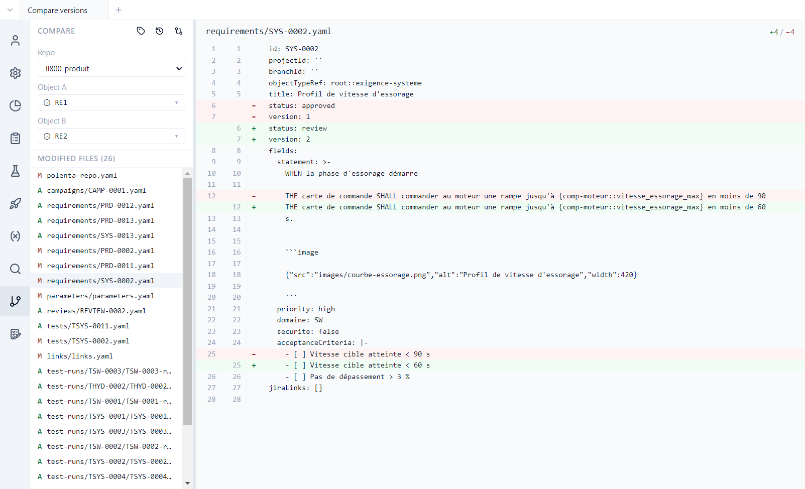
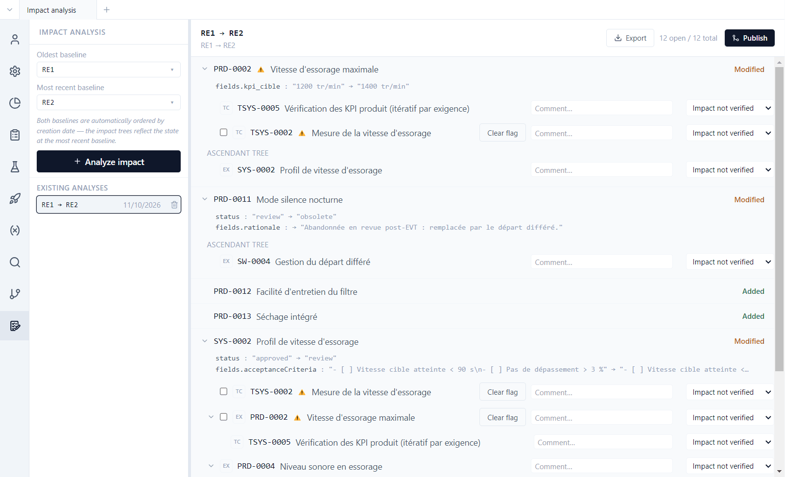

# 7. Versions and baselines

**English** | [Français](../tutoriels/07-versions.md)

Polenta relies on git for history, teamwork and reference versions, without requiring you to know
git. This tutorial shows how to publish, read the history, set a baseline, compare two versions and
analyse the impact of a change.

## Publish

Changes made in Polenta are first saved on your machine. **Publish**, top right of every view,
shares them with the team:

1. Give the change a **title** ("Spin speed 1600 rpm"…).
2. Polenta records the change under that title, merges it into the repository's main branch and
   sends it to the git server.

If the change touches a component, the component is published first, then the product, which
records the component's new version. If a colleague changed the same item, Polenta offers to
resolve the conflict field by field.

The demo is a clone of public repositories: publishing there will fail when sending. Experiment
without publishing, or on a copy pushed to your own repositories.

## History

**Version** view: for each repository, the pending changes, then the **version tree**.

- Each row is a published change, with its author and date. Labels show branches (`main`,
  `dev-essorage-1600`) and baselines (`RE1`, `RE2`).
- The `dev-essorage-1600` branch is an ongoing study, not merged yet: 1600 rpm spin speed and a
  steam programme.
- In the panel, **Modifications** lists the changed, unpublished files. On opening, Polenta adds
  `AGENTS.md` there, the guide for AI agents ([tutorial 8](08-ai-agent.md)).

## Baselines

A **baseline** is a reference version of the whole project, set at a milestone (design review,
delivery). Polenta sets it as a git tag on **all repositories** at once. The demo has two: RE1
(design review no. 1, April) and RE2 (after the EVT tests, June).

The **Baselines** button (tag icon, at the top of the Version panel) lists them and opens the
creation form:

Polenta checks the state of each repository: a baseline can only be set on repositories without
pending changes (here, `AGENTS.md` blocks the creation). A test campaign is attached to a baseline:
the requirements and parameters verified are those of that version.

## Compare two versions

**Compare two versions** (crossed arrows icon): choose the repository, then two branches,
baselines or commits.

The list of changed files (added `A`, modified `M`) appears; a click shows the line-by-line
differences. Between RE1 and RE2, SYS-0002 went back from `approved` to `review` at version 2, with
an acceleration ramp shortened from 90 to 60 s.

## Analyze the impact

**Impact analysis** view: choose two baselines, then **Analyze impact**.

For each item added, modified or made obsolete between the two versions:

- the detail of the changed fields (PRD-0002: `kpi_cible` from 1200 to 1400 rpm);
- the **tree** of linked items: tests that verify it, requirements it refines (ascendant tree);
- for each, a comment and a tracking status, from *Impact not verified* to *Modification
  verified*, through *No real impact* or *Modification to do*;
- **Clear flag** removes the *needs revalidation* marker once the item has been checked.

The analysis is saved in the repository (`impact-analyses/`) and is listed under **Existing
analyses**. **Export** produces it in Excel or PDF, for a review file.
