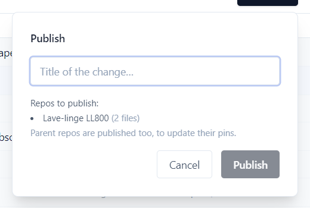
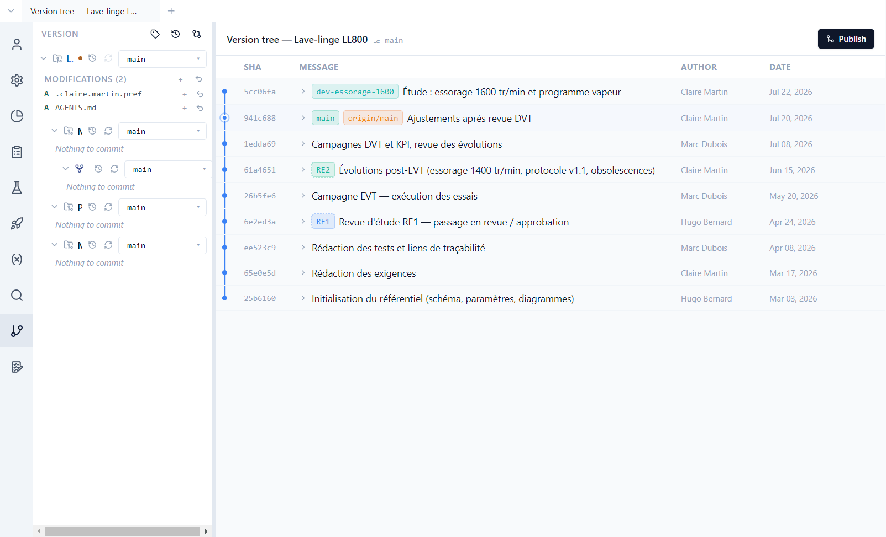
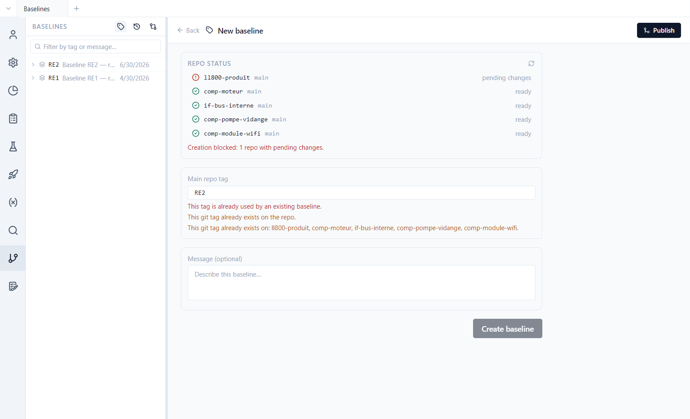
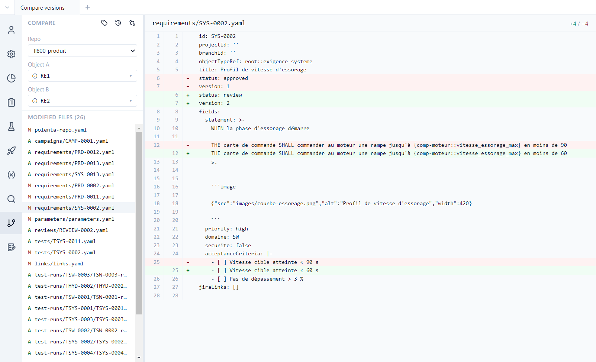

# 8. Publishing and history

**English** | [Français](../tutoriels/08-publier-historique.md)

Polenta relies on git for history, teamwork and reference versions, without requiring you to know
git. This tutorial shows how to publish, read the history and the differences, resolve a conflict,
set a baseline and compare two versions.

## Publish

Changes made in Polenta are first saved on your machine. **Publish**, top right of every view,
shares them with the team:

1. Give the change a **title** ("Spin speed 1600 rpm"…).
2. Polenta records the change under that title, merges it into the repository's **integration
   branch** and sends it to the git server.

If the change touches a component, the component is published first, then the product, which
records the component's new version. If a colleague changed the same item, Polenta opens conflict
resolution (below).

The demo is a clone of public repositories: publishing there will fail when sending. Experiment
without publishing, or on a copy pushed to your own repositories
([tutorial 11](11-team-projects.md)).

### The integration branch

Each repository has a designated **integration branch**, where the team pools its work; a
repository created by Polenta names it `int-…`. It is shown and changed in *Project › Data model ›
Structure*, on the repository's row; **New branch…** creates another one.

- As soon as you modify a repository that is on its integration branch, Polenta sets your work
  aside on a local `dev-auto` branch (never sent to the server): the integration branch can thus
  keep receiving colleagues' work. **Publish** then merges your work into the integration.
- On another branch (a `dev-…` study, for example), the **Publish** window warns you: *Publishing
  will merge this branch into … then push …*. Unchecking **Merge into …** publishes the branch
  alone, without touching the integration.

## History

**Version** view: for each repository, the pending changes, then the **version tree**.

- Each row is a published change, with its author and date. Labels show branches (`main`,
  `dev-essorage-1600`), baselines (`RE1`, `RE2`) and version tags (`ll800-produit-1.0`).
- The `dev-essorage-1600` branch is an ongoing study, not merged yet: 1600 rpm spin speed and a
  steam programme.
- In the panel, **Modifications** lists the changed, unpublished files. On opening, Polenta adds
  `AGENTS.md` there, the guide for AI agents ([tutorial 12](12-ai-agent.md)).
- The top of the panel gives access to the **versions** of the product and of the components
  ([tutorial 9](09-versions.md)), to **Baselines**, to **Compare two versions** and to the
  **Terminal**.

## Reading the differences

A click on a changed file, or on a file of a published change, opens its **differences**:

- **Rendered** shows an item field by field, *Before* / *After* columns, with the change
  highlighted to the character; **Hide unchanged** keeps only what moved. **Raw** shows the raw file
  line by line.
- **Side by side** or **Inline**; **F7** / **Shift+F7** go to the next or previous change.
- For a local change not yet published, the *After* side is **editable**: **Restore** takes back the
  previous value for a block, **Add** completes a list, **Save** (Ctrl+S) writes the file.
  Differences between two published changes are read-only.

## Resolving a conflict

When a colleague has modified the same lines, the **Conflicts** view shows each conflict with *My
changes* on the left and *Destination* on the right:

- block by block: **← Take left**, **Take right →**, **Take both**, or **Take ancestor** (the
  common version from before the two changes);
- or all at once: **Take all left** / **Take all right**;
- **F7** goes to the next conflict, **Ctrl+Z** / **Ctrl+Y** undo and redo; each handled block
  carries *✓ Resolved*. Once everything is resolved, the merge completes and publishing resumes.

## The terminal

For those who know git, **Terminal** (at the top of the Version panel, or **Ctrl+`**) opens a real
Git Bash at the bottom of the window, with **Go to …** to move into a repository's folder. It
requires Git for Windows; if it is missing, Polenta offers **Install Git**. The terminal does not
exist in the web client.

## Baselines

A **baseline** is a reference version of the whole project, set at a milestone (design review,
delivery). Polenta sets it as a git tag on **all repositories** at once. The demo has two: RE1
(design review no. 1, April) and RE2 (after the EVT tests, June).

The **Baselines** button (tag icon, at the top of the Version panel) lists them and opens the
creation form:

Polenta checks the state of each repository: a baseline can only be set on repositories without
pending changes (here, `AGENTS.md` blocks the creation).

The baseline is a documentary landmark, to compare or find the state of a milestone. What is
delivered and tested is tracked by **versions** ([tutorial 9](09-versions.md)): they are what test
executions and validations refer to. In the demo, the washing machine's `1.0` version carries the
`ll800-produit-1.0` tag, and the motor's `1.2.4` the `comp-moteur-1.2.4` tag.

## Compare two versions

**Compare two versions** (crossed arrows icon): choose the repository, then two branches,
baselines or commits.

The list of changed files (added `A`, modified `M`) appears; a click shows the differences, in
**Rendered** or **Raw**. Between RE1 and RE2, SYS-0002 went back from `approved` to `review` at
version 2, with an acceleration ramp shortened from 90 to 60 s.

## Exercises

The demo clones public repositories: sending to the server fails. These exercises stop before, or
accept that sending fails after a local merge.

**Prepare a publication.**
1. Change PRD-0005's title.
2. **Publish**: read the list of changes, give a title.
3. **Cancel**.

Result: the window lists PRD-0005 (and `AGENTS.md`); nothing is published.

**Compare a study branch.**
1. **Compare two versions**, product repository: `main`, then `dev-essorage-1600`.

Result: PRD-0002 is modified (status `review`, KPI 1600 tr/min), PRD-0014 is added, and
`vitesse_essorage` goes from 1400 to 1600 in `parameters/parameters.yaml`.

**Resolve a conflict.**
1. On `main`, change PRD-0002's *KPI cible* (`1450 tr/min`), then **Publish**: the local merge
   happens, sending fails (*Merged locally, but the push failed*).
2. *Project › Data model › Structure*: switch the product repository to `dev-essorage-1600`.
3. **Publish**, with **Merge into main** ticked.
4. In the **Conflicts** view, keep one of the two KPI values, then finish.

Result: PRD-0002 is in conflict on the KPI; once the block is resolved (*✓ Resolved*), the merge
completes. Sending then fails, as in step 1.

**Compare two baselines.**
1. **Compare two versions**, product repository: RE1, then RE2.
2. Open `parameters/parameters.yaml`, then SYS-0002.

Result: `vitesse_essorage` goes from 1200 to 1400; SYS-0002 goes from `approved` to `review`, at
version 2.

**Read the history in the terminal.**
1. **Terminal**, **Go to …** the product repository, then `git log --format="%an %ad %s" --date=short`.

Result: the changes by Hugo Bernard, Claire Martin and Marc Dubois, from the initialisation in
March to the abandonment of the 1.1 fix in July, including `[version] LLV-0001 1.0 released`.
