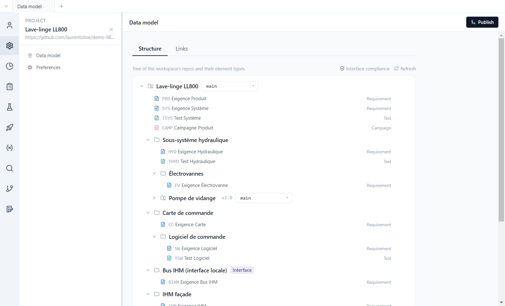

# Polenta tutorials

**English** | [Français](../tutoriels/README.md)

A guided tour of Polenta, from the git account to the validation of a version, mostly on the demo
project, the **LL800** washing machine: requirements, tests, campaigns, parameters, traceability,
tracking, publishing, versions, issues, validation, teamwork and working with an AI agent. Each
tutorial shows where to click and what to look at.

## Path

| # | Tutorial | What it covers |
|---|---|---|
| 1 | [Account and login](01-account-login.md) | installing Polenta, creating a GitHub or Forgejo account, connecting Polenta, the Account panel, the web client |
| 2 | [Getting started](02-getting-started.md) | opening the demo, the interface and navigation, the data model, the files on disk |
| 3 | [Requirements](03-requirements.md) | table and document views, saved views, the four statuses, editor, EARS, links, transition constraints |
| 4 | [Tests and campaigns](04-tests-campaigns.md) | test cases, run fields, campaigns, execution and tested version, execution history, Excel |
| 5 | [Parameters](05-parameters.md) | parameter base, `{name}` references, "Used by" |
| 6 | [Traceability](06-traceability.md) | link types, verification (coverage), impact to check, interface compliance |
| 7 | [Tracking and search](07-tracking.md) | dashboards, queries and scripts, computed columns, multi-repo search |
| 8 | [Publishing and history](08-publishing-history.md) | publishing, integration branch, differences, conflicts, terminal, baselines, comparison |
| 9 | [Versions and impact analysis](09-versions.md) | component and product versions, backlog, impact analysis, tests to run, releasing |
| 10 | [Issues and validation](10-issues-validation.md) | issues, validating a version requirement by requirement, signature |
| 11 | [Team projects](11-team-projects.md) | creating a project or a component on the server, opening an existing repository, members and visibility |
| 12 | [Working with an AI agent](12-ai-agent.md) | MCP server, `AGENTS.md`, bulk import and update |

The tutorials follow each other, but each one can be read on its own once you are logged in
(tutorial 1) and the demo is open (tutorial 2). Tutorials 9 to 11 leave the demo: they add types or
create repositories.

## The demo project

The LL800 front-loading washing machine (8 kg, 1400 rpm) is a complete project, with several months
of history, several authors and two baselines. It is spread over **five git repositories**:

| Repository | Role |
|---|---|
| `ll800-produit` | root repository: product (PRD) and system (SYS) requirements, system tests, campaigns, dashboards |
| `comp-moteur` | reusable component: BLDC motor and inverter |
| `comp-pompe-vidange` | reusable component: drain pump, pinned to tag `v2.0` |
| `comp-module-wifi` | reusable component: Wi-Fi module, deliberately without tests |
| `if-bus-interne` | **interface**: internal bus requirements, with the `controller` and `device` roles |

The product repository also holds **local** components (hydraulic subsystem, control board and its
software, user interface, UI bus). The demo deliberately contains defects to find: uncovered
requirements, failing tests, items to revalidate, a non-EARS statement, unresolved parameters. It
declares no versions, issues or validations.

The demo's content (titles, statements, type names) is in French; the screenshots show the English
interface. They were taken with Polenta 0.0.8, on the demo generated by
`scripts/demo-lave-linge/generate.mjs`; some screens have changed since (activity bar, campaigns),
and the more recent features do not have a screenshot yet.
