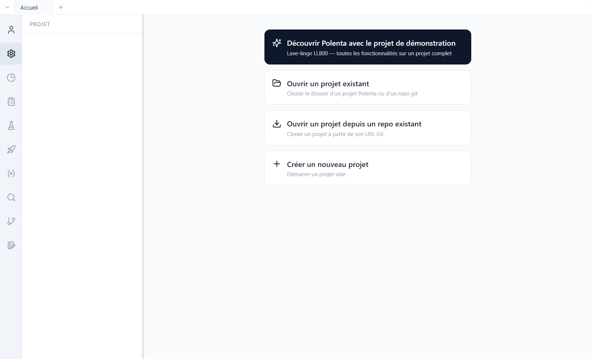

# 1. Prise en main

[English](../tutorials/01-getting-started.md) | **Français**

Ce tutoriel ouvre le projet de démonstration, présente l'interface et le modèle de données, puis
montre ce que Polenta écrit sur le disque.

## Ouvrir la démo

Sans projet ouvert, Polenta affiche son écran d'accueil.



1. Cliquer sur **Découvrir Polenta avec le projet de démonstration**.
2. Choisir un dossier **vide** : Polenta y clone le dépôt produit puis ses composants.
3. Le projet s'ouvre sur son **modèle de données**.

Les autres choix de l'accueil servent aux vrais projets : ouvrir un dossier déjà présent sur le
poste, cloner un projet depuis son URL git, ou créer un projet vide.

## L'interface

- La **barre d'activité**, à gauche, change de vue : Compte, Projet, Suivi, Exigences, Tests,
  Campagnes, Paramètres, Recherche, Version, Analyse d'impact. Un clic droit masque un bouton, un
  glisser-déposer les réordonne.
- Le **panneau latéral** affiche le contenu de la vue : arborescence des exigences, liste des
  campagnes, dashboards…
- La **zone principale** affiche l'élément ouvert. Chaque vue s'ouvre dans un **onglet** (en haut) ;
  **Ctrl+T** ouvre un nouvel onglet.
- Le bouton **Publier**, en haut à droite, partage les modifications (voir le
  [tutoriel 7](07-versions.md)).

## Le modèle de données

*Projet > Modèle de données*, onglet **Structure** : l'arbre des dépôts du projet et des types
d'éléments de chacun.


- Chaque **type d'élément** a un préfixe (`PRD`, `SYS`, `TSYS`…), une catégorie (exigence, test ou
  campagne), ses champs, ses statuts. Le crayon d'un type ouvre sa définition.
- Les **composants locaux** (dossiers) découpent le produit dans le même dépôt : *Sous-système
  hydraulique*, *Carte de commande › Logiciel de commande*…
- Les **composants réutilisables** (icône de dépôt) sont d'autres dépôts git, montés à une version
  précise : *Pompe de vidange* est figée sur le tag `v2.0`. On peut les partager entre plusieurs
  produits ; dans le produit ils sont en lecture seule.
- Une **interface** (badge *Interface*) décrit un échange entre composants, avec des rôles
  (maître / esclave, controller / device). Voir le [tutoriel 5](05-tracabilite.md).

L'onglet **Liens** définit les types de liens autorisés entre éléments (raffinement,
implémentation, vérification…).

Tout est configurable : les noms des types, des champs et des statuts sont ceux de l'équipe, pas
ceux de l'outil.

## Sur le disque

Un projet Polenta est un dossier de fichiers texte versionnés par git. Une exigence est un fichier
YAML lisible et comparable ligne à ligne :

```yaml
# ll800-produit/requirements/PRD-0002.yaml
id: PRD-0002
objectTypeRef: root::exigence-produit
title: Vitesse d'essorage maximale
status: approved
version: 1
fields:
  statement: THE lave-linge SHALL essorer à une vitesse maximale de {vitesse_essorage} en programme Coton.
  priority: high
  source: Marketing
  kpi_cible: 1400 tr/min
  acceptanceCriteria: '- [ ] Vitesse mesurée au tachymètre ≥ {vitesse_essorage} − 2 %'
```

| Dossier | Contenu |
|---|---|
| `requirements/`, `tests/`, `campaigns/` | un fichier par élément |
| `links/links.yaml` | tous les liens de traçabilité du dépôt |
| `parameters/parameters.yaml` | la base de paramètres |
| `test-runs/` | les résultats d'exécution |
| `queries/`, `dashboards/` | les requêtes et dashboards partagés |
| `.polenta/schema.yaml` | le modèle de données |
| `polenta-repo.yaml` | les composants réutilisés et leur version |

L'historique, les auteurs et les dates viennent de git : aucune base de données à part.
