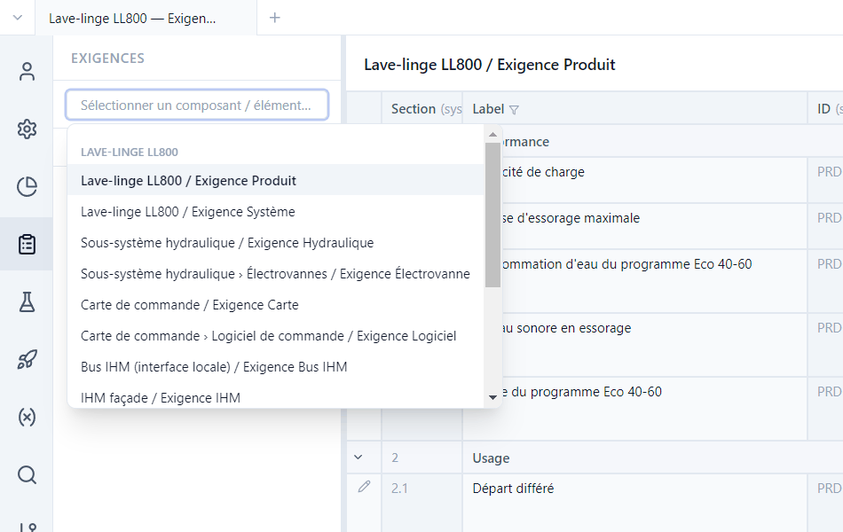
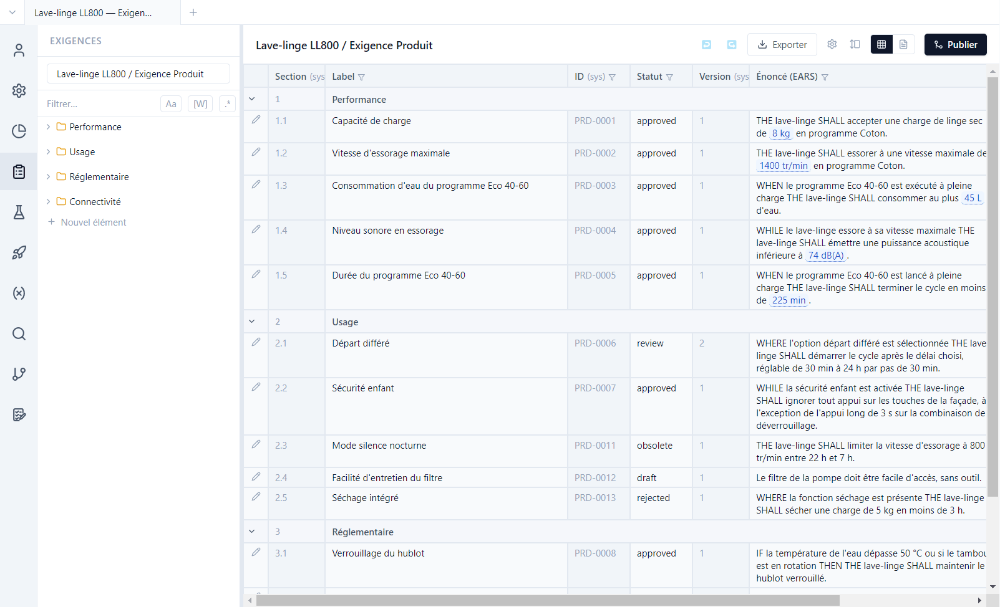
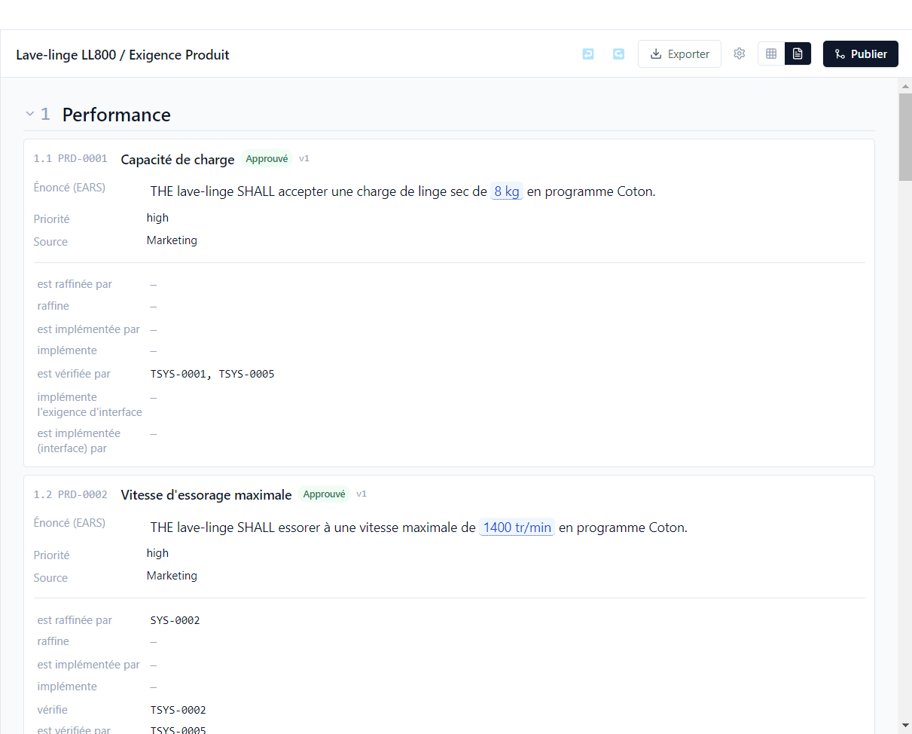
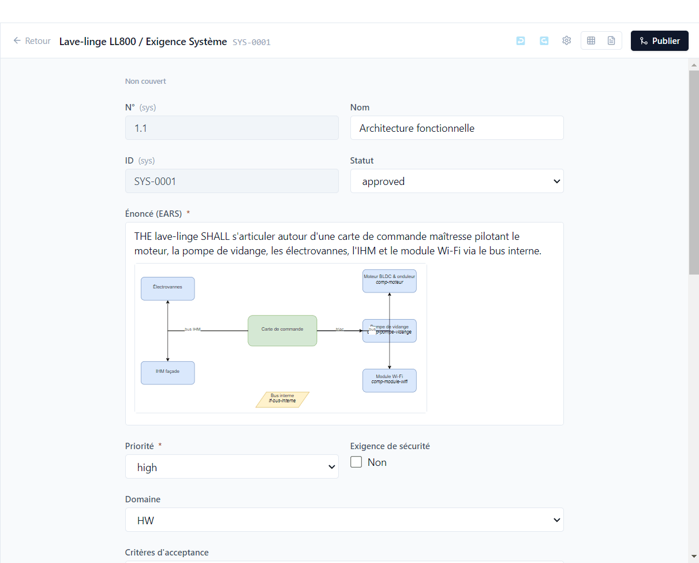
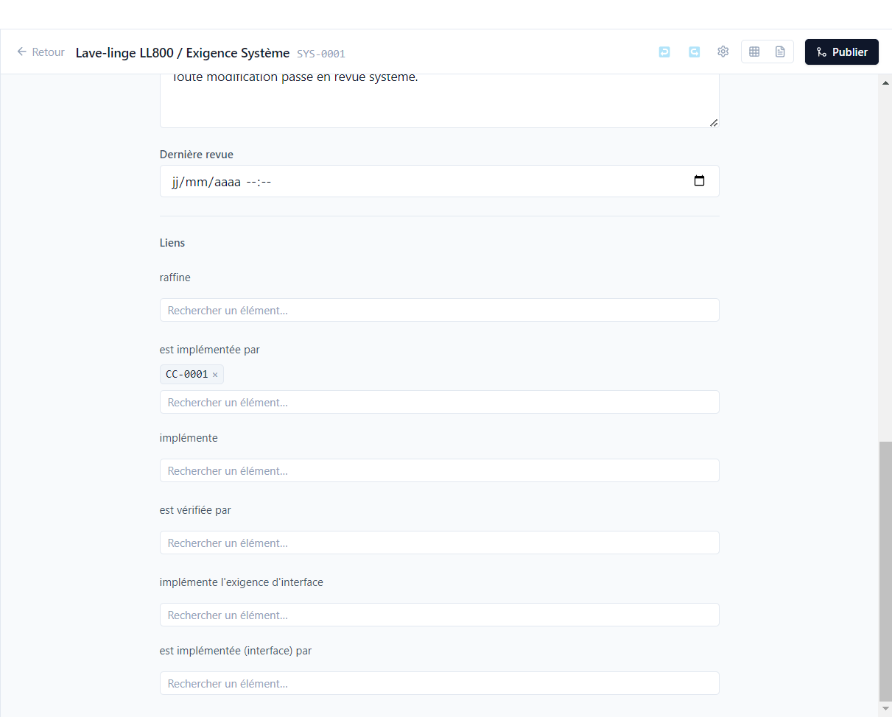

# 2. Exigences

[English](../tutorials/02-requirements.md) | **Français**

Ce tutoriel parcourt les exigences de la démo : les listes, l'éditeur, la syntaxe EARS, les
diagrammes et les liens.

## Choisir un type d'exigence

Vue **Exigences** (barre d'activité). Le sélecteur en haut du panneau latéral liste chaque type
d'exigence de chaque composant : *Lave-linge LL800 / Exigence Produit*, *Sous-système hydraulique /
Exigence Hydraulique*, *Moteur BLDC & onduleur / Exigence Moteur*… Il se filtre au clavier.

Sous le sélecteur, l'arborescence range les exigences en **sections** (*Performance*, *Usage*,
*Réglementaire*…). **Nouvel élément** ajoute une exigence ; l'ID (`PRD-0014`…) est
attribué par Polenta et n'est jamais réutilisé, même après suppression.

## Vue tableau et vue document

La **vue tableau** montre une ligne par exigence et une colonne par champ.

- L'entonnoir d'une colonne la filtre ; **Configurer les colonnes** choisit les colonnes affichées.
- Les valeurs bleues soulignées (`8 kg`, `1400 tr/min`) sont des **paramètres** : la valeur vient
  de la base de paramètres ([tutoriel 4](04-parametres.md)).
- Les statuts suivent le cycle défini par le type : `draft`, `review`, `approved`, et deux statuts
  terminaux, `obsolete` (PRD-0011) et `rejected` (PRD-0013).
- **Exporter** produit un fichier Excel, Word ou PDF, avec un gabarit client au besoin.

La **vue document** (icône de page) présente les mêmes exigences comme un document de
spécification, avec leurs liens.

## L'éditeur

Le crayon d'une ligne ouvre l'éditeur. Ouvrir **SYS-0001** (*Exigence Système*, section
*Architecture*) :

- En haut, l'état de **couverture** de l'exigence (ici *Non couvert* : aucun test ne la vérifie,
  voir le [tutoriel 5](05-tracabilite.md)).
- Les champs viennent du type : texte, texte riche, liste, cases à cocher, date, utilisateur,
  nombre, diagramme… Une étoile marque un champ obligatoire.
- Le texte riche accepte des **diagrammes draw.io**, des images et des tableaux. Le diagramme
  d'architecture de SYS-0001 est un fichier `.drawio` du dépôt, affiché dans l'énoncé.
- **Retour** revient à la liste ; **↩ / ↪** annulent et rétablissent.

Chaque enregistrement est daté et attribué par git. Rouvrir une exigence approuvée (la repasser en
`review` ou `draft`) incrémente sa **version** : PRD-0006 en est à la version 2. Les éléments qui lui
sont liés sont alors marqués **à revalider** ([tutoriel 5](05-tracabilite.md)).

## Rédiger en EARS

Les énoncés suivent la syntaxe **EARS** (*Easy Approach to Requirements Syntax*), cinq formes
courtes et vérifiables :

| Forme | Modèle | Exemple de la démo |
|---|---|---|
| Ubiquitaire | `THE <système> SHALL <action>` | PRD-0001 |
| Événementielle | `WHEN <déclencheur> THE <système> SHALL <action>` | PRD-0003 |
| Conditionnelle | `WHILE <état> THE <système> SHALL <action>` | PRD-0004 |
| Optionnelle | `WHERE <option> THE <système> SHALL <action>` | PRD-0006 |
| Indésirable | `IF <condition> THEN THE <système> SHALL <action>` | PRD-0008 |

Le champ *Énoncé* d'un type porte le validateur `EARS`. L'énoncé de **PRD-0012** (« Le filtre de la
pompe doit être facile d'accès… ») ne le respecte pas : Polenta le signale dans les critères de
**maturité** des requêtes ([tutoriel 6](06-suivi.md)) et refuse un import en masse non conforme
([tutoriel 8](08-agent-ia.md)).

## Les liens

En bas de l'éditeur, une rubrique par type de lien, dans les deux sens : *raffine* / *est raffinée
par*, *implémente* / *est implémentée par*, *est vérifiée par*…

Taper un ID ou un titre dans **Rechercher un élément…** crée le lien ; la croix le supprime. Seuls
les éléments autorisés par le type de lien sont proposés, y compris ceux des autres dépôts :
SYS-0002 est implémentée par MOT-0001, une exigence du composant moteur.
