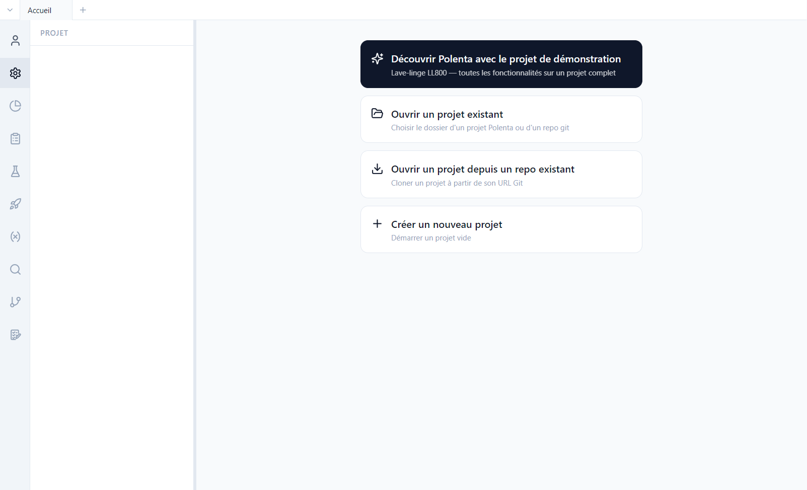
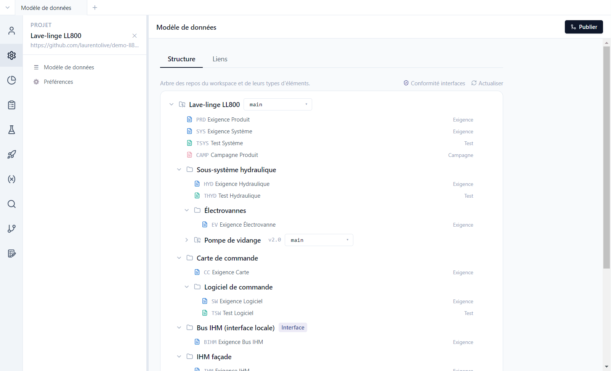

# 2. Prise en main

[English](../tutorials/02-getting-started.md) | **Français**

Ce tutoriel ouvre le projet de démonstration, présente l'interface et le modèle de données, puis
montre ce que Polenta écrit sur le disque. Il suppose un compte connecté
([tutoriel 1](01-compte-connexion.md)).

## Ouvrir la démo

Sans projet ouvert, Polenta affiche son écran d'accueil.



1. Cliquer sur **Découvrir Polenta avec le projet de démonstration**.
2. Choisir un dossier **vide** : Polenta y clone le dépôt produit puis ses composants.
3. Le projet s'ouvre sur son **modèle de données**.

Les autres choix de l'accueil servent aux vrais projets :

| Choix | Usage |
|---|---|
| **Ouvrir un projet existant** | un dossier déjà présent sur le poste |
| **Ouvrir un projet depuis un repo existant** | cloner un projet : choisi dans la liste des projets accessibles avec votre compte, ou par son URL git |
| **Créer un nouveau projet** | un projet vide, **Sur ce poste uniquement** ou **Sur un serveur (GitHub, Forgejo)** ([tutoriel 11](11-projets-equipe.md)) |
| **Projets de votre équipe** | sur un serveur Forgejo d'entreprise, les projets publiés pour vos équipes, à ouvrir d'un clic |

## L'interface

- La **barre d'activité**, à gauche, change de vue : Compte, Projet, Suivi, Exigences, Tests,
  Campagnes, Issues, Validation, Paramètres, Recherche, Version. Un clic droit masque un bouton (ou
  **Réinitialiser la disposition**), un glisser-déposer les réordonne.
- Le **panneau latéral** affiche le contenu de la vue : arborescence des exigences, liste des
  campagnes, dashboards… Un nouveau clic sur l'icône de la vue active le **replie** ou le déplie ;
  raccourci **Ctrl+B**.
- La **zone principale** affiche l'élément ouvert. Chaque vue s'ouvre dans un **onglet** (en haut) ;
  **Ctrl+T** ouvre un nouvel onglet.
- Le bouton **Publier**, en haut à droite, partage les modifications
  ([tutoriel 8](08-publier-historique.md)).

### Naviguer

- **Précédent** et **Suivant** (`<` `>`, à gauche des onglets), ou **Alt+←** / **Alt+→**, comme dans
  un navigateur ; un clic droit montre l'historique. Quitter une page aux modifications non
  enregistrées demande confirmation.
- Tout **ID** affiché qui désigne un autre élément (dans un tableau, un document, une fiche, une
  campagne, un résultat de recherche ou de dashboard…) est un **lien** : un clic ouvre l'élément,
  **Ctrl+clic** l'ouvre dans un nouvel onglet, un survol prolongé affiche un **aperçu**.
- **Zoom** de toute l'interface : **Ctrl+molette**, **Ctrl+=** / **Ctrl+-**, **Ctrl+0** pour revenir à
  100 %.

## Le modèle de données

*Projet > Modèle de données*, onglet **Structure** : l'arbre des dépôts du projet et des types
d'éléments de chacun.



- Chaque **type d'élément** a un préfixe (`PRD`, `SYS`, `TSYS`…), une catégorie (exigence, test,
  campagne, version, issue, validation), ses champs, ses statuts. Le crayon d'un type ouvre sa
  définition ; le **+** sur la ligne d'un composant lui ajoute un type.
- Les **composants locaux** (dossiers) découpent le produit dans le même dépôt : *Sous-système
  hydraulique*, *Carte de commande › Logiciel de commande*…
- Les **composants réutilisables** (icône de dépôt) sont d'autres dépôts git, montés à une version
  précise : *Pompe de vidange* est figée sur le tag `v2.0`. On peut les partager entre plusieurs
  produits ; dans le produit ils sont en lecture seule.
- Une **interface** (badge *Interface*) décrit un échange entre composants, avec des rôles
  (maître / esclave, controller / device). Voir le [tutoriel 6](06-tracabilite.md).
- Chaque dépôt affiche sa **branche d'intégration**, celle où l'équipe partage son travail
  ([tutoriel 8](08-publier-historique.md)) et, sur un serveur GitHub ou Forgejo, ses **Paramètres
  du repo** (engrenage au survol, [tutoriel 11](11-projets-equipe.md)).

L'onglet **Liens** définit les types de liens autorisés entre éléments (raffinement,
implémentation, vérification…).

Tout est configurable : les noms des types, des champs et des statuts sont ceux de l'équipe, pas
ceux de l'outil. Les règles facultatives (champs obligatoires sous condition, contraintes de
transition de statut) sont présentées au [tutoriel 3](03-exigences.md).

## Sur le disque

Un projet Polenta est un dossier de fichiers texte versionnés par git. Une exigence est un fichier
YAML lisible et comparable ligne à ligne :

```yaml
# ll800-produit/requirements/PRD-0002.yaml
id: PRD-0002
objectTypeRef: root::exigence-produit
title: Vitesse d'essorage maximale
status: approved
version: 1
fields:
  statement: THE lave-linge SHALL essorer à une vitesse maximale de {vitesse_essorage} en programme Coton.
  priority: high
  source: Marketing
  kpi_cible: 1400 tr/min
  acceptanceCriteria: '- [ ] Vitesse mesurée au tachymètre ≥ {vitesse_essorage} − 2 %'
```

| Dossier | Contenu |
|---|---|
| `requirements/`, `tests/`, `campaigns/` | un fichier par élément |
| `issues/`, `versions/`, `validations/` | un fichier par issue, version, validation ([tutoriels 9](09-versions.md) et [10](10-issues-validation.md)) |
| `links/links.yaml` | tous les liens de traçabilité du dépôt |
| `parameters/parameters.yaml` | la base de paramètres |
| `test-runs/` | les résultats d'exécution |
| `queries/`, `dashboards/` | les requêtes et dashboards partagés |
| `.polenta/schema.yaml` | le modèle de données |
| `.polenta/views/` | les vues enregistrées de l'équipe |
| `polenta-repo.yaml` | les composants réutilisés et leur version |

L'historique, les auteurs et les dates viennent de git : aucune base de données à part.
