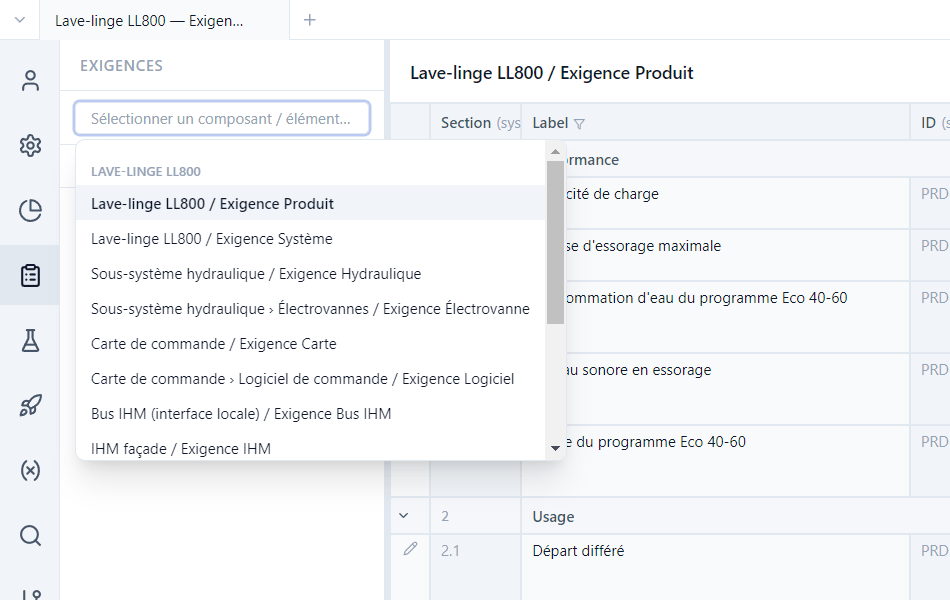
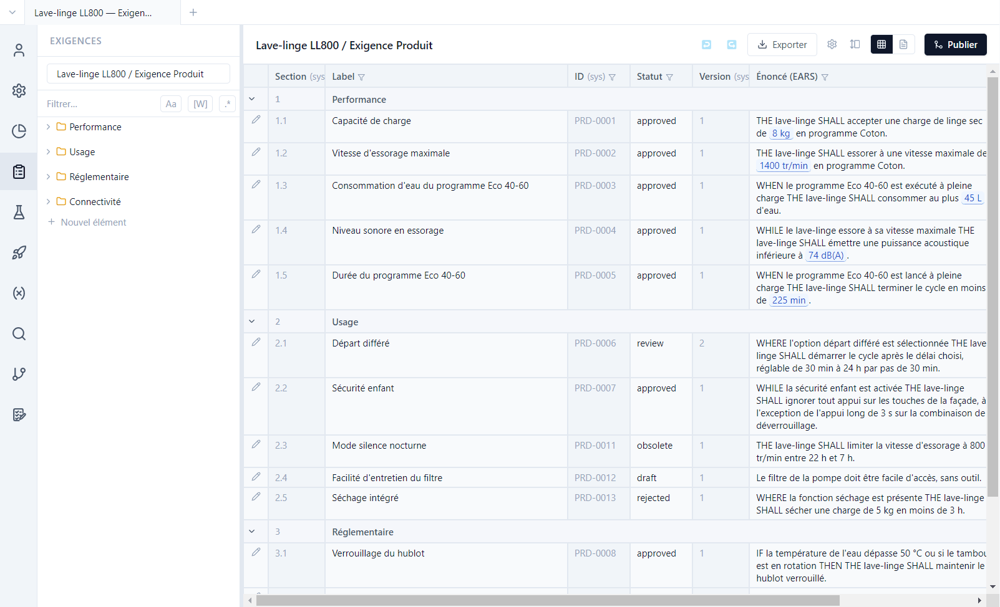
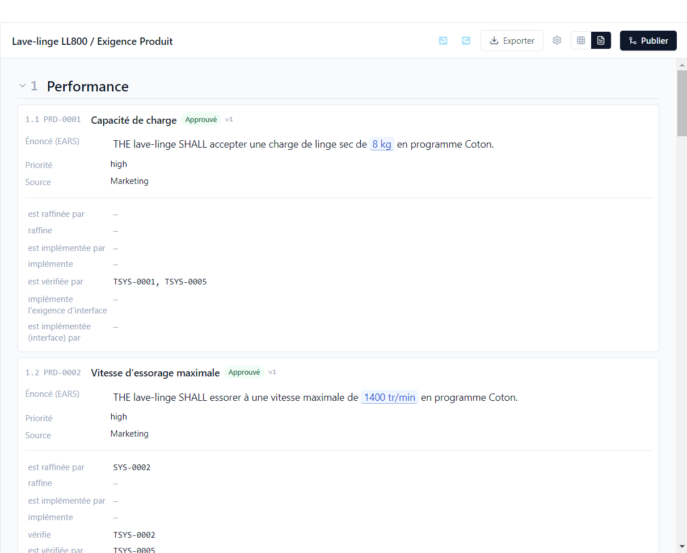
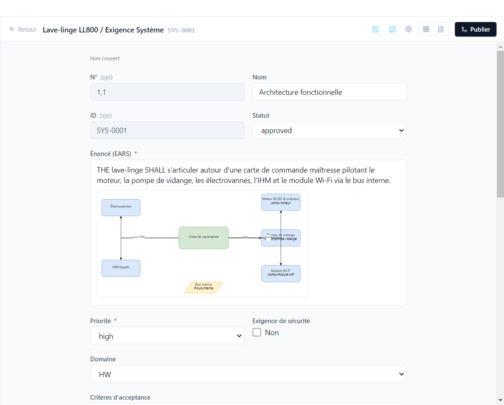
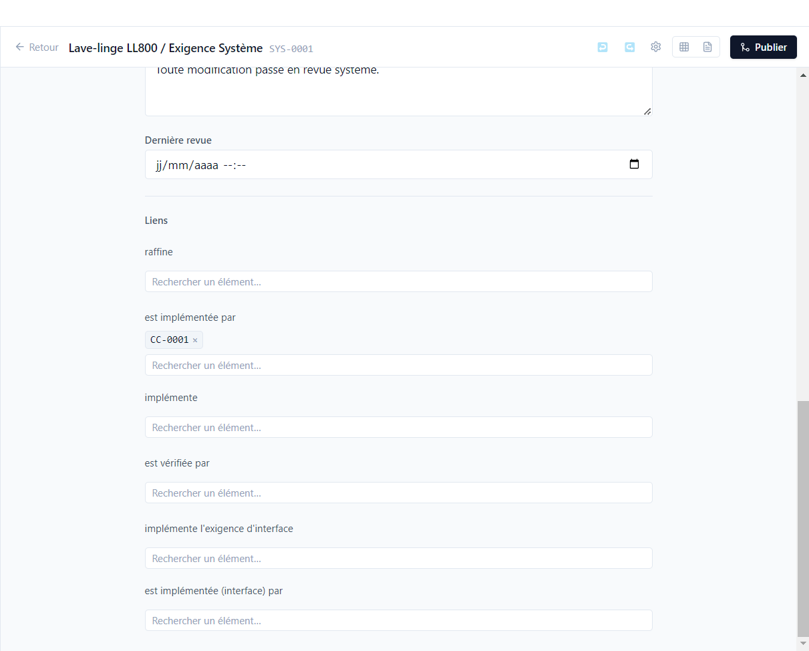

# 3. Exigences

[English](../tutorials/03-requirements.md) | **Français**

Ce tutoriel parcourt les exigences de la démo : les listes, les vues enregistrées, l'éditeur, la
syntaxe EARS, les diagrammes, les liens et les règles de passage d'un statut à l'autre.

## Choisir un type d'exigence

Vue **Exigences** (barre d'activité). Le sélecteur en haut du panneau latéral liste chaque type
d'exigence de chaque composant : *Lave-linge LL800 / Exigence Produit*, *Sous-système hydraulique /
Exigence Hydraulique*, *Moteur BLDC & onduleur / Exigence Moteur*… Il se filtre au clavier.

Sous le sélecteur, l'arborescence range les exigences en **sections** (*Performance*, *Usage*,
*Réglementaire*…). **Nouvel élément** ajoute une exigence ; l'ID (`PRD-0014`…) est attribué par
Polenta et n'est jamais réutilisé, même après suppression. Une exigence pas encore rangée apparaît en
fin de liste, triée par ID, jusqu'à ce qu'on la glisse dans une section.

## Vue tableau et vue document

La **vue tableau** montre une ligne par exigence et une colonne par champ.

- L'entonnoir d'une colonne la filtre (texte, casse, mot entier, expression régulière), y compris la
  colonne **Vérification** (*Non couvert*, *En échec*…).
- L'engrenage **⚙️ › Champs visibles** choisit les colonnes : champs du type, liens, **colonnes
  calculées** par le projet (par exemple *Dernier résultat* de campagne, ou une colonne par campagne,
  voir le [tutoriel 7](07-suivi.md)). Quand un type est à la fois source et cible d'un même lien, les
  deux sens ont chacun leur colonne (*raffine* / *est raffinée par*).
- Les valeurs bleues soulignées (`8 kg`, `1400 tr/min`) sont des **paramètres** : la valeur vient
  de la base de paramètres ([tutoriel 5](05-parametres.md)).
- Les statuts suivent le cycle défini par le type : `draft`, `review`, `approved`, et deux statuts
  terminaux, `obsolete` (PRD-0011) et `rejected` (PRD-0013).
- **Exporter** produit un fichier Excel, Word ou PDF, avec un gabarit client au besoin.

La **vue document** (icône de page) présente les mêmes exigences comme un document de
spécification, avec leurs liens. Passer d'une vue à l'autre garde l'exigence sélectionnée.

### Les quatre statuts d'une exigence

Une exigence a quatre statuts, que les colonnes facultatives de **⚙️ › Champs visibles** affichent
côte à côte :

| Statut | Ce qu'il dit | D'où il vient |
|---|---|---|
| **Rédaction** | brouillon, en revue, approuvée… | le statut saisi |
| **Design** | la première version livrée qui contient l'exigence dans son état actuel (`1.2.4`), « — » sinon | les versions ([tutoriel 9](09-versions.md)) |
| **Vérification** | *Non couvert*, *Couvert*, *Vérifié*, *En échec*, *À revalider* | les tests et leurs résultats ([tutoriel 6](06-tracabilite.md)) |
| **Validation** | la décision de la dernière validation signée, avec sa version (*Conforme (1.2.4)*) | les validations ([tutoriel 10](10-issues-validation.md)) |

Seule la rédaction est saisie ; les trois autres sont calculés à l'affichage.

### Les vues enregistrées

Un réglage de colonnes, de filtres et de tri s'enregistre comme **vue**, par la liste déroulante à
côté de ⚙️ :

- **Enregistrer sous…** : un nom, et une **portée** — *Personnelle* (pour vous seul) ou *Équipe*
  (écrite dans le dépôt, sous `.polenta/views/`, à publier pour la partager) ;
- la liste regroupe **Mes vues** et **Équipe** ; une vue modifiée depuis son chargement porte la
  mention *modifiée* ; **Enregistrer**, **Renommer**, **Supprimer**, **Colonnes par défaut**.

L'onglet **Popup** de ⚙️ choisit les champs affichés dans l'aperçu qui s'ouvre au survol d'un ID.

## L'éditeur

Le crayon d'une ligne ouvre l'éditeur. Ouvrir **SYS-0001** (*Exigence Système*, section
*Architecture*) :

- En haut, l'état de **vérification** de l'exigence (ici *Non couvert* : aucun test ne la vérifie,
  voir le [tutoriel 6](06-tracabilite.md)).
- Les champs viennent du type : texte, texte riche, liste, cases à cocher, date, utilisateur,
  nombre, diagramme, **lien** (un libellé et une URL : page web, fichier ou partage réseau)… Une
  étoile marque un champ obligatoire.
- Le texte riche accepte des **diagrammes draw.io**, des images et des tableaux. Le diagramme
  d'architecture de SYS-0001 est un fichier `.drawio` du dépôt, affiché dans l'énoncé.
- En bas, la section **Exécutions** liste tous les résultats des tests qui vérifient l'exigence
  ([tutoriel 4](04-tests-campagnes.md)).
- **↩ / ↪** annulent et rétablissent ; **Précédent** revient à la liste.

Chaque enregistrement est daté et attribué par git. Rouvrir une exigence approuvée (la repasser en
`review` ou `draft`) incrémente sa **version** : PRD-0006 en est à la version 2. Les éléments qui lui
sont liés sont alors marqués **Impact à vérifier** ([tutoriel 6](06-tracabilite.md)).

Changer de statut propose un **Commentaire du changement de statut** (facultatif) : il est gardé
dans l'historique de l'exigence, avec la date et l'auteur du changement.

## Rédiger en EARS

Les énoncés suivent la syntaxe **EARS** (*Easy Approach to Requirements Syntax*), cinq formes
courtes et vérifiables :

| Forme | Modèle | Exemple de la démo |
|---|---|---|
| Ubiquitaire | `THE <système> SHALL <action>` | PRD-0001 |
| Événementielle | `WHEN <déclencheur> THE <système> SHALL <action>` | PRD-0003 |
| Conditionnelle | `WHILE <état> THE <système> SHALL <action>` | PRD-0004 |
| Optionnelle | `WHERE <option> THE <système> SHALL <action>` | PRD-0006 |
| Indésirable | `IF <condition> THEN THE <système> SHALL <action>` | PRD-0008 |

Le champ *Énoncé* d'un type porte le validateur `EARS`. L'énoncé de **PRD-0012** (« Le filtre de la
pompe doit être facile d'accès… ») ne le respecte pas : Polenta le signale dans les critères de
**maturité** des requêtes ([tutoriel 7](07-suivi.md)), refuse un import en masse non conforme
([tutoriel 12](12-agent-ia.md)) et, si le type le demande, au passage de statut (ci-dessous).

## Les liens

En bas de l'éditeur, une rubrique par type de lien, dans les deux sens : *raffine* / *est raffinée
par*, *implémente* / *est implémentée par*, *est vérifiée par*…

Taper un ID ou un titre dans **Rechercher un élément…** crée le lien ; la croix le supprime. Seuls
les éléments autorisés par le type de lien sont proposés, y compris ceux des autres dépôts du
projet : SYS-0002 est implémentée par MOT-0001, une exigence du composant moteur.

## Les règles du type

Dans *Projet › Modèle de données*, la définition d'un type porte deux règles facultatives. La démo
n'en déclare aucune : les essayer sur un type de la démo.

**Obligatoire si.** La colonne **Oblig. si** de la table des champs rend un champ obligatoire sous
condition : `status = approved` (la justification n'est exigée qu'à l'approbation), ou une valeur
d'un autre champ (`priority = high`). Renommer le statut ou la valeur met la condition à jour.

**Contraintes de transition.** La section **Contraintes de transition** d'un type d'exigence, de
test ou d'issue contrôle le passage d'un statut à un autre :

1. **+ Ajouter une règle** : **Depuis** (facultatif, *Tout statut* par défaut) et **Vers** un statut ;
2. pour chaque condition — **Champs obligatoires remplis**, **Formats valides (EARS…)**, **Couverte
   par un test** — un niveau : **Aucun contrôle**, **Notification** (par défaut) ou **Blocage**.

Dans la liste des statuts de l'éditeur, une transition bloquée est grisée avec son motif ; une
transition notifiée reste possible, avec un avertissement et une notification *points à vérifier*
après le passage. Sans règle, le passage est libre.
