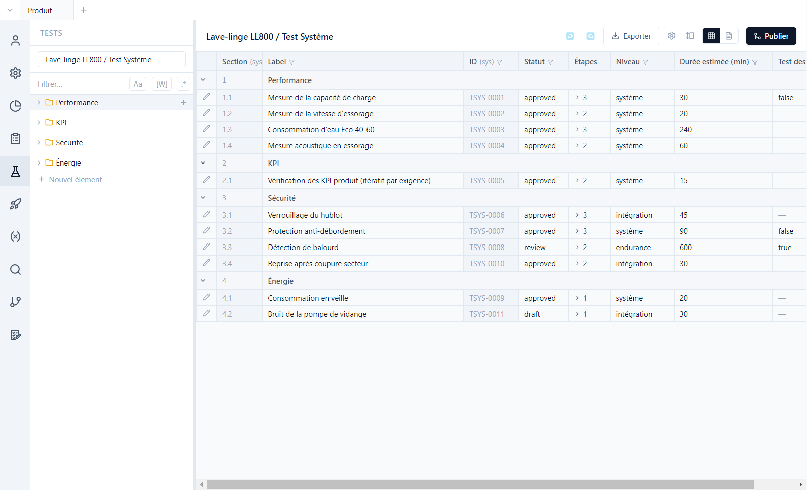
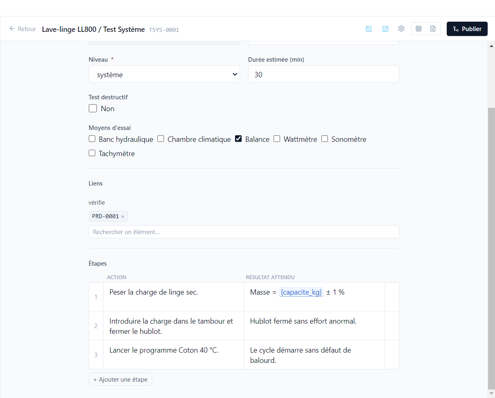
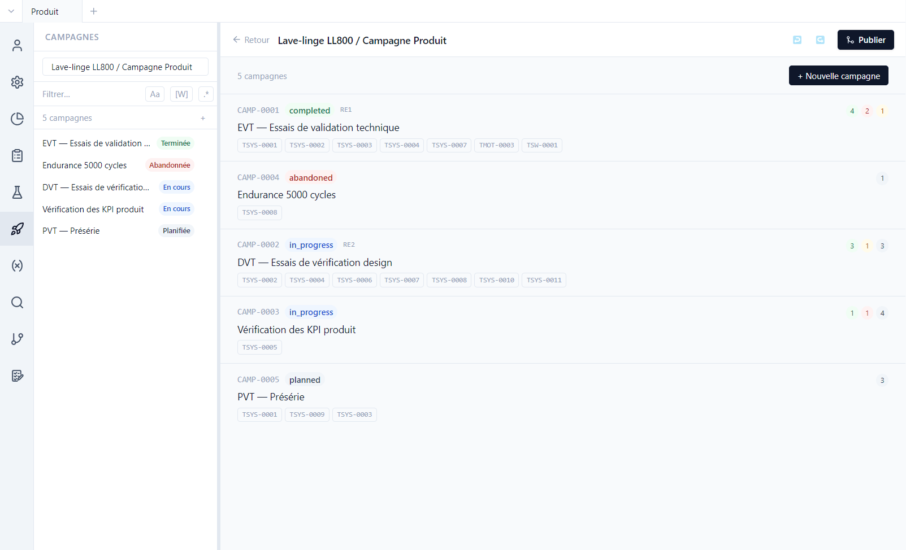
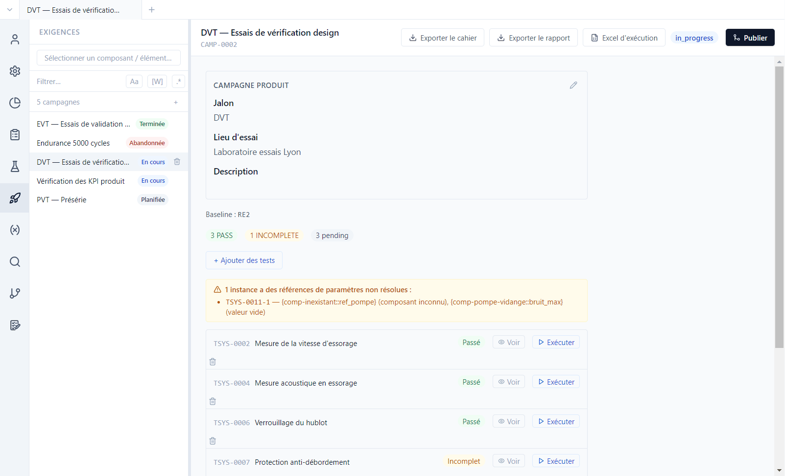
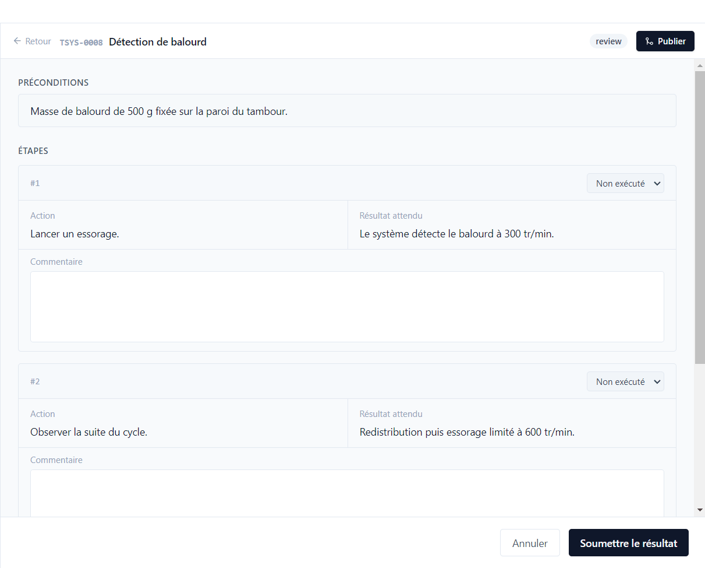

# 3. Tests et campagnes

[English](../tutorials/03-tests-campaigns.md) | **Français**

Un **cas de test** décrit comment vérifier une ou plusieurs exigences. Une **campagne** regroupe des
tests à exécuter ensemble, sur une version donnée du projet, et garde leurs résultats.

## Les cas de test

Vue **Tests**, type *Lave-linge LL800 / Test Système*. Comme les exigences, les tests sont rangés
en sections et listés en tableau, avec les champs de leur type : niveau, durée estimée, test
destructif…

Ouvrir **TSYS-0001** (*Mesure de la capacité de charge*) et descendre en bas de l'éditeur :

- **Liens** : TSYS-0001 *vérifie* PRD-0001. C'est ce lien qui rend l'exigence couverte.
- **Étapes** : une action et un résultat attendu par ligne ; **+ Ajouter une étape** en ajoute une.
  Le résultat attendu de l'étape 1 contient le paramètre `{capacite_kg}` : la valeur est figée au
  moment où le test entre dans une campagne.

Un test peut aussi itérer sur des exigences : TSYS-0005 (*Vérification des KPI produit*) vérifie le
`{req.kpi_cible}` de chaque exigence qu'on lui associe, avec une instance par exigence dans la
campagne CAMP-0003.

## Les campagnes

Vue **Campagnes**. La démo en compte cinq, une par jalon du projet :

| Campagne | Statut | Baseline |
|---|---|---|
| CAMP-0001 EVT | terminée | RE1 |
| CAMP-0002 DVT | en cours | RE2 |
| CAMP-0003 KPI | en cours | — |
| CAMP-0004 Endurance | abandonnée | — |
| CAMP-0005 PVT | planifiée | — |

Chaque ligne indique les tests de la campagne et le décompte des résultats. **+ Nouvelle
campagne** en crée une à partir des tests choisis.

## Une campagne en cours

Ouvrir **DVT — Essais de vérification design** :

- La **baseline** (RE2) fixe la version des exigences et des paramètres vérifiés. La même mesure
  attend 1200 tr/min dans la campagne EVT (baseline RE1) et 1400 tr/min dans la campagne DVT.
- Le bandeau orange signale une **référence de paramètre non résolue** dans TSYS-0011 : un
  composant inconnu et une valeur vide. Le test reste exécutable, mais le testeur est prévenu.
- Chaque test a son résultat (*Passé*, *Incomplet*, *En attente*), **Voir** pour relire la dernière
  exécution, **Exécuter** pour en faire une nouvelle.
- En bas, **Clore la campagne** ou **Abandonner**.

## Exécuter un test

**Exécuter** sur *TSYS-0008 Détection de balourd* :

1. Lire les **préconditions**.
2. Pour chaque étape, choisir le résultat (*Passé*, *Échoué*, *Bloqué*, *Ignoré*) et noter un
   commentaire si besoin.
3. Choisir le **résultat global** (*Passé*, *Échoué*, *Bloqué*, *Incomplet*) et **Soumettre le
   résultat**.

Le résultat est enregistré dans `test-runs/` du dépôt **du test** : un test du composant moteur
exécuté dans une campagne produit garde son résultat dans `comp-moteur`. Quand un test est exécuté
plusieurs fois, la dernière exécution fait foi : TSYS-0004, en échec en EVT, est passé en DVT.

## Hors de l'outil

En haut de la campagne :

| Bouton | Usage |
|---|---|
| **Exporter le cahier** | le plan de test, à imprimer ou à faire relire |
| **Exporter le rapport** | les résultats de la campagne |
| **Excel d'exécution** | un classeur à remplir au banc par les testeurs, puis à réimporter dans la campagne |
