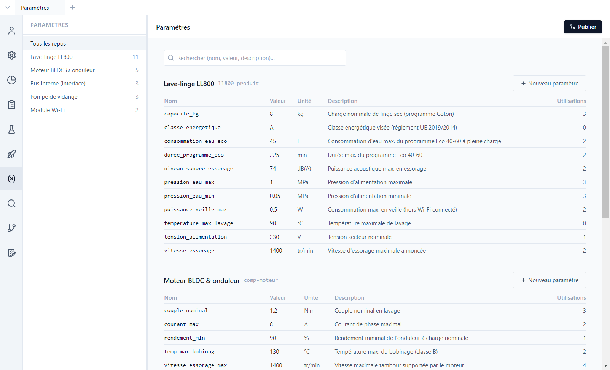
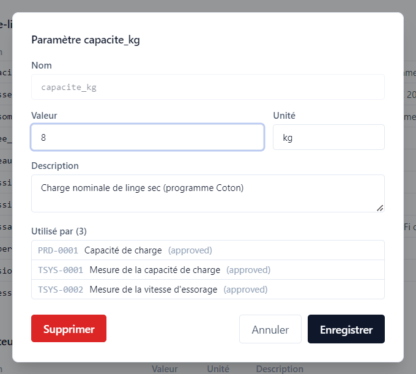

# 4. Paramètres

[English](../tutorials/04-parameters.md) | **Français**

Une valeur qui revient dans plusieurs exigences et tests (une capacité, une vitesse, une tension)
se déclare une fois dans la **base de paramètres** du dépôt. Les textes y font référence au lieu de
recopier la valeur.

## La base de paramètres

Vue **Paramètres** : un tableau par dépôt, avec le nombre de paramètres de chacun dans le panneau
latéral.

Chaque paramètre a un nom, une valeur, une unité, une description. La colonne **Utilisations**
compte les éléments qui y font référence. La base est stockée dans `parameters/parameters.yaml`,
dans chaque dépôt.

## Faire référence à un paramètre

Dans un champ texte, écrire le nom du paramètre entre accolades :

| Écriture | Paramètre visé |
|---|---|
| `{capacite_kg}` | paramètre du même dépôt |
| `{comp-moteur::vitesse_essorage_max}` | paramètre d'un composant monté dans le projet |

À l'affichage, la référence est remplacée par la valeur et l'unité, en bleu (`8 kg`). La démo
montre aussi les cas limites :

- SYS-0011 fait référence à `{comp-pompe-vidange::bruit_max}`, dont la valeur est **vide** : la
  référence est signalée non résolue. Dans une campagne, le test concerné porte un bandeau d'alerte.
- SYS-0012 fait référence à `{effort_fermeture_hublot}`, **absent** de la base : le texte reste tel
  quel. Dans un test, une telle référence locale est saisie à la main au moment de l'exécution
  (paramètre `charge_essai` de la campagne EVT).

## Qui utilise ce paramètre ?

Cliquer sur `capacite_kg` ouvre sa fiche :

**Utilisé par** liste les trois éléments qui y font référence. Changer la valeur est donc une
modification de ces trois éléments :

- les éléments **approuvés** qui l'utilisent sont marqués
  **à revalider** ([tutoriel 5](05-tracabilite.md)) ;
- **Supprimer** est refusé tant que le paramètre est utilisé.

Dans la démo, `vitesse_essorage` est passée de 1200 à 1400 tr/min entre les baselines RE1 et RE2 :
la comparaison des deux baselines le montre ([tutoriel 7](07-versions.md)).
