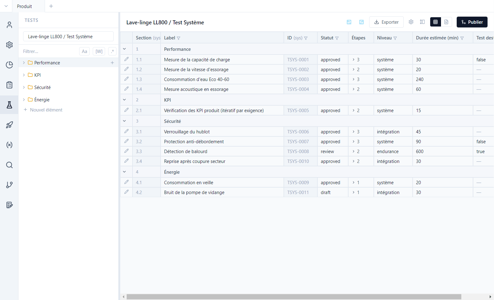
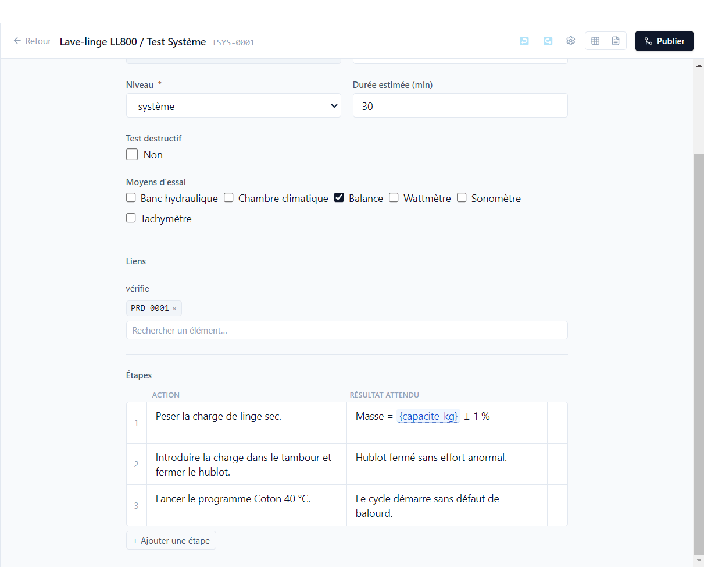
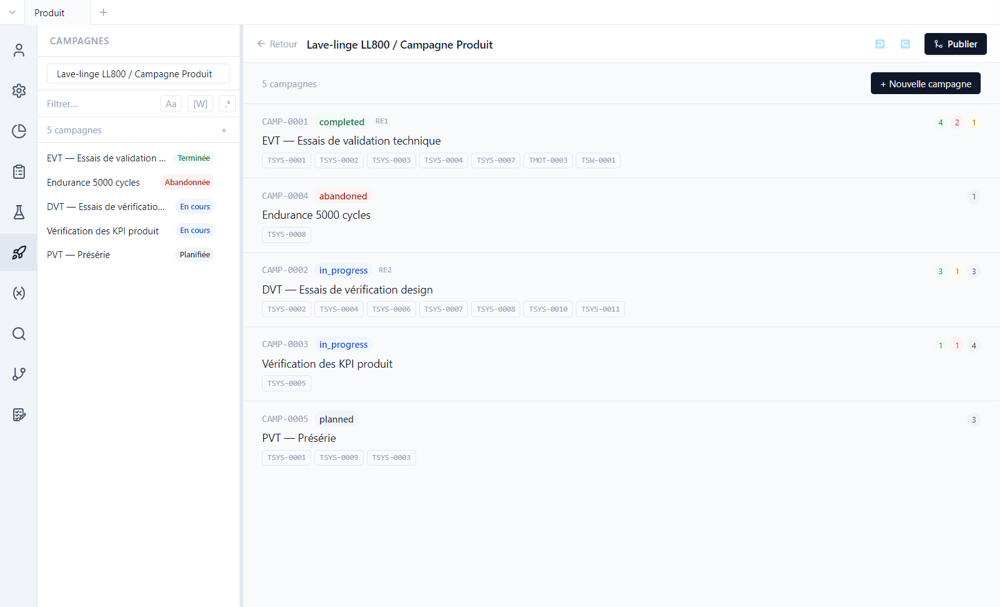
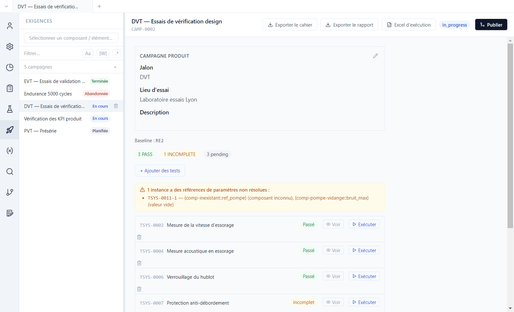
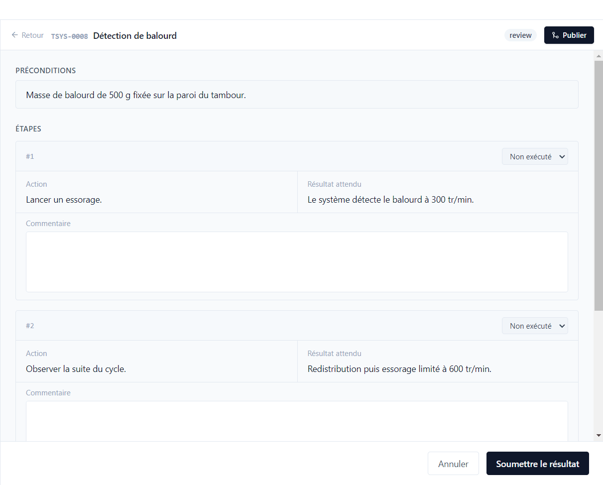

# 4. Tests et campagnes

[English](../tutorials/04-tests-campaigns.md) | **Français**

Un **cas de test** décrit comment vérifier une ou plusieurs exigences. Une **campagne** regroupe des
tests à exécuter ensemble et garde leurs résultats ; chaque résultat dit sur quelle **version** du
produit le test a été passé.

## Les cas de test

Vue **Tests**, type *Lave-linge LL800 / Test Système*. Comme les exigences, les tests sont rangés
en sections et listés en tableau, avec les champs de leur type : niveau, durée estimée, test
destructif…

Ouvrir **TSYS-0001** (*Mesure de la capacité de charge*) et descendre en bas de l'éditeur :

- **Liens** : TSYS-0001 *vérifie* PRD-0001. C'est ce lien qui rend l'exigence couverte.
- **Étapes** : une action et un résultat attendu par ligne ; **+ Ajouter une étape** en ajoute une.
  Le résultat attendu de l'étape 1 contient le paramètre `{capacite_kg}` : sa valeur est figée au
  moment où le test entre dans une campagne.
- **Exécutions** : la grille de tous les passages du test, toutes campagnes confondues (voir plus
  bas).

Un test peut aussi itérer sur des exigences : TSYS-0005 (*Vérification des KPI produit*) vérifie le
`{req.kpi_cible}` de chaque exigence qu'on lui associe, avec une instance par exigence dans la
campagne CAMP-0003.

### Les champs d'exécution

Le type de test peut déclarer, dans le modèle de données, des **Champs d'exécution** (saisis une
fois par passage : numéro de série de l'échantillon, banc utilisé…) et des **Champs d'étape**
(saisis à chaque étape : valeur mesurée…). La colonne **Oblig. si** les rend obligatoires selon le
résultat (`result = FAIL` : décrire l'écart). Ils apparaissent à l'exécution et dans le classeur
Excel d'exécution.

## Les campagnes

Vue **Campagnes**. La démo en compte cinq, une par jalon du projet :

| Campagne | Statut |
|---|---|
| CAMP-0001 EVT | terminée |
| CAMP-0002 DVT | en cours |
| CAMP-0003 KPI | en cours |
| CAMP-0004 Endurance | abandonnée |
| CAMP-0005 PVT | planifiée |

Chaque ligne indique les tests de la campagne et le décompte des résultats. **+ Nouvelle
campagne** en crée une à partir des tests choisis ; dans le sélecteur de tests, ⚙️ choisit les
colonnes affichées, sans perdre la sélection. Une campagne ne contient que des tests de son dépôt.

## Une campagne en cours

Ouvrir **DVT — Essais de vérification design** :

- Les valeurs de paramètres sont celles lues quand le test est entré dans la campagne : la même
  mesure attend 1200 tr/min dans la campagne EVT et 1400 tr/min dans la campagne DVT, créée après le
  changement de valeur.
- Le bandeau orange signale une **référence de paramètre non résolue** dans TSYS-0011 : un
  composant inconnu et une valeur vide. Le test reste exécutable, mais le testeur est prévenu.
- Chaque test a son résultat (*Passé*, *Incomplet*, *En attente*), **Voir** pour relire la dernière
  exécution, **Exécuter** pour en faire une nouvelle.
- En bas, **Clore la campagne** ou **Abandonner**.

## Exécuter un test

**Exécuter** sur *TSYS-0008 Détection de balourd* :

1. Lire les **préconditions**.
2. Indiquer la **Version testée** quand le dépôt déclare des versions
   ([tutoriel 9](09-versions.md)) : une version de la liste (en cours ou livrée), ou **Autre (texte
   libre)…**. La version de l'exécution précédente est proposée. **Structure testée** détaille la
   version de chaque composant et permet de noter un écart (un composant monté dans une autre
   version que prévu).
3. Pour chaque étape, choisir le résultat (*Passé*, *Échoué*, *Bloqué*, *Ignoré*), remplir les
   champs d'étape, noter un commentaire si besoin.
4. Remplir les champs d'exécution, choisir le **résultat global** (*Passé*, *Échoué*, *Bloqué*,
   *Incomplet*) et **Soumettre le résultat**.

Le résultat est enregistré dans `test-runs/` du dépôt **du test**, avec une copie figée de la
version et de la structure testées : un test du composant moteur exécuté dans une campagne produit
garde son résultat dans `comp-moteur`. Quand un test est exécuté plusieurs fois, la dernière
exécution fait foi : TSYS-0004, en échec en EVT, est passé en DVT.

**En cas d'échec**, Polenta propose de tracer le problème : *Exécution en échec — voulez-vous tracer
ce problème dans une issue ?*, avec **Créer une issue**, **Lier à une issue existante** ou
**Ignorer** ([tutoriel 10](10-issues-validation.md)).

## L'historique des exécutions

En bas de la fiche d'un test, et de celle d'une exigence, la section **Exécutions** liste tous les
passages : verdict, date, testeur, durée, campagne, version du test, **version testée**, écarts,
origine (*saisie* ou *import Excel*)… **Colonnes** choisit les colonnes, **Afficher les étapes**
détaille chaque passage. C'est l'endroit pour répondre à « sur quelle version ce test a-t-il été
passé ? ».

## Hors de l'outil

En haut de la campagne :

| Bouton | Usage |
|---|---|
| **Exporter le cahier** | le plan de test, à imprimer ou à faire relire |
| **Exporter le rapport** | les résultats de la campagne |
| **Excel d'exécution** | **Exporter le classeur d'exécution…** à remplir au banc (étapes, champs d'exécution, version testée), puis **Importer des résultats…** : un aperçu sépare les lignes à importer, en erreur et en avertissement avant l'import |
