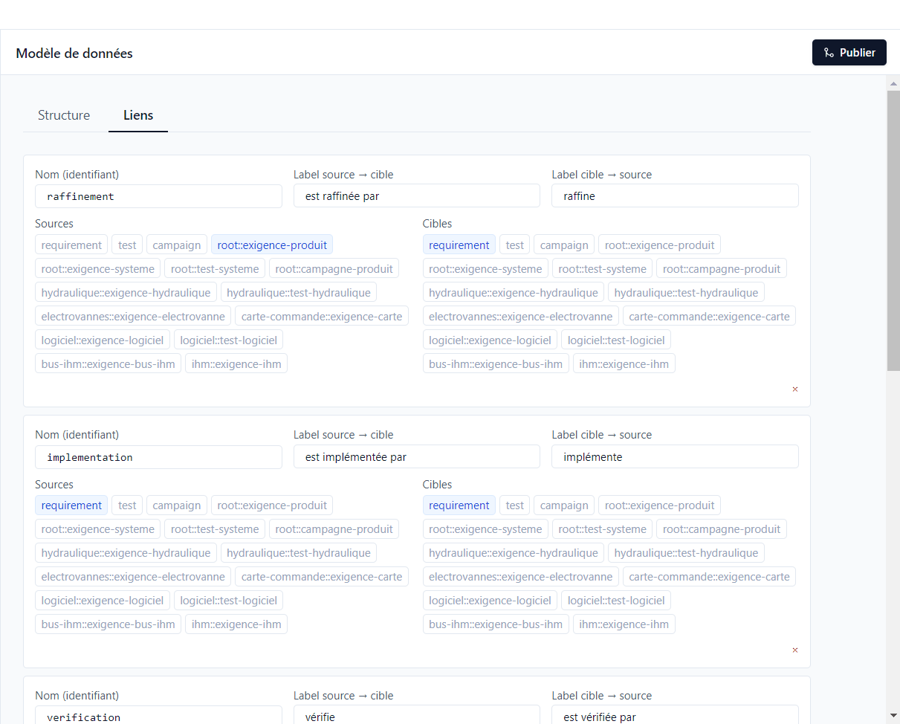
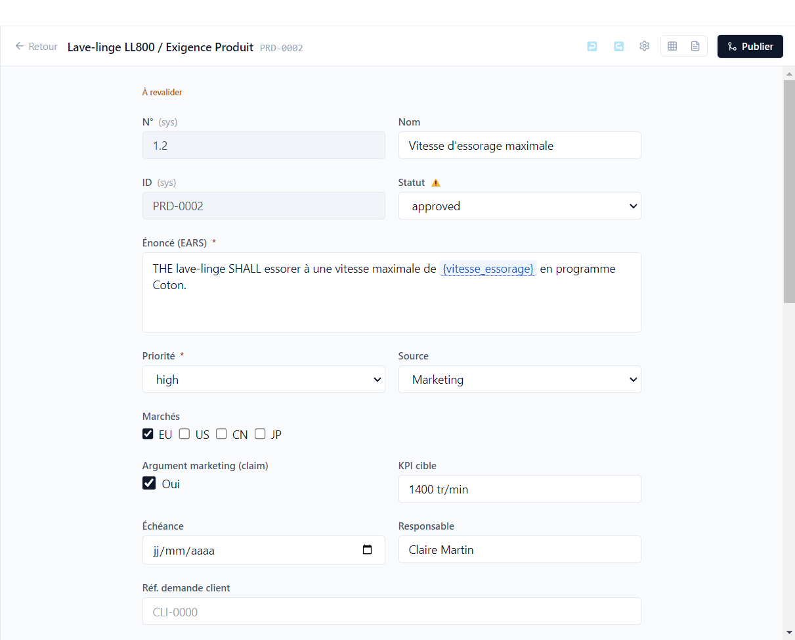
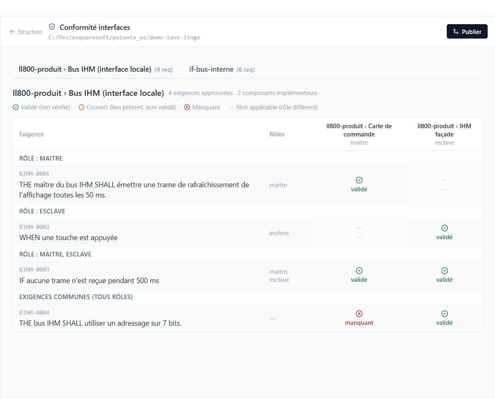

# 5. Traçabilité

[English](../tutorials/05-traceability.md) | **Français**

Polenta relie les besoins produit aux exigences système, aux composants qui les réalisent et aux
tests qui les vérifient. Ce tutoriel montre comment ces liens sont définis, ce que Polenta en
déduit et comment il signale un lien devenu douteux.

## Les types de liens

*Projet > Modèle de données*, onglet **Liens** :

Chaque type de lien a un nom, un libellé dans chaque sens (*est raffinée par* / *raffine*) et la
liste des éléments autorisés en source et en cible : une catégorie entière (`requirement`, `test`)
ou un type précis (`root::exigence-produit`). La démo en déclare cinq :

| Type | Sens | Exemple |
|---|---|---|
| raffinement | une exigence en détaille une autre | SYS-0002 raffine PRD-0002 |
| implémentation | un composant réalise une exigence | CC-0001 implémente SYS-0001 |
| vérification | un test vérifie une exigence | TSYS-0001 vérifie PRD-0001 |
| implémentation d'interface | une exigence de composant réalise une exigence d'interface | MOT-0006 implémente une exigence du bus interne |
| relation | lien libre, non contraint | — |

Le sens d'un lien de vérification n'a pas d'importance : créé depuis le test ou depuis l'exigence,
il compte de la même façon.

## La couverture

Chaque exigence porte un état de **couverture**, calculé à partir de ses liens de vérification et
du dernier résultat de chaque test lié. Il apparaît en haut de l'éditeur, dans les colonnes de la
vue tableau et dans les requêtes (colonne `coverageStatus`).

| État | Signification | Dans la démo |
|---|---|---|
| **Non couvert** | aucun test lié | SYS-0008, exigences du module Wi-Fi |
| **Couvert** | des tests liés, pas encore exécutés | SYS-0010 |
| **Validé** | le dernier résultat des tests liés est *Passé* | PRD-0001, SW-0001 |
| **En échec** | le dernier résultat d'un test lié n'est pas *Passé* (échec, blocage…) | PRD-0009 |
| **À revalider** | un élément lié a changé après approbation | PRD-0002, SYS-0002 |

## Les éléments à revalider

Quand une exigence approuvée est rouverte, ou qu'un paramètre utilisé change de valeur, Polenta ne
peut pas savoir si les éléments liés restent justes. Il les marque **à revalider** : un ⚠ à côté de
leur statut, et le bandeau *À revalider* en haut de l'éditeur.

Dans la démo, SYS-0002 (qui raffine PRD-0002) est repassée en revue ; PRD-0002 et le test
TSYS-0002 sont marqués. L'[analyse d'impact](07-versions.md#analyser-limpact) permet de vérifier
chaque élément et de lever le marqueur.

## La conformité des interfaces

Une **interface** regroupe les exigences d'un échange entre composants, avec des rôles. Chaque
composant qui implémente l'interface déclare son rôle, et doit couvrir les exigences de ce rôle.

*Projet > Modèle de données > Structure*, **Conformité interfaces** :

Pour le bus IHM (rôles maître et esclave), une ligne par exigence d'interface, une colonne par
composant qui l'implémente :

- *validé* : le composant a une exigence liée, et elle est validée par ses tests ;
- *couvert* : le lien existe, la validation manque ;
- *manquant* : aucune exigence du composant ne réalise celle de l'interface. Ici, la carte de
  commande (maître) ne couvre pas BIHM-0004 ;
- un tiret : l'exigence ne concerne pas le rôle de ce composant.
