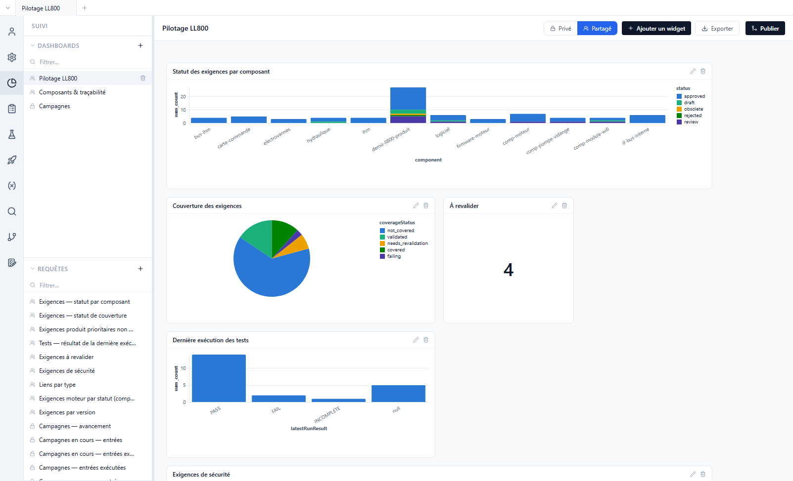
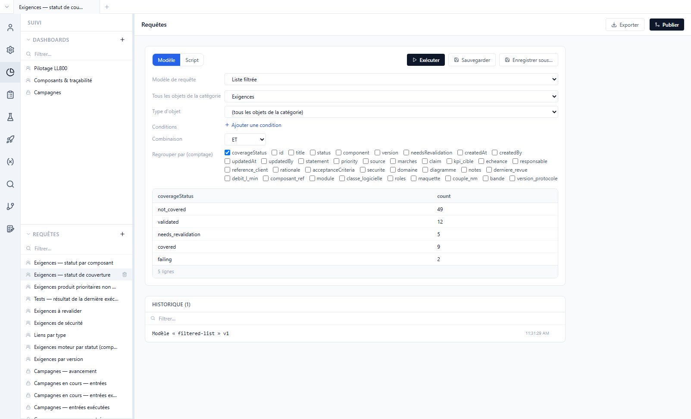
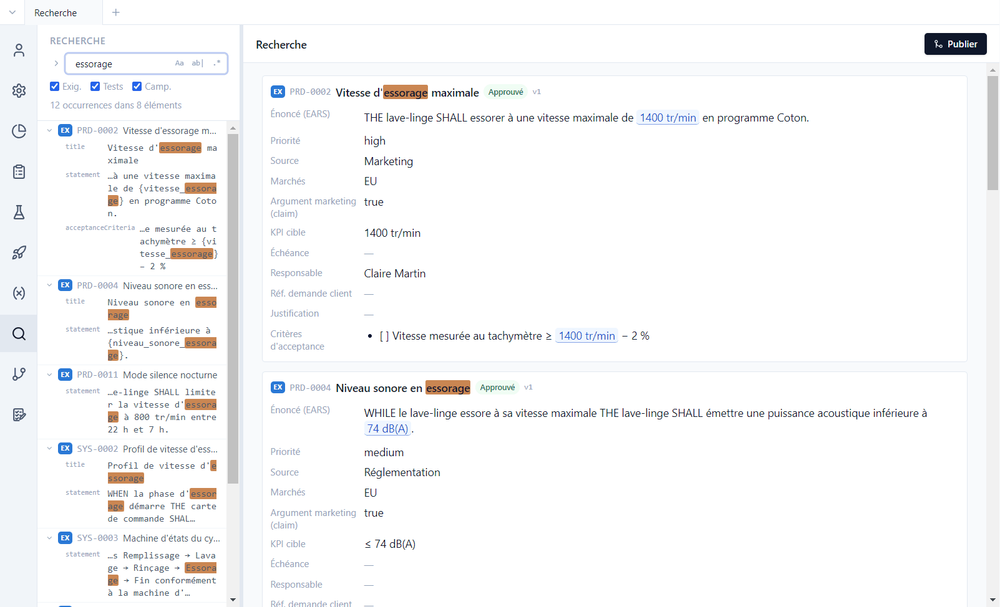

# 6. Suivi et recherche

[English](../tutorials/06-tracking.md) | **Français**

La vue **Suivi** répond aux questions de pilotage : où en sont les exigences, qu'est-ce qui n'est
pas testé, où en sont les campagnes. Elle repose sur des **requêtes** sur l'ensemble du projet
(produit et composants), affichées dans des **dashboards**.

## Les dashboards

Vue **Suivi**, dashboard *Pilotage LL800* :



- Chaque **widget** affiche le résultat d'une requête : barres (ici empilées par statut),
  camembert, courbe, tableau, indicateur (*À revalider* : 4), matrice, aire dans le temps.
- Un clic sur une barre, une part ou un indicateur ouvre le **détail** : les exigences, tests ou
  entrées de campagne concernés, chacun ouvrable dans un onglet.
- **Ajouter un widget** en ajoute un ; le crayon d'un widget le modifie. Le widget se règle par un
  **modèle** (onglet *Modèle* : type de graphe, colonnes, mesure) ; l'onglet *Code* montre le code
  généré, modifiable par un utilisateur avancé (le widget est alors « personnalisé », *Revenir au
  modèle* annule).
- **Privé** / **Partagé** : un dashboard partagé est enregistré dans le dépôt et visible de toute
  l'équipe ; un dashboard privé reste à son auteur.
- **Exporter** produit une version Word ou PDF du dashboard.

Le second dashboard, *Composants & traçabilité*, suit la couverture composant par composant. Au
premier accès, Polenta crée aussi le dashboard partagé *Status* (s'il n'existe aucun dashboard) et
un dashboard privé *Campagnes* : avancement de chaque campagne (de la préparation des tests au
résultat), % exécuté, % PASS, exécutions par jour, entrées en échec, avancement dans le temps.

## Les requêtes

Le bas du panneau latéral liste les requêtes partagées. Ouvrir *Exigences — statut de couverture* :



Une requête se construit de deux façons :

- **Modèle** : un formulaire, sans code — *Liste filtrée* (type d'objet, composant, conditions,
  regroupement), *Entrées de campagne*, *Avancement dans le temps* ;
- **Script** : un script JavaScript qui lit les données du projet (exigences, tests, liens,
  campagnes, exécutions, historiques) et renvoie des lignes. Il s'exécute dans un bac à sable isolé,
  sans accès au disque ni au réseau.

**Exécuter** affiche le résultat, **Sauvegarder** l'enregistre, l'historique garde les dernières
requêtes lancées ; **Exporter** produit un fichier Excel ou PDF. Exemple de script :

```js
// Exigences approuvées sans test
export default (data) => data.requirements
  .filter((r) => r.status === 'approved' && r.coverageStatus === 'not_covered')
  .map((r) => ({ id: r.id, title: r.title, _ids: [r.id] }))
```

La colonne `_ids` désigne les objets d'origine : c'est elle qui rend une ligne ou une barre
cliquable. Les scripts peuvent importer la **bibliothèque du projet** (`dashboards/lib/`, copiée au
premier accès) : étapes d'avancement des campagnes, état des campagnes jour par jour, **maturité**
des exigences (champs obligatoires remplis, énoncé EARS, critère d'acceptance mesurable, lien de
vérification pour une exigence approuvée, aucun impact en attente) :

```js
import { maturity, maturityContext } from 'lib/maturity.js'

// Exigences qui ne sont pas « mûres », avec la raison
export default (data) => {
  const ctx = maturityContext(data)
  return data.requirements
    .map((r) => ({ r, m: maturity(data, r, ctx) }))
    .filter(({ m }) => !m.ok)
    .map(({ r, m }) => ({ id: r.id, title: r.title, manque: m.missing.join(', '), _ids: [r.id] }))
}
```

Quand Polenta livre une nouvelle version d'un fichier de la bibliothèque ou d'un widget de
dashboard pré-configuré, un bandeau **Mises à jour disponibles** apparaît en tête du panneau : rien
n'est modifié sans *Appliquer*. Un assistant IA connecté au projet (tutoriel 8) peut écrire et tester
ces scripts pour vous.

## La recherche

Vue **Recherche** : un texte, ou une expression régulière, cherché dans tous les dépôts du projet.



- **Aa** respecte la casse, **ab|** cherche le mot entier, **.\*** active les expressions
  régulières ; les cases limitent la recherche aux exigences, aux tests ou aux campagnes.
- À gauche, chaque occurrence avec son champ ; à droite, les éléments trouvés en entier.
- La flèche à gauche du champ ouvre le **remplacement**, sur tout le projet.

Exemple : `\{[a-z_]+\}` en expression régulière trouve toutes les références de paramètres.
