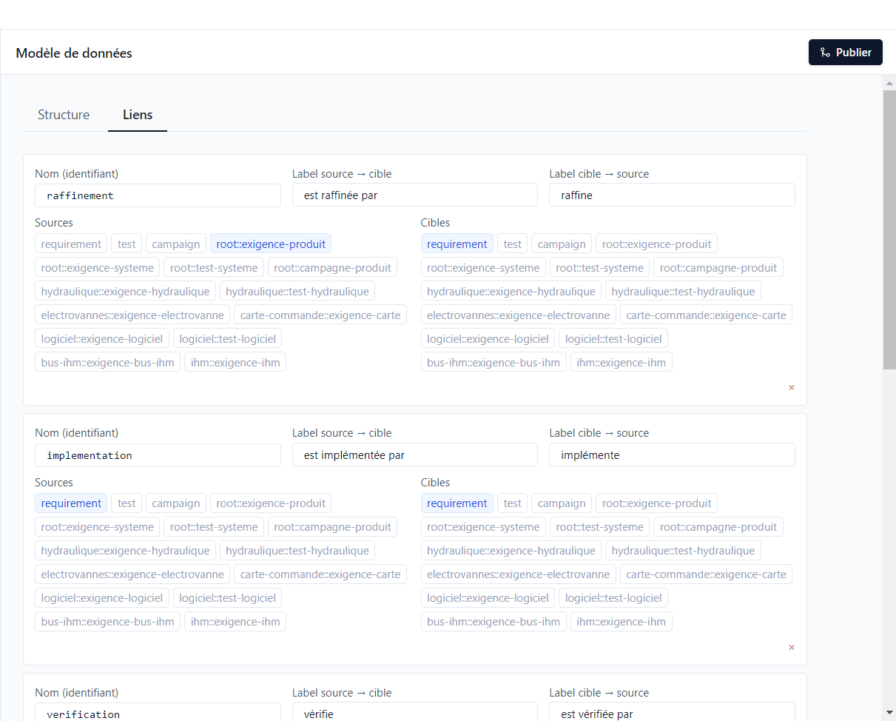
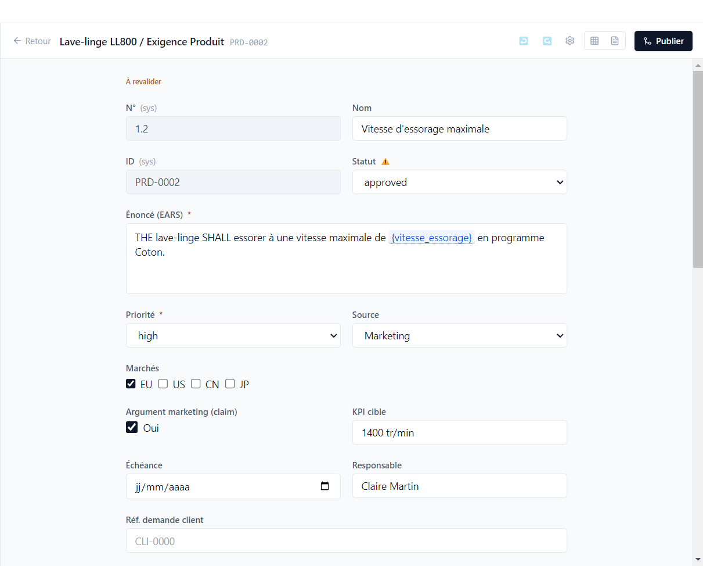
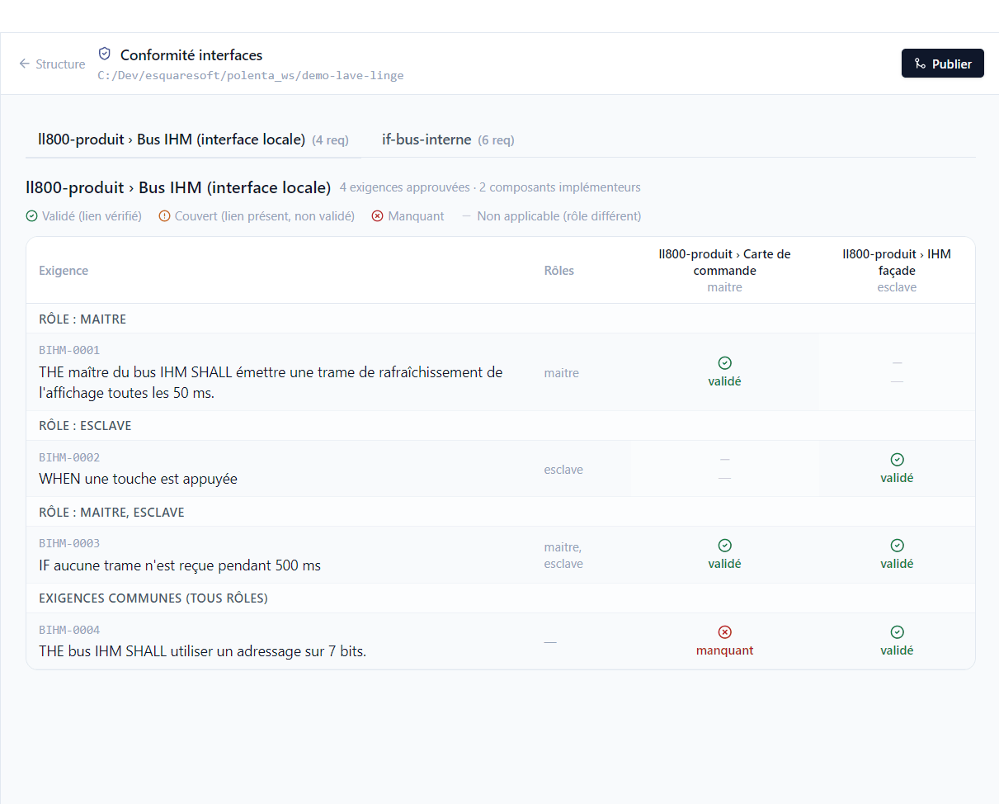

# 6. Traçabilité

[English](../tutorials/06-traceability.md) | **Français**

Polenta relie les besoins produit aux exigences système, aux composants qui les réalisent et aux
tests qui les vérifient. Ce tutoriel montre comment ces liens sont définis, ce que Polenta en
déduit et comment il signale un lien devenu douteux.

## Les types de liens

*Projet > Modèle de données*, onglet **Liens** :

Chaque type de lien a un nom, un libellé dans chaque sens (*est raffinée par* / *raffine*) et la
liste des éléments autorisés en source et en cible : une catégorie entière (`requirement`, `test`)
ou un type précis (`root::exigence-produit`). La démo en déclare six :

| Type | Sens | Exemple |
|---|---|---|
| raffinement | une exigence en détaille une autre | SYS-0002 raffine PRD-0002 |
| implémentation | un composant réalise une exigence | CC-0001 implémente SYS-0001 |
| vérification | un test vérifie une exigence | TSYS-0001 vérifie PRD-0001 |
| implémentation d'interface | une exigence de composant réalise une exigence d'interface | MOT-0006 implémente une exigence du bus interne |
| impact d'issue | une issue touche une exigence ([tutoriel 10](10-issues-validation.md)) | ISS-0003 impacte PRD-0002 |
| relation | lien libre, non contraint | — |

Le sens d'un lien de vérification n'a pas d'importance : créé depuis le test ou depuis l'exigence,
il compte de la même façon. Dans la démo, le lien entre PRD-0002 et TSYS-0002 a été créé depuis
l'exigence.

## La vérification (couverture)

Chaque exigence porte un statut de **vérification** (sa couverture), calculé à partir de ses liens
de vérification et du dernier résultat de chaque test lié. Il apparaît en haut de l'éditeur, dans la
colonne *Vérification* de la vue tableau (filtrable) et dans les requêtes (colonne
`coverageStatus`).

| État | Signification | Dans la démo |
|---|---|---|
| **Non couvert** | aucun test lié | SYS-0008, exigences du module Wi-Fi |
| **Couvert** | des tests liés, pas encore exécutés | SYS-0010 |
| **Vérifié** | le dernier résultat des tests liés est *Passé* | PRD-0001, SW-0001 |
| **En échec** | le dernier résultat d'un test lié n'est pas *Passé* (échec, blocage…) | PRD-0009 |
| **À revalider** | un élément lié a changé après approbation | PRD-0002, SYS-0002 |

La vérification est l'un des quatre statuts d'une exigence, avec la rédaction, le design et la
validation ([tutoriel 3](03-exigences.md#les-quatre-statuts-dune-exigence)).

## Les éléments à revalider

Quand une exigence approuvée est rouverte, ou qu'un paramètre utilisé change de valeur, Polenta ne
peut pas savoir si les éléments liés restent justes. Il les marque **Impact à vérifier** : un ⚠ à
côté de leur statut, et un bandeau en haut de l'éditeur.

Dans la démo, SYS-0002 (qui raffine PRD-0002) est repassée en revue ; PRD-0002 et le test
TSYS-0002 sont marqués. Dans la vue **Version**, l'entrée **Impact à vérifier** du panneau les
liste : vérifier chaque élément, puis **Lever le flag** (un par un ou sur la sélection). L'analyse
d'impact d'une version fait ce travail de façon organisée, élément modifié par élément modifié
([tutoriel 9](09-versions.md)) : dans la version `2.0` en cours (LLV-0002), SYS-0002 est notée
*Impact à tester*.

Avant même de publier, l'entrée **Modifications locales (vs HEAD)** du même panneau montre les
éléments modifiés sur le poste et ce qui leur est lié.

## La conformité des interfaces

Une **interface** regroupe les exigences d'un échange entre composants, avec des rôles. Chaque
composant qui implémente l'interface déclare son rôle, et doit couvrir les exigences de ce rôle.

*Projet > Modèle de données > Structure*, **Conformité interfaces** :

Pour le bus IHM (rôles maître et esclave), une ligne par exigence d'interface, une colonne par
composant qui l'implémente :

- *validé* : le composant a une exigence liée, et elle est validée par ses tests ;
- *couvert* : le lien existe, la validation manque ;
- *manquant* : aucune exigence du composant ne réalise celle de l'interface. Ici, la carte de
  commande (maître) ne couvre pas BIHM-0004 ;
- un tiret : l'exigence ne concerne pas le rôle de ce composant.

## Exercices

**Couvrir une exigence, dans les deux sens.**
1. Ouvrir TSYS-0010, rubrique *vérifie* : ajouter SYS-0008.
2. Ouvrir SYS-0012, rubrique *est vérifiée par* : ajouter TSYS-0010.

Résultat : SYS-0008 et SYS-0012 passent de *Non couvert* à *Couvert* : TSYS-0010 n'a pas encore été
exécuté. Le sens de création ne change rien.

**Marquer, puis lever un impact.**
1. Ouvrir SYS-0001 (approuvée) et la repasser en `review`.
2. Ouvrir CC-0001, qui l'implémente.
3. Vue **Version**, **Impact à vérifier** : sélectionner CC-0001, **Lever le flag**.

Résultat : CC-0001 porte le ⚠ et le bandeau *Impact à vérifier* ; après la levée, il quitte la
liste. Son fichier est modifié, à publier.

**Trouver une exigence d'interface sans réalisation.**
1. *Projet › Modèle de données › Structure*, **Conformité interfaces** : choisir le bus interne.

Résultat : BUS-0006 (*Mode veille du bus*) n'est réalisée par aucun composant.

**Suivre un lien entre dépôts.**
1. Ouvrir SYS-0002, rubrique *est implémentée par* : cliquer sur MOT-0001.

Résultat : MOT-0001 s'ouvre ; c'est une exigence de `comp-moteur`.

**Parcourir la constellation.**
1. Vue **Exigences**, **Constellation des exigences** : chercher PRD-0002.
2. Cliquer sur le point pour l'épingler.

Résultat : la lignée de PRD-0002 s'affiche (SYS-0002, puis MOT-0001…), avec sa couverture par les
tests.

**Lire l'impact d'une modification locale.**
1. Modifier l'énoncé de SYS-0005, sans publier.
2. Vue **Version**, **Modifications locales (vs HEAD)**.

Résultat : SYS-0005 est listée avec les éléments qui lui sont liés (PRD-0003, PRD-0009, HYD-0001,
EV-0002).
