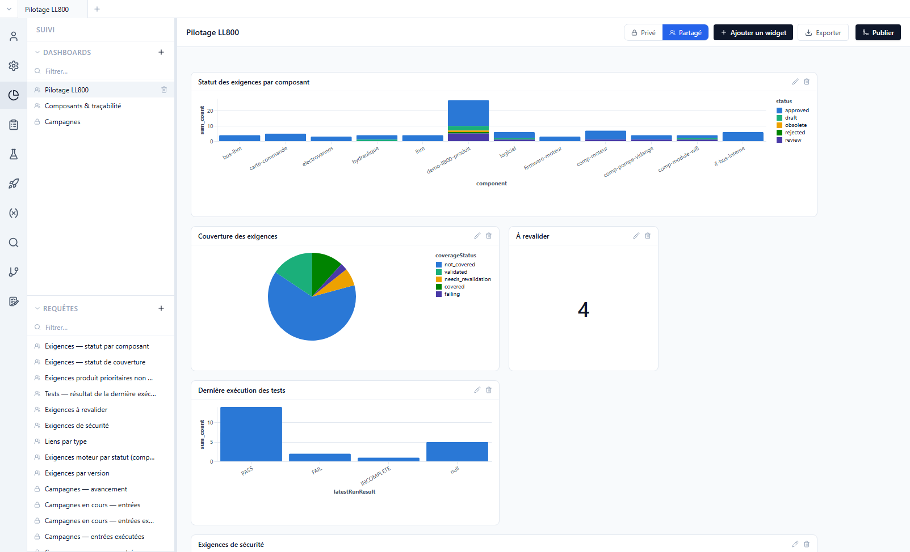
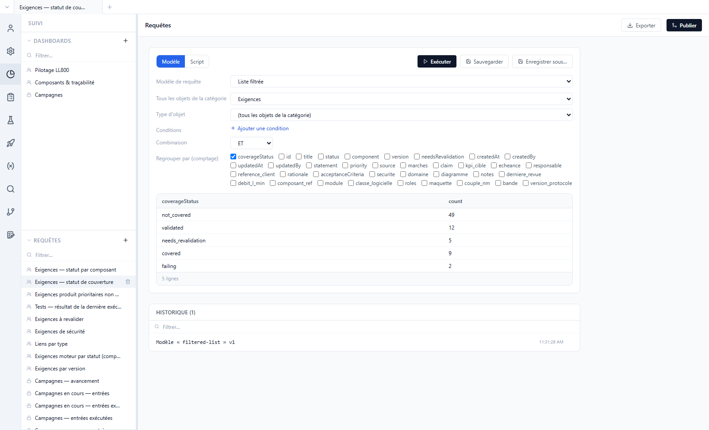
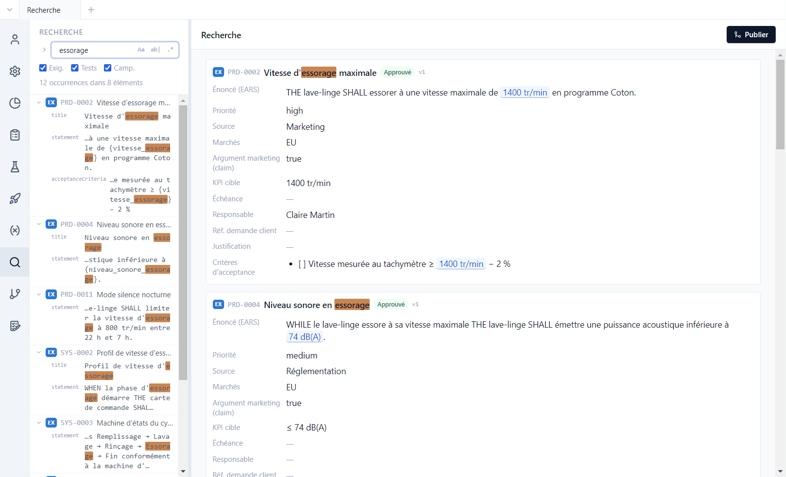

# 7. Suivi et recherche

[English](../tutorials/07-tracking.md) | **Français**

La vue **Suivi** répond aux questions de pilotage : où en sont les exigences, qu'est-ce qui n'est
pas testé, où en sont les campagnes. Elle repose sur des **requêtes** sur l'ensemble du projet
(produit et composants), affichées dans des **dashboards**.

## Les dashboards

Vue **Suivi**, dashboard *Pilotage LL800* :



- Chaque **widget** affiche le résultat d'une requête. *Pilotage LL800* montre des barres (ici
  empilées par statut), un camembert, un indicateur (*À revalider* : 4), un tableau et une courbe ;
  d'autres formes existent, comme la matrice ou l'aire dans le temps.
- Un clic sur une barre, une part ou un indicateur ouvre le **détail** : les exigences, tests ou
  entrées de campagne concernés, chacun ouvrable dans un onglet.
- **Ajouter un widget** en ajoute un ; le crayon d'un widget le modifie. Le widget se règle par un
  **modèle** (onglet *Modèle* : type de graphe, colonnes, mesure) ; l'onglet *Code* montre le code
  généré, modifiable par un utilisateur avancé (le widget est alors « personnalisé », *Revenir au
  modèle* annule).
- **Privé** / **Partagé** : un dashboard partagé est enregistré dans le dépôt et visible de toute
  l'équipe ; un dashboard privé reste à son auteur.
- **Exporter** produit une version Word ou PDF du dashboard.

Le deuxième dashboard, *Composants & traçabilité*, montre les liens par type (camembert), les
exigences du moteur par statut (barres) et les exigences produit prioritaires non approuvées
(tableau). Le troisième, *Versions & validation*, compte les issues de chaque version et répartit
les décisions d'une validation. Au premier accès, Polenta crée aussi le dashboard partagé *Status* (s'il n'existe aucun dashboard) et
un dashboard privé *Campagnes* : avancement de chaque campagne (de la préparation des tests au
résultat), % exécuté, % PASS, exécutions par jour, entrées en échec, avancement dans le temps.

**Paramètres choisis à l'affichage.** Dans le dashboard *Campagnes*, chaque widget affiche dans
son en-tête un sélecteur **Campagne** : sur *Toutes*, le widget montre les campagnes en cours ; une
campagne choisie (même terminée) recentre ce widget seul sur elle — par exemple l'avancement dans le
temps d'une campagne précise, à côté de l'avancement de toutes les campagnes. Le choix est propre à
chaque widget et mémorisé pour vous seul (rien à publier) ; l'icône *Réinitialiser* de l'en-tête,
visible dès qu'une valeur diffère du défaut, revient à *Toutes*. Pour recentrer tout le dashboard,
changez la campagne de chaque widget. Toute requête peut déclarer de tels paramètres (campagne,
composant, type d'objet, liste de valeurs, texte, période) : par les cases « … choisi(e) à
l'affichage » de son modèle, ou dans la section *Paramètres choisis à l'affichage* de la vue
Requêtes en mode Script, où le script lit les valeurs dans `polenta.params`. Deux widgets d'une même
requête ont chacun leur sélecteur et leur valeur.
Dans le dashboard partagé *Versions & validation*, le widget *Décisions de la validation* a ainsi
un sélecteur **Validation** : *Validation 1.0*, *Validation 2.0* ou *Validation 1.2.4* (moteur).

## Les requêtes

Le bas du panneau latéral liste les requêtes partagées. Ouvrir *Exigences — statut de couverture* :



Une requête se construit de deux façons :

- **Modèle** : un formulaire, sans code — *Liste filtrée* (type d'objet, composant, conditions,
  regroupement), *Entrées de campagne*, *Avancement dans le temps* ;
- **Script** : un script JavaScript qui lit les données du projet (exigences, tests, liens,
  campagnes, exécutions, historiques, versions, issues, validations) et renvoie des lignes. Il s'exécute dans un bac à sable isolé,
  sans accès au disque ni au réseau.

**Exécuter** affiche le résultat, **Sauvegarder** l'enregistre, l'historique garde les dernières
requêtes lancées ; **Exporter** produit un fichier Excel ou PDF. Exemple de script :

```js
// Exigences approuvées sans test
export default (data) => data.requirements
  .filter((r) => r.status === 'approved' && r.coverageStatus === 'not_covered')
  .map((r) => ({ id: r.id, title: r.title, _ids: [r.id] }))
```

La colonne `_ids` désigne les objets d'origine : c'est elle qui rend une ligne ou une barre
cliquable. Les scripts peuvent importer la **bibliothèque du projet** (`dashboards/lib/`, copiée au
premier accès) : étapes d'avancement des campagnes, état des campagnes jour par jour, **maturité**
des exigences (champs obligatoires remplis, énoncé EARS, critère d'acceptance mesurable, lien de
vérification pour une exigence approuvée, aucun impact en attente) :

```js
import { maturity, maturityContext } from 'lib/maturity.js'

// Exigences qui ne sont pas « mûres », avec la raison
export default (data) => {
  const ctx = maturityContext(data)
  return data.requirements
    .map((r) => ({ r, m: maturity(data, r, ctx) }))
    .filter(({ m }) => !m.ok)
    .map(({ r, m }) => ({ id: r.id, title: r.title, manque: m.missing.join(', '), _ids: [r.id] }))
}
```

Quand Polenta livre une nouvelle version d'un fichier de la bibliothèque ou d'un widget de
dashboard pré-configuré, un bandeau **Mises à jour disponibles** apparaît en tête du panneau : rien
n'est modifié sans *Appliquer*. Un assistant IA connecté au projet ([tutoriel 12](12-agent-ia.md))
peut écrire et tester ces scripts pour vous.

### Des colonnes calculées dans les vues

Une requête partagée peut aussi **ajouter une colonne** aux vues tableau des exigences ou des tests :
elle déclare une colonne, et renvoie une valeur par élément. Le modèle fourni calcule le **Dernier
résultat** de campagne de chaque test ; une variante éclate la colonne en **une colonne par
campagne**, et une nouvelle campagne y ajoute sa colonne d'elle-même. Ces colonnes se choisissent
dans **⚙️ › Champs visibles › Colonnes calculées**, se filtrent et s'exportent comme les autres.
Elles sont définies par le projet, pas par Polenta : chaque équipe calcule ce dont elle a besoin.

## La recherche

Vue **Recherche** : un texte, ou une expression régulière, cherché dans tous les dépôts du projet.



- **Aa** respecte la casse, **ab|** cherche le mot entier, **.\*** active les expressions
  régulières ; les cases limitent la recherche aux exigences, aux tests ou aux campagnes.
- À gauche, chaque occurrence avec son champ ; à droite, les éléments trouvés en entier.
- La flèche à gauche du champ ouvre le **remplacement**, sur tout le projet.

Exemple : `\{[a-z_]+\}` en expression régulière trouve toutes les références de paramètres.

## Exercices

**Ajouter un widget.**
1. *Pilotage LL800*, **Ajouter un widget** sur la requête *Exigences — statut de couverture*, en
   tableau.
2. Crayon du widget : changer le regroupement dans l'onglet *Modèle*.

Résultat : le nouveau widget s'affiche à côté des six autres et suit la modification.

**Changer un paramètre d'un widget.**
1. Dashboard *Versions & validation*, widget *Décisions de la validation*, sélecteur **Validation**
   de son en-tête : *Validation 1.0*.
2. Choisir *Validation 1.2.4*, puis l'icône *Réinitialiser* de l'en-tête.

Résultat : le camembert se recalcule. La 1.0 montre surtout des décisions *conforme*, deux *hors
scope* (PRD-0010, SYS-0013) et une *dérogation* (SYS-0004) ; la 1.2.4 porte sur les exigences du
moteur.

**Afficher une colonne calculée.**
1. Vue **Tests**, *Test Système*, **⚙️ › Champs visibles › Colonnes calculées** : cocher *Dernier
   résultat* (QUERY-0010).

Résultat : une colonne *Dernier résultat* apparaît ; TSYS-0004 affiche `PASS` (DVT), TSYS-0007
`INCOMPLETE`.

**Compter les issues par version.**
1. Vue **Suivi**, nouvelle requête en mode Script :

```js
export default (data) => data.versions.map((v) => ({
  version: v.component + ' ' + v.title,
  issues: v.changes.filter((c) => data.issues.some((i) => i.id === c.id)).length,
}))
```

2. **Exécuter**, puis comparer avec la requête partagée *Issues par version* (QUERY-0012).

Résultat : la `1.0` du produit compte une issue (ISS-0001), la `2.0` deux (ISS-0002, ISS-0003), la
`1.3` du moteur une (MISS-0001) ; les autres versions, aucune.

**Chercher et remplacer.**
1. Vue **Recherche** : `essorage`.
2. Ouvrir le remplacement, saisir un texte de remplacement, lire l'aperçu, ne pas appliquer.

Résultat : les occurrences sont listées dans le dépôt produit et dans `comp-moteur`, chacune avec
son champ.
