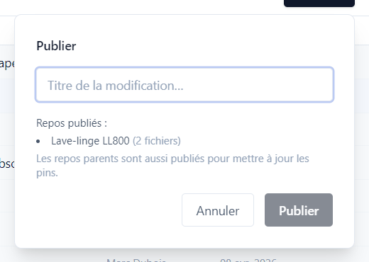
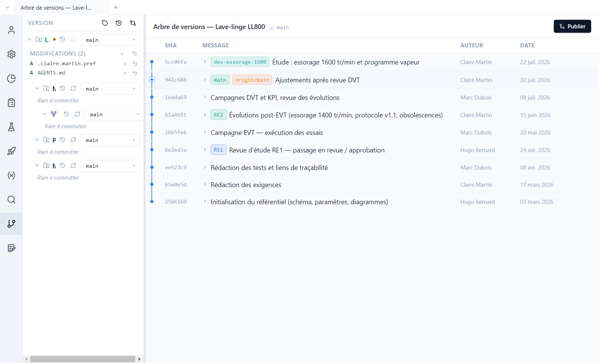
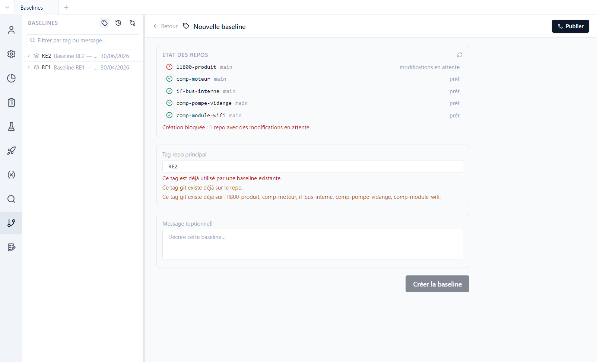
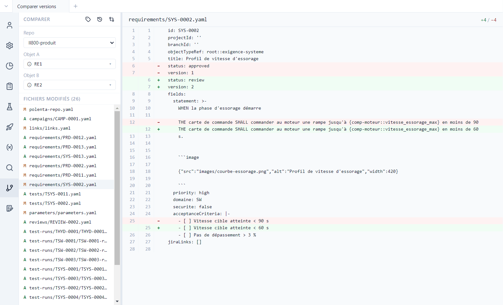
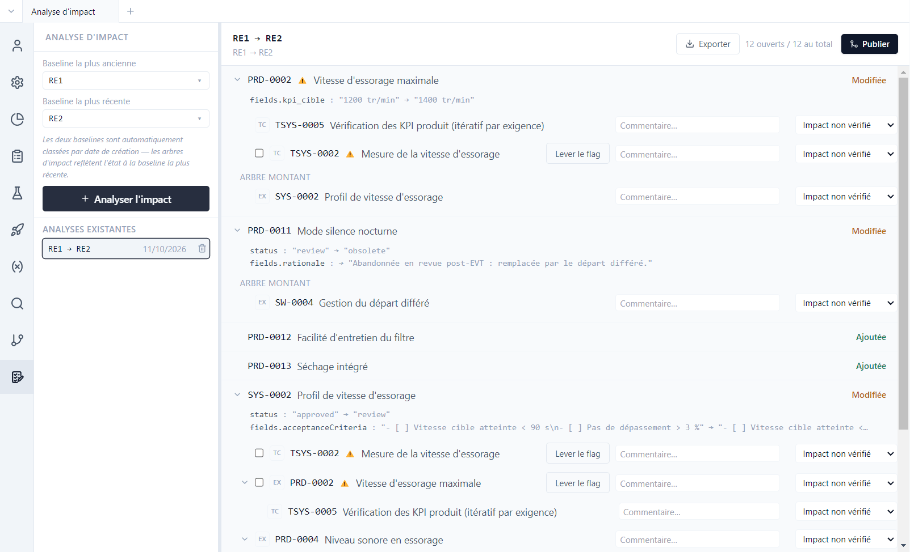

# 7. Versions et baselines

[English](../tutorials/07-versions.md) | **Français**

Polenta s'appuie sur git pour l'historique, le travail à plusieurs et les versions de référence,
sans demander de connaître git. Ce tutoriel montre comment publier, relire l'historique, poser une
baseline, comparer deux versions et analyser l'impact d'une évolution.

## Publier

Les modifications faites dans Polenta s'enregistrent d'abord sur le poste. **Publier**, en haut à
droite de chaque vue, les partage avec l'équipe :

1. Donner un **titre** à la modification (« Essorage 1600 tr/min »…).
2. Polenta enregistre la modification sous ce titre, l'intègre à la branche principale du dépôt
   et l'envoie sur le serveur git.

Si la modification touche un composant, le composant est publié d'abord, puis le produit, qui
enregistre la nouvelle version du composant. Si un collègue a modifié le même élément, Polenta
propose de résoudre le conflit champ par champ.

La démo est un clone de dépôts publics : publier y échouera à l'envoi. Les essais se font sans
publier, ou sur une copie poussée vers vos propres dépôts.

## L'historique

Vue **Version** : pour chaque dépôt, les modifications en attente, puis l'**arbre de versions**.

- Chaque ligne est une modification publiée, avec son auteur et sa date. Les étiquettes montrent
  les branches (`main`, `dev-essorage-1600`) et les baselines (`RE1`, `RE2`).
- La branche `dev-essorage-1600` est une étude en cours, pas encore intégrée : vitesse
  d'essorage à 1600 tr/min et programme vapeur.
- Dans le panneau, **Modifications** liste les fichiers modifiés et non publiés. À l'ouverture,
  Polenta y ajoute `AGENTS.md`, le guide destiné aux agents IA ([tutoriel 8](08-agent-ia.md)).

## Les baselines

Une **baseline** est une version de référence de tout le projet, posée à un jalon (revue d'étude,
livraison). Polenta la pose sous forme de tag git sur **tous les dépôts** à la fois. La démo en a
deux : RE1 (revue d'étude n°1, avril) et RE2 (après les essais EVT, juin).

Le bouton **Baselines** (icône d'étiquette, en haut du panneau Version) les liste, et ouvre le
formulaire de création :

Polenta vérifie l'état de chaque dépôt : une baseline ne se pose que sur des dépôts sans
modifications en attente (ici, `AGENTS.md` bloque la création). Une campagne de test se rattache
à une baseline : les exigences et paramètres vérifiés sont ceux de cette version.

## Comparer deux versions

**Comparer deux versions** (icône de flèches croisées) : choisir le dépôt, puis deux branches,
baselines ou commits.

La liste des fichiers modifiés (ajoutés `A`, modifiés `M`) s'affiche ; un clic montre les
différences ligne à ligne. Entre RE1 et RE2, SYS-0002 est repassée de `approved` à `review` en
version 2, avec une rampe d'accélération ramenée de 90 à 60 s.

## Analyser l'impact

Vue **Analyse d'impact** : choisir deux baselines, puis **Analyser l'impact**.

Pour chaque élément ajouté, modifié ou rendu obsolète entre les deux versions :

- le détail des champs modifiés (PRD-0002 : `kpi_cible` passée de 1200 à 1400 tr/min) ;
- l'**arbre** des éléments liés : tests qui le vérifient, exigences qu'il raffine (arbre montant) ;
- pour chacun, un commentaire et un état de suivi, de *Impact non vérifié* à *Modification
  vérifiée*, en passant par *Pas d'impact réel* ou *Modification à faire* ;
- **Lever le flag** retire le marqueur *à revalider* une fois l'élément vérifié.

L'analyse est enregistrée dans le dépôt (`impact-analyses/`) et se retrouve sous **Analyses
existantes**. **Exporter** la produit en Excel ou en PDF, pour un dossier de revue.
