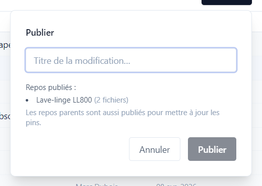
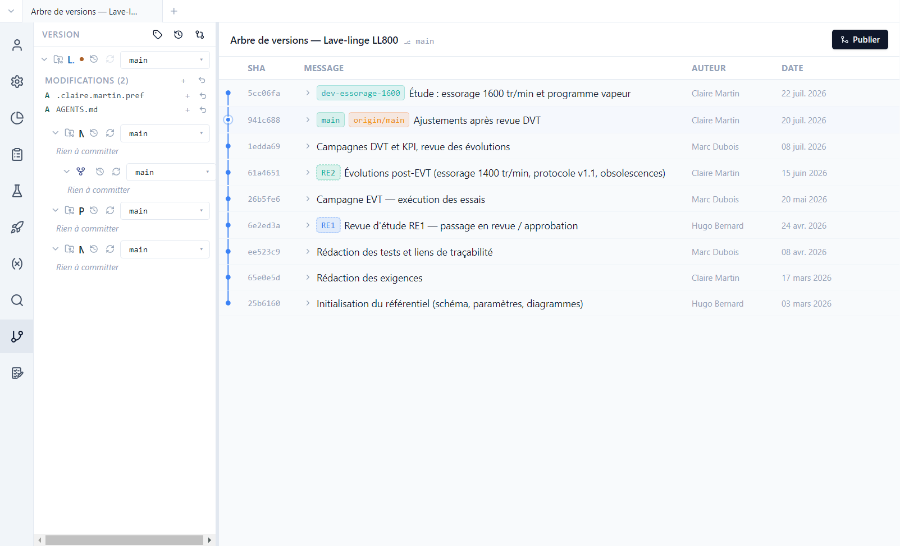
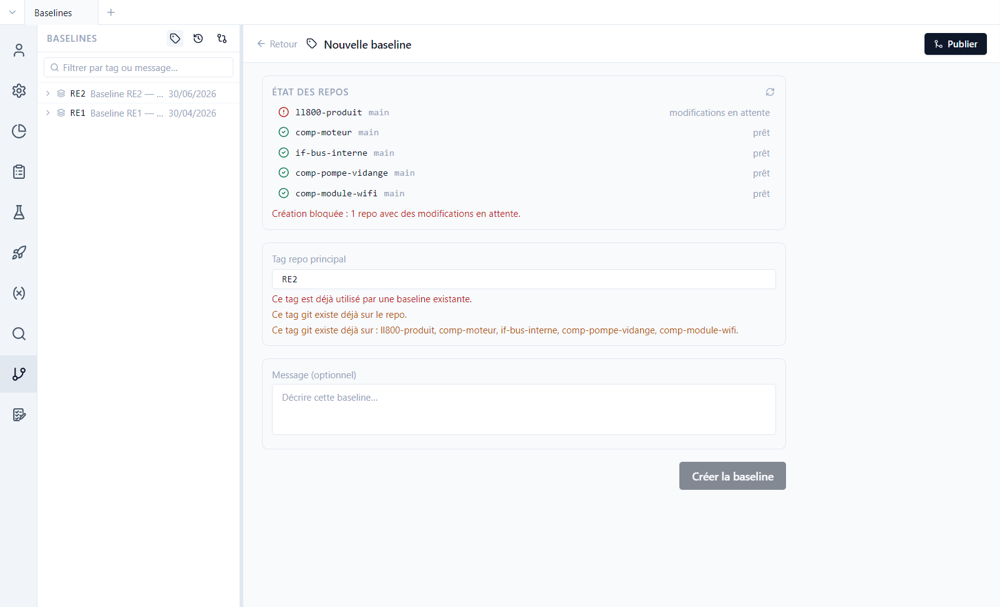
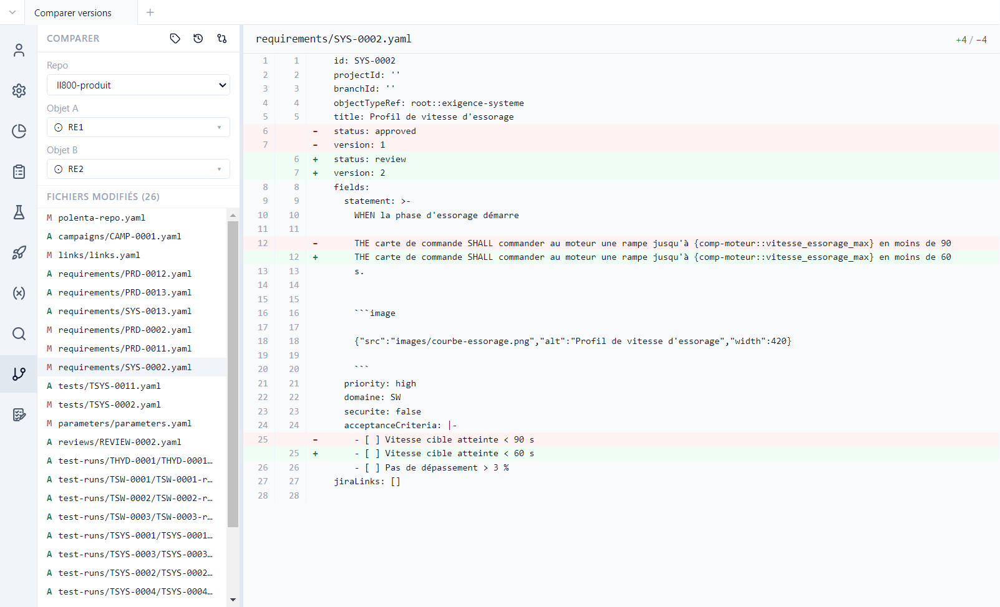

# 8. Publier et historique

[English](../tutorials/08-publishing-history.md) | **Français**

Polenta s'appuie sur git pour l'historique, le travail à plusieurs et les versions de référence,
sans demander de connaître git. Ce tutoriel montre comment publier, relire l'historique et les
différences, résoudre un conflit, poser une baseline et comparer deux versions.

## Publier

Les modifications faites dans Polenta s'enregistrent d'abord sur le poste. **Publier**, en haut à
droite de chaque vue, les partage avec l'équipe :

1. Donner un **titre** à la modification (« Essorage 1600 tr/min »…).
2. Polenta enregistre la modification sous ce titre, l'intègre à la **branche d'intégration** du
   dépôt et l'envoie sur le serveur git.

Si la modification touche un composant, le composant est publié d'abord, puis le produit, qui
enregistre la nouvelle version du composant. Si un collègue a modifié le même élément, Polenta
ouvre la résolution de conflit (plus bas).

La démo est un clone de dépôts publics : publier y échouera à l'envoi. Les essais se font sans
publier, ou sur une copie poussée vers vos propres dépôts ([tutoriel 11](11-projets-equipe.md)).

### La branche d'intégration

Chaque dépôt a une **branche d'intégration** désignée, où l'équipe met son travail en commun ; un
dépôt créé par Polenta la nomme `int-…`. Elle se voit et se change dans *Projet › Modèle de données › Structure*, sur la ligne du
dépôt ; **Nouvelle branche…** en crée une autre.

- Dès que vous modifiez un dépôt qui est sur sa branche d'intégration, Polenta met votre travail de
  côté sur une branche locale `dev-auto` (jamais envoyée sur le serveur) : la branche d'intégration
  peut ainsi continuer à recevoir le travail des collègues. **Publier** fusionne ensuite votre
  travail dans l'intégration.
- Sur une autre branche (une étude `dev-…`, par exemple), la fenêtre **Publier** prévient :
  *Publier fusionnera cette branche dans … puis poussera …*. Décocher **Fusionner dans …** publie la
  branche seule, sans toucher à l'intégration.

## L'historique

Vue **Version** : pour chaque dépôt, les modifications en attente, puis l'**arbre de versions**.

- Chaque ligne est une modification publiée, avec son auteur et sa date. Les étiquettes montrent
  les branches (`main`, `dev-essorage-1600`) et les baselines (`RE1`, `RE2`).
- La branche `dev-essorage-1600` est une étude en cours, pas encore intégrée : vitesse
  d'essorage à 1600 tr/min et programme vapeur.
- Dans le panneau, **Modifications** liste les fichiers modifiés et non publiés. À l'ouverture,
  Polenta y ajoute `AGENTS.md`, le guide destiné aux agents IA ([tutoriel 12](12-agent-ia.md)).
- Le haut du panneau donne accès aux **versions** du produit et des composants
  ([tutoriel 9](09-versions.md)), aux **Baselines**, à **Comparer deux versions** et au
  **Terminal**.

## Lire les différences

Un clic sur un fichier modifié, ou sur un fichier d'une modification publiée, ouvre ses
**différences** :

- **Rendu** présente un élément champ par champ, colonnes *Avant* / *Après*, avec le changement
  surligné au caractère près ; **Masquer les inchangés** ne garde que ce qui a bougé. **Raw** montre
  le fichier brut ligne à ligne.
- **Côte à côte** ou **En ligne** ; **F7** / **Maj+F7** passent au changement suivant ou précédent.
- Pour une modification locale pas encore publiée, le côté *Après* est **modifiable** : **Rétablir**
  reprend la valeur d'avant pour un bloc, **Ajouter** complète une liste, **Enregistrer** (Ctrl+S)
  écrit le fichier. Les différences entre deux modifications publiées sont en lecture seule.

## Résoudre un conflit

Quand un collègue a modifié les mêmes lignes, la vue **Conflits** présente chaque conflit avec *Mes
modifications* à gauche et *Destination* à droite :

- par bloc : **← Prendre gauche**, **Prendre droite →**, **Prendre les deux**, ou **Prendre
  l'ancêtre** (la version commune d'avant les deux modifications) ;
- ou en une fois : **Tout prendre à gauche** / **à droite** ;
- **F7** passe au conflit suivant, **Ctrl+Z** / **Ctrl+Y** annulent et rétablissent ; chaque bloc
  traité porte *✓ Résolu*. Une fois tout résolu, la fusion se termine et la publication reprend.

## Le terminal

Pour qui connaît git, **Terminal** (en haut du panneau Version, ou **Ctrl+ù**) ouvre un vrai Git Bash
en bas de la fenêtre, avec **Aller à …** pour se placer dans le dossier d'un dépôt. Il demande Git
pour Windows ; s'il manque, Polenta propose **Installer Git**. Le terminal n'existe pas dans le
client web.

## Les baselines

Une **baseline** est une version de référence de tout le projet, posée à un jalon (revue d'étude,
livraison). Polenta la pose sous forme de tag git sur **tous les dépôts** à la fois. La démo en a
deux : RE1 (revue d'étude n°1, avril) et RE2 (après les essais EVT, juin).

Le bouton **Baselines** (icône d'étiquette, en haut du panneau Version) les liste, et ouvre le
formulaire de création :

Polenta vérifie l'état de chaque dépôt : une baseline ne se pose que sur des dépôts sans
modifications en attente (ici, `AGENTS.md` bloque la création).

La baseline est un repère documentaire, pour comparer ou retrouver l'état d'un jalon. Ce qui est
livré et testé est suivi par les **versions** ([tutoriel 9](09-versions.md)) : ce sont elles que
les exécutions de test et les validations référencent.

## Comparer deux versions

**Comparer deux versions** (icône de flèches croisées) : choisir le dépôt, puis deux branches,
baselines ou commits.

La liste des fichiers modifiés (ajoutés `A`, modifiés `M`) s'affiche ; un clic montre les
différences, en **Rendu** ou en **Raw**. Entre RE1 et RE2, SYS-0002 est repassée de `approved` à
`review` en version 2, avec une rampe d'accélération ramenée de 90 à 60 s.
