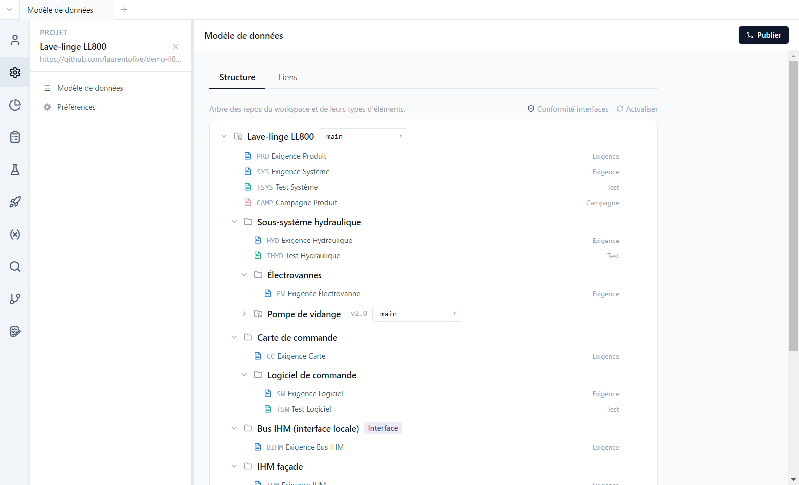

# Tutoriels Polenta

[English](../tutorials/README.md) | **Français**

Une visite guidée de Polenta sur son projet de démonstration, le lave-linge **LL800** : exigences,
tests, campagnes, paramètres, traçabilité, suivi, versions et travail avec un agent IA. Chaque
tutoriel part du projet ouvert et montre où cliquer et quoi regarder.

## Parcours

| # | Tutoriel | Ce qu'on y voit |
|---|---|---|
| 1 | [Prise en main](01-prise-en-main.md) | ouvrir la démo, l'interface, le modèle de données, les fichiers sur disque |
| 2 | [Exigences](02-exigences.md) | vue tableau et vue document, éditeur, EARS, diagrammes draw.io, liens |
| 3 | [Tests et campagnes](03-tests-campagnes.md) | cas de test, campagnes, exécution pas à pas, cahier et rapport |
| 4 | [Paramètres](04-parametres.md) | base de paramètres, références `{nom}`, « Utilisé par » |
| 5 | [Traçabilité](05-tracabilite.md) | couverture, types de liens, éléments à revalider, conformité des interfaces |
| 6 | [Suivi et recherche](06-suivi.md) | dashboards, requêtes SQL, recherche multi-repos |
| 7 | [Versions et baselines](07-versions.md) | publier, historique, baselines, comparaison, analyse d'impact |
| 8 | [Travailler avec un agent IA](08-agent-ia.md) | serveur MCP, `AGENTS.md`, import en masse |

Les tutoriels se suivent dans l'ordre, mais chacun peut se lire seul une fois la démo ouverte
(tutoriel 1).

## Installer Polenta (une fois)

1. Télécharger l'installeur Windows de la dernière version sur la page
   [Releases](https://github.com/laurentolive/polenta/releases) du dépôt GitHub, et le lancer.
   L'installation se fait pour l'utilisateur courant, sans droits administrateur. L'application se
   met ensuite à jour toute seule.
2. Au premier lancement, connecter un compte git : **Se connecter avec GitHub**, un jeton d'accès
   personnel, ou le serveur de votre entreprise. Polenta n'a pas de serveur à lui : les projets sont
   des dépôts git, poussés et tirés sur ce compte.

## Le projet de démonstration

Le lave-linge frontal LL800 (8 kg, 1400 tr/min) est un projet complet, avec plusieurs mois
d'historique, plusieurs auteurs et deux baselines. Il est réparti sur **cinq dépôts git** :

| Dépôt | Rôle |
|---|---|
| `ll800-produit` | dépôt racine : exigences produit (PRD) et système (SYS), tests système, campagnes, dashboards |
| `comp-moteur` | composant réutilisable : moteur BLDC et onduleur |
| `comp-pompe-vidange` | composant réutilisable : pompe de vidange, figé sur le tag `v2.0` |
| `comp-module-wifi` | composant réutilisable : module Wi-Fi, volontairement sans tests |
| `if-bus-interne` | **interface** : exigences du bus interne, avec les rôles `controller` et `device` |

Le dépôt produit contient aussi des composants **locaux** (sous-système hydraulique, carte de
commande et son logiciel, IHM, bus IHM). La démo comporte volontairement des défauts à trouver :
exigences non couvertes, tests en échec, éléments à revalider, énoncé non EARS, paramètres non
résolus.

Les captures ont été faites avec Polenta 0.0.8, sur la démo générée par
`scripts/demo-lave-linge/generate.mjs`.
