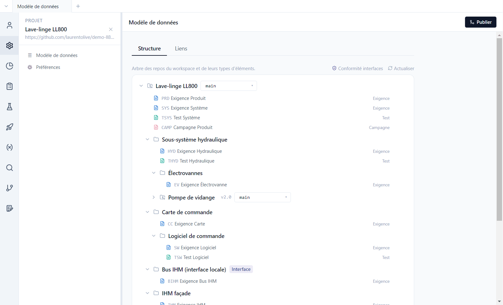

# Tutoriels Polenta

[English](../tutorials/README.md) | **Français**

Une visite guidée de Polenta, du compte git à la validation d'une version, en grande partie sur le
projet de démonstration, le lave-linge **LL800** : exigences, tests, campagnes, paramètres,
traçabilité, suivi, publication, versions, issues, validation, travail en équipe et avec un agent
IA. Chaque tutoriel montre où cliquer et quoi regarder.

## Parcours

| # | Tutoriel | Ce qu'on y voit |
|---|---|---|
| 1 | [Compte et connexion](01-compte-connexion.md) | installer Polenta, créer un compte GitHub ou Forgejo, connecter Polenta, le panneau Compte, le client web |
| 2 | [Prise en main](02-prise-en-main.md) | ouvrir la démo, l'interface et la navigation, le modèle de données, les fichiers sur disque |
| 3 | [Exigences](03-exigences.md) | vue tableau et vue document, vues enregistrées, les quatre statuts, éditeur, EARS, liens, contraintes de transition |
| 4 | [Tests et campagnes](04-tests-campagnes.md) | cas de test, champs d'exécution, campagnes, exécution et version testée, historique des exécutions, Excel |
| 5 | [Paramètres](05-parametres.md) | base de paramètres, références `{nom}`, « Utilisé par » |
| 6 | [Traçabilité](06-tracabilite.md) | types de liens, vérification (couverture), impact à vérifier, conformité des interfaces |
| 7 | [Suivi et recherche](07-suivi.md) | dashboards, requêtes et scripts, colonnes calculées, recherche multi-repos |
| 8 | [Publier et historique](08-publier-historique.md) | publier, branche d'intégration, différences, conflits, terminal, baselines, comparaison |
| 9 | [Versions et analyse d'impact](09-versions.md) | versions de composant et de produit, backlog, analyse d'impact, tests à exécuter, passage released |
| 10 | [Issues et validation](10-issues-validation.md) | issues, validation d'une version exigence par exigence, signature |
| 11 | [Projets d'équipe](11-projets-equipe.md) | créer un projet ou un composant sur le serveur, ouvrir un dépôt existant, membres et visibilité |
| 12 | [Travailler avec un agent IA](12-agent-ia.md) | serveur MCP, `AGENTS.md`, import et modification en masse |

Les tutoriels se suivent dans l'ordre, mais chacun peut se lire seul une fois connecté (tutoriel 1)
et la démo ouverte (tutoriel 2). Les tutoriels 2 à 12 se terminent par des **exercices** à faire sur
la démo ; le tutoriel 2 explique comment repartir d'une démo propre. Seul le tutoriel 11 sort de la
démo : il crée des dépôts sur un serveur.

## Le projet de démonstration

Le lave-linge frontal LL800 (8 kg, 1400 tr/min) est un projet complet, avec plusieurs mois
d'historique, plusieurs auteurs et deux baselines. Il est réparti sur **cinq dépôts git** (le dépôt
produit est cloné dans le dossier `demo-ll800-produit`) :

| Dépôt | Rôle |
|---|---|
| `ll800-produit` | dépôt racine : exigences produit (PRD) et système (SYS), tests système, campagnes, dashboards |
| `comp-moteur` | composant réutilisable : moteur BLDC et onduleur |
| `comp-pompe-vidange` | composant réutilisable : pompe de vidange, figé sur le tag `v2.0` |
| `comp-module-wifi` | composant réutilisable : module Wi-Fi, volontairement sans tests |
| `if-bus-interne` | **interface** : exigences du bus interne, avec les rôles `controller` et `device`, monté sous le moteur |

Le dépôt produit contient aussi des composants **locaux** (sous-système hydraulique, carte de
commande et son logiciel, IHM, bus IHM). La démo comporte volontairement des défauts à trouver :
exigences non couvertes, tests en échec, éléments à revalider, énoncé non EARS, paramètres non
résolus.

Elle suit aussi le produit jusqu'à sa livraison :

- **versions** : lave-linge `1.0` livré et `2.0` en cours, correctif `1.1` abandonné ; moteur
  `1.2.4` livré et `1.3` en cours ; une version livrée pour la pompe, le module Wi-Fi et le bus ;
- **issues** ouvertes depuis des essais en échec ou une décision de validation ;
- **validations** : la `1.0` du lave-linge et la `1.2.4` du moteur sont signées, la `2.0` est en
  cours ;
- campagnes avec version testée, champs d'exécution, résultats reportés et importés d'Excel ;
- vues d'équipe, historique des champs suivis, contraintes de transition, champ lien, ID supprimé.

Les captures ont été faites avec Polenta 0.0.8, sur la démo générée par
`scripts/demo-lave-linge/generate.mjs` ; certains écrans ont évolué depuis (barre d'activité,
campagnes), et les fonctions plus récentes n'ont pas encore de capture.
