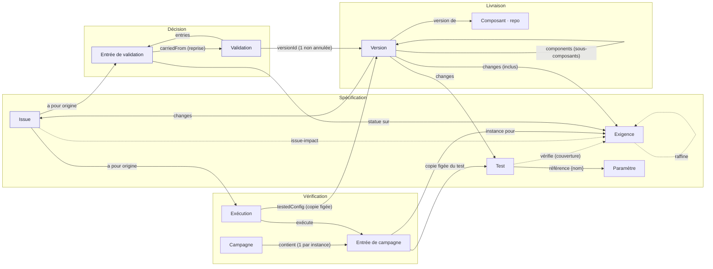

# Modèle objets Polenta — vue d'ensemble

> Vue d'ensemble du modèle à la fin du milestone D (redessinée par #272, 2026-11-05). Elle ne fait
> pas foi : en cas d'écart, le détail est dans `specs/MILESTONE-D.md` et dans SPEC-REQ §10 à §13
> (versions, issues, validation), SPEC-TESTS §3–§4 (exécutions, campagnes) et SPEC-TRACEABILITY
> (couverture, impact). À mettre à jour quand une spec modifie un objet ou un lien.

## Diagramme

Légende : fond blanc = objets d'avant le milestone D · fond violet = objets ajoutés par le
milestone D (version, issue, validation). Trait plein = champ de l'objet source · pointillé =
`ObjectLink` de `links/links.yaml`.

Exigences et tests sont au centre. Une **version** fige l'état d'un repo et liste ses changements ;
les **exécutions** disent sur quelle version un test a été passé ; la **validation** statue,
exigence par exigence, sur une version. Chaque objet est stocké dans le repo de son composant.

## Les objets

| Objet | Rôle | Stockage | Spec |
|---|---|---|---|
| Exigence | Ce que le produit doit faire (énoncé EARS, champs du type) | `requirements/<ID>.yaml` | SPEC-REQ |
| Test | Procédure de vérification : étapes, matériel, champs du type, champs d'exécution | `tests/<ID>.yaml` | SPEC-TESTS |
| Paramètre | Valeur nommée référencée dans les textes par `{nom}` | `parameters/parameters.yaml` | SPEC-REQ (T171) |
| Issue | Modification du produit non tracée dans les exigences (bug, non-conformité, évolution) ou constat à traiter ; pas de verrou d'approbation | `issues/<ID>.yaml` | SPEC-REQ §12 |
| Campagne | Plan et suivi d'exécution d'un ensemble de tests **de son repo** ; ne porte ni baseline ni version | `campaigns/CAMP-….yaml` | SPEC-TESTS §4 |
| Entrée de campagne | Une inclusion d'un test (une par exigence pour un test itérant), avec copie figée du test | dans la campagne (`runs`) | SPEC-TESTS §4.2 |
| Exécution (run) | Un passage du test, figé : verdicts, testeur, notes, champs d'exécution, **version testée** | `test-runs/<TEST>/<RUN>.yaml` | SPEC-TESTS §3 |
| Composant | Élément de la structure du produit ; un repo (ou nœud local) porte ses objets | nœud de `schema.yaml`, dépendance `polenta-repo.yaml` | SPEC-FORKS §4 |
| Version | État figé d'un **repo** (composant, ou produit pour le repo racine) et changements qu'il livre ; un type par repo | `versions/<ID>.yaml` | SPEC-REQ §11 |
| Validation | Décisions de la qualité sur les exigences du composant, pour une version ; signée sur une version released = feu vert (go production série pour la version produit) | `validations/<ID>.yaml` | SPEC-REQ §13 |
| Entrée de validation | Décision (valeurs configurables), commentaire, champs, empreinte du contenu, copie prise à la signature | dans la validation (`entries`) | SPEC-REQ §13 |

Une **version** n'a de sens que par repo : un composant local (nœud enfant sans repo) n'a pas de
version propre. Le **label** d'une version (ex. `1.2.4`) est son `title`.

## Les relations

| De | Relation | Vers | Porté par |
|---|---|---|---|
| Exigence | raffine | Exigence parente | `links/links.yaml` |
| Test | vérifie | Exigence | `links/links.yaml` (sens indifférent) |
| Issue | impacte | Exigence **de son composant** | `links/links.yaml` (`issue-impact`, issue → exigence ; `NOT_OWN_ELEMENT` sinon) |
| Exigence, Test | référence | Paramètre | `{nom}` dans le texte |
| Campagne | contient | Entrée | `runs` |
| Entrée | copie figée de | Test | `testSnapshot` |
| Entrée | instance pour | Exigence | `requirementId` |
| Exécution | exécute | Entrée | `campaignEntry` |
| Exécution | compte pour | Exigence | `requirementId` |
| Exécution | testée sur | Version du repo de la campagne + structure | `testedConfig` (`ref`, `label`, `state`, `commit`, `changesAt`, `components` récursifs, écarts `expected` / `undocumented`) |
| Issue | a pour origine | Exécution, entrée de validation | `origin.runs`, `origin.decisions` (`<VAL>/<REQ>`) |
| Version | version de | Repo du composant | emplacement du fichier |
| Version | basée sur | Version précédente du repo | `basedOn` |
| Version | se compose de | Versions des dépendances | `components` (par nom de montage) |
| Version | inclut | Exigence, Test, Issue du composant | `changes` (`{ id, base? }`, `base` = état dans la dernière version released qui l'incluait) |
| Version | figée par | Tag git du repo | `freeze` (`tag`, `sha`, `at`), au passage released |
| Version | analyse d'impact | Exigences, tests impactés | `impacted` (saisies, en cours) ; `analysis` (figée au passage released) |
| Validation | porte sur | Version | `versionId` |
| Validation | contient | Entrée de validation | `entries` |
| Entrée de validation | statue sur | Exigence | `requirementId` (+ `contentHash`) |
| Entrée de validation | reprise de | Validation signée de `basedOn` | `carriedFrom` |

Aucun lien **version ↔ campagne** : « Créer une campagne » depuis une version est un raccourci.
C'est l'exécution qui référence une version.

## Les quatre statuts d'une exigence

| Statut | Sens | Source |
|---|---|---|
| Rédaction | `status` du type (brouillon, review, approuvé…) | saisi |
| Design | première version released qui **inclut** l'exigence et dont l'état figé est **identique** à son contenu courant ; « — » sinon | calculé (versions) |
| Vérification | couverture : `not_covered`, `covered`, `validated`, `failing`, `needs_revalidation` (SPEC-TRACEABILITY §2.2) | calculé (liens, exécutions) |
| Validation | décision de la **dernière validation signée** du repo de l'exigence, avec le label de sa version | saisi (validation) |

Les quatre servent des fonctions de Polenta (vue Validation, reflets des vues exigence, GH210) :
calculés dans Polenta, rien de stocké sur l'exigence (GH79).

## Règles portées par le schéma, pas par un objet

- **Contraintes de transition** (#206) : bloc facultatif `transitions` d'un type d'exigence, de
  test ou d'issue ; conditions `fieldsFilled`, `validatorsPass`, `hasCoverageLink`, chacune au niveau
  `off`, `warn` (défaut) ou `block`. La version a son passage released, la validation sa signature.
- **Décisions de validation** : valeurs configurables du type de validation ; Polenta ne lit que
  `isPending` (bloque la signature) et `proposesIssue` (propose une issue).

## À retenir

- **La version remplace le changeset et la configuration produit.** Elle porte les changements, leur
  analyse d'impact et les tests à exécuter ; récursive comme l'arbre des composants, la version
  produit est celle du repo racine.
- **Les faits restent figés.** Exécutions, copies de test, structure testée (`testedConfig`),
  version released (tag, `analysis`) et validation signée (`atSignature`) ne sont jamais réécrites.
  Une validation signée se lit dans sa copie : liens retirés ou nouveaux runs ne la changent plus.
- **La décision qualité n'est pas un champ de l'exigence.** Elle vit dans la validation de la
  version ; les vues Exigences ne la montrent qu'en reflet.
- **Le « pourquoi » d'une modification non tracée est une issue**, qui entre dans une version comme
  une exigence ou un test ; ses exigences impactées sont des racines de l'analyse d'impact.
- **La baseline documentaire** (tag `baseline/<nom>`, SPEC-FORKS §5) existe toujours, mais aucun
  objet de ce modèle ne la référence : ni la campagne, ni la validation, dont la signature ne pose
  ni tag ni baseline.

## Ce qui a disparu (milestone D)

| Ancien objet ou lien | Remplacé par |
|---|---|
| Change / changeset (`changesets/`), assignation à la création et à la réouverture | version (`changes`, `impacted`, `analysis`) et issue (#243, #201, #244) |
| Configuration produit (`configurations/`) | version du repo racine et ses `components` |
| Revue de conformité (`conformity/`), décision et ses preuves (`evidence`) | validation d'une version, copie `atSignature` (#204, #267) |
| Campagne : `baselineRef`, `changeset`, configuration prévue | rien : l'exécution porte la version testée (#202) |
| Revue : baseline posée à la signature | tag de la version, posé au passage released |
