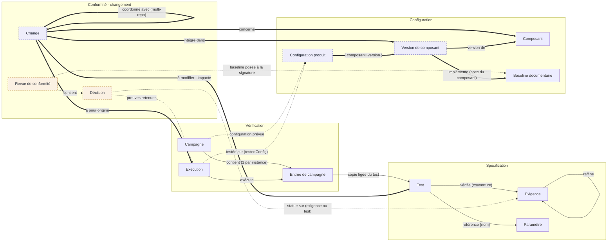

# Modèle objets Polenta — vue d'ensemble

> Document de référence partagé par les épiques **#191** (conformité aux jalons) et **#193**
> (gestion du changement). Il montre l'existant et ce que ces deux épiques ajoutent. Les specs
> détaillées restent `specs/GH191.md` et `specs/GH193.md`, qui font foi en cas d'écart. Ce document
> est à mettre à jour quand une spec de lot modifie un objet ou un lien.

## Diagramme

Légende : trait plein = existant · pointillé = ajouté par #191 · trait épais = ajouté par #193.
Couleur de fond : orange = objet #191, violet = objet #193.

Exigences et tests sont au centre : tout le reste les vérifie, statue sur eux ou les fait évoluer.
La **configuration produit** (ce qui est testé) est distincte de la **baseline documentaire** (ce
qui est spécifié). Les liens « raffine », « vérifie » et « coordonné avec » sont des `ObjectLink`
de `links/links.yaml`. Les autres sont des champs de l'objet source. Chaque objet est stocké dans
le repo d'un composant.

## Les objets

| Objet | Rôle | Stockage | Origine |
|---|---|---|---|
| Exigence | Ce que le produit doit faire (énoncé EARS, champs du type) | `requirements/<ID>.yaml` | existant |
| Test | Procédure de vérification : étapes, matériel, champs du type | `tests/<ID>.yaml` | existant |
| Paramètre | Valeur nommée référencée dans les textes par `{nom}` | `parameters/parameters.yaml` | existant |
| Campagne | Plan et suivi d'exécution d'un ensemble de tests | `campaigns/CAMP-….yaml` | existant |
| Entrée de campagne | Une inclusion d'un test (une par exigence pour un test itérant), avec copie figée du test | dans la campagne | existant |
| Exécution (run) | Un passage du test, figé : verdicts, testeur, notes ; champs d'exécution et configuration testée | `test-runs/<TEST>/<RUN>.yaml` | existant, enrichi #191 |
| Composant | Élément du produit et repo (ou nœud local) qui porte ses objets | nœud de `schema.yaml` | existant |
| Baseline documentaire | Photo des specs, posée au passage d'un jalon | tag git `baseline/<nom>` | existant |
| Revue de conformité | Registre de décisions d'un jalon ; signée puis figée par une baseline | `conformity/CONF-….yaml` | #191 |
| Décision | Conforme, non conforme, dérogation… sur une exigence ou un test, avec ses preuves | dans la revue | #191 |
| Change | Évolution ou non-conformité : éléments à modifier, éléments impactés, analyse d'impact | `changes/<ID>.yaml` | #193 |
| Version de composant | Version produit d'un composant (ex. firmware 1.2.4), distincte de sa spec | `versions/<ID>.yaml` | #193 |
| Configuration produit | Batch de référence (FOT, SOT, PR1…) : une version par composant | `configurations/CFG-….yaml` | #193 |

## Les relations

| De | Relation | Vers | Porté par | Origine |
|---|---|---|---|---|
| Exigence | raffine | Exigence parente | `links/links.yaml` | existant |
| Test | vérifie | Exigence | `links/links.yaml` (sens indifférent) | existant |
| Exigence, Test | référence | Paramètre | `{nom}` dans le texte | existant |
| Campagne | contient | Entrée | `runs` | existant |
| Campagne | constituée sur | Baseline documentaire | `baselineRef` | existant |
| Entrée | copie figée de | Test | `testSnapshot` | existant |
| Entrée | instance pour | Exigence | `requirementId` | existant |
| Exécution | exécute | Entrée | `campaignEntry` | existant |
| Exécution | compte pour | Exigence | `requirementId` | existant |
| Campagne | configuration prévue | Configuration produit | `configurationRef` | #191 |
| Exécution | testée sur | Configuration produit + versions | `testedConfig` | #191 |
| Revue | contient | Décision | `entries` | #191 |
| Revue | référence du jalon | Configuration produit | `configurationRef` | #191 |
| Revue | figée par | Baseline documentaire | `baselineRef`, posée à la signature | #191 |
| Décision | statue sur | Exigence ou Test | `objectId` (+ `requirementId`) + `objectVersion` | #191 |
| Décision | s'appuie sur | Exécution | `evidence` | #191 |
| Décision | reprise de | Décision du jalon précédent | `carriedFrom` | #191 |
| Change | concerne | Composant | `component` (périmètre d'impact par défaut) | #193 |
| Change | à modifier | Exigence, Test | `toModify` | #193 |
| Change | impacte | Exigence, Test | `impacted` (déclarés + calculés) | #193 |
| Change | a pour origine | Exécution, Décision | `origin` | #193 |
| Change | intégré dans | Version de composant | `integratedIn` | #193 |
| Change | crée et alimente | Campagne | `campaigns` | #193 |
| Change | coordonné avec | Change d'un autre repo | `links/links.yaml` (`change-coordination`) | #193 |
| Commit | rattaché à | Change | ligne finale `Change: <ID>` | #193 |
| Configuration produit | nomenclature de | Version de composant | `versions: { composant: version }` | #193 |
| Version de composant | version de | Composant | `component` | #193 |
| Version de composant | implémente | Baseline documentaire du composant | `implements` (tag du repo du composant) | #193 |
| Version de composant | basée sur | Version précédente | `basedOn` | #193 |

## À retenir

- **Deux configurations.** La baseline documentaire photographie les specs au jalon. La
  configuration produit dit ce qui a été testé. Un correctif soft crée une version de composant
  sans nouvelle baseline documentaire.
- **Les faits restent figés.** Exécutions, copies de test et configurations testées ne sont jamais
  réécrites. Une décision mémorise la version de l'objet sur lequel elle porte.
- **La décision qualité n'est pas un champ.** Elle vit dans la revue du jalon. Les vues Exigences
  et Tests ne la montrent qu'en lecture.
- **Le change relie tout** : d'une non-conformité (exécution ou décision) jusqu'à la version qui la
  corrige et à la campagne qui la vérifie.
